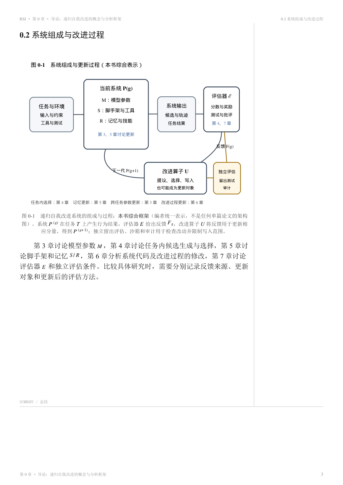
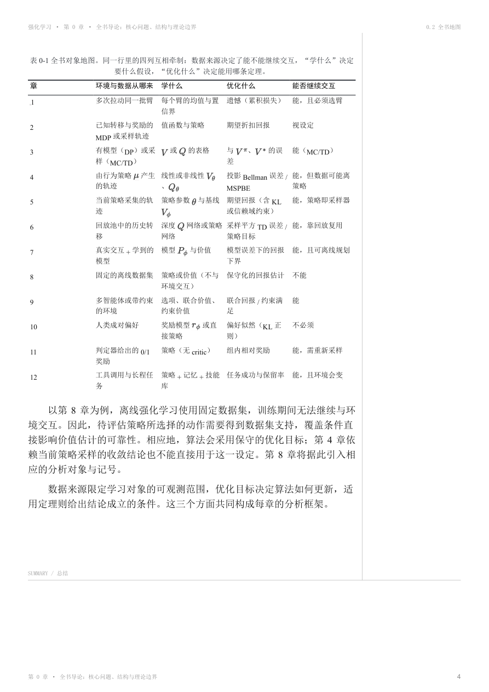
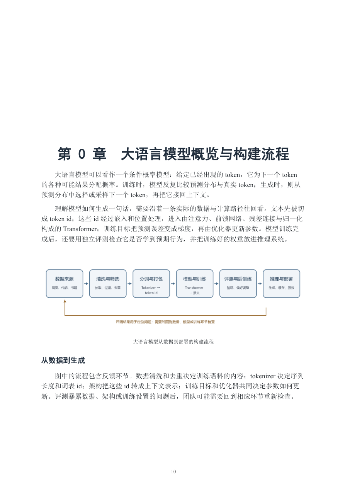

# 中文机器学习与大语言模型教材

三本合订教材由王自强整理，面向自学、课程配套和研究入门。页面侧栏留有笔记空间；《大语言模型从 0 构建》另提供公开版与康奈尔批注版。

编写与整理的目标，是补足进入主题所需的前置知识，沿着问题的来龙去脉解释方法为什么出现、如何发展，并帮助读者建立学科全局观。阅读时可以从导论和全书地图开始，再按自己的基础与兴趣进入各章。

## 下载教材

1. **递归自我改进：概念、方法与证据** — [下载合订本 PDF](./递归自我改进_合订本.pdf)（86 页）。从概念、系统表示与证据类型讲起，讨论模型训练、测试时扩展、脚手架、记忆和开放式自修改。源稿、资料、实验和构建代码位于 [`books/rsi_book/`](./books/rsi_book/)。
2. **强化学习：从 Bandit 到 RLHF、RLVR 与 Agentic RL** — [下载合订本 PDF](./强化学习教材_合订本.pdf)（289 页）。从多臂老虎机、MDP、Bellman 理论和经典算法逐步进入深度强化学习、离线 RL 与语言模型后训练。正文、图表、来源和审校/复现实验材料位于 [`books/rl_textbook/`](./books/rl_textbook/)。
3. **大语言模型从 0 构建** — [下载合订本 PDF](./大语言模型从0构建_合订本.pdf)（151 页）。按数据、分词、架构、算子、并行、训练规模、评测和后训练等环节组织。源稿、打印版式、插图、来源登记和构建入口位于 [`books/cs336_book/`](./books/cs336_book/)。[康奈尔批注版合订本](./editions/大语言模型从0构建_合订本.pdf)（153 页）在正文右侧留有笔记区。

## 教材内页预览

### 递归自我改进：系统组成与改进过程



### 强化学习：全书对象地图



### 大语言模型从 0 构建：从数据到部署



## 仓库结构

```text
open-course/
├── README.md                    本说明与内页预览
├── 递归自我改进_合订本.pdf
├── 强化学习教材_合订本.pdf
├── 大语言模型从0构建_合订本.pdf
├── editions/                    CS336 康奈尔批注版
├── previews/                    从最终 PDF 截取的内页预览
└── books/
    ├── rsi_book/                章节稿、来源、实验、构建工具与报告
    ├── rl_textbook/             正文、图表、来源、审校记录与复现实验
    └── cs336_book/              正文、打印输入、插图、来源登记与构建脚本
```

每本教材目录内的 README 介绍其文件结构、构建方式和检查范围。仓库保留可复用源稿和自有构建材料；第三方课程、论文等材料按其许可和引用信息处理，详见 [`THIRD_PARTY_NOTICES.md`](./THIRD_PARTY_NOTICES.md)。

## 审阅与验证范围

当前公开稿由 GPT 辅助审阅，尚未经过逐条人工审校。GPT 审阅不能替代专业审校或对原始文献的核对；涉及学术结论时，请结合书中引用和原始来源判断。

构建检查与内容正确性是两件事。公式“通过”在此指公式能够被构建流程渲染并排入 PDF，不代表每个推导都经过形式化证明。代码验证只覆盖明确列出的脚本，不表示书中所有代码片段都已逐段运行。

| 教材 | 已运行的检查 | 检查范围 |
| --- | --- | --- |
| 递归自我改进 | 完整 PDF 构建；206 个公式排版实例无渲染失败；`source/labs/coverage_demo.py` 与 `selection_overfit_demo.py` 均运行完成 | 实验脚本核对示例中的覆盖率和筛选偏差；未逐条证明全部数学表述 |
| 强化学习 | 完整 PDF 构建；公式渲染失败数为 0；`verify.py` 结构检查报告 problems=0；`review/reproductions/` 下 7 个复现实验脚本均运行完成 | 检查 PDF 结构及所列复现实验；验证器提示 6 个正文较短页供排版检查，不计为结构错误 |
| 大语言模型从 0 构建 | Edge 打印管线成功生成公开版与批注版；抽查封面、使用说明、目录和正文页 | 没有对全书代码示例做系统运行测试；公式内容以打印稿的渲染检查为准 |

## 许可

- 原创书稿和原创图表：CC BY-NC-SA 4.0，见 [`LICENSE`](./LICENSE)。
- 项目代码：MIT，见 [`LICENSE-CODE`](./LICENSE-CODE)。
- 第三方软件、课程及图表材料遵循各自许可，见 [`THIRD_PARTY_NOTICES.md`](./THIRD_PARTY_NOTICES.md)。