# 第 0 章　大语言模型概览与构建流程

大语言模型可以看作一个条件概率模型：给定已经出现的 token，它为下一个 token 的各种可能结果分配概率。训练时，模型反复比较预测分布与真实 token；生成时，则从预测分布中选择或采样下一个 token，再把它接回上下文。

理解模型如何生成一句话，需要沿着一条实际的数据与计算路径往回看。文本先被切成 token id；这些 id 经过嵌入和位置处理，进入由注意力、前馈网络、残差连接与归一化构成的 Transformer；训练目标把预测误差变成梯度，再由优化器更新参数。模型训练完成后，还要用独立评测检查它是否学到预期行为，并把训练好的权重放进推理系统。

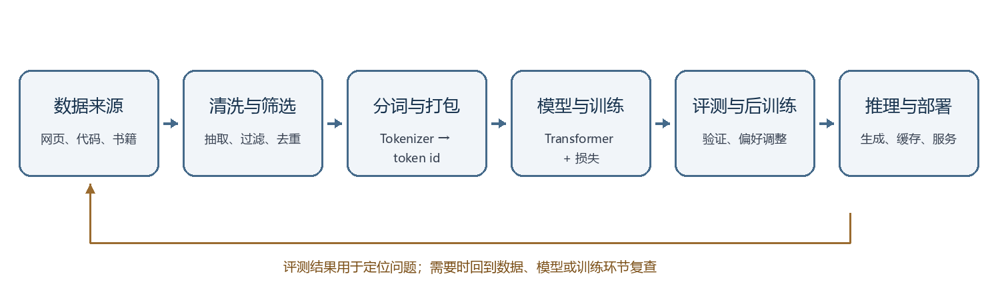

## 从数据到生成

图中的流程包含反馈环节。数据清洗和去重决定训练语料的内容；tokenizer 决定序列长度和词表 id；架构把这些 id 转成上下文表示；训练目标和优化器共同决定参数如何更新。评测暴露数据、架构或训练设置的问题后，团队可能需要回到相应环节重新检查。

| 阶段 | 主要任务 | 主要产物 |
| --- | --- | --- |
| 数据来源与处理 | 确定数据来源、使用条件，并进行清洗与去重 | 有记录、可追溯的训练语料 |
| 分词与样本构造 | 将原文映射为 token id，并组织训练序列 | 词表与 token 序列 |
| 架构与资源规划 | 设计上下文计算方式并估算显存与算力需求 | 可训练的模型配置 |
| 训练与优化 | 选择训练目标、计算梯度并更新参数 | 预训练权重与检查点 |
| 后训练与评测 | 模型是否遵循指令，指标能否代表目标能力？ | 行为调整结果与评测证据 |
| 推理与部署 | 管理延迟、吞吐、缓存和服务成本 | 可服务的生成系统 |

## Transformer 的基本组成

**Token 和词表。** Token 是 tokenizer 输出的离散符号；token id 是它在词表中的整数编号。Token 不等同于汉字或英文单词，一个词可能被拆成多个 token。模型的嵌入层根据 id 查出对应向量。

**Embedding 和位置表示。** Embedding 是一个可训练的查表矩阵，把离散 id 映射为连续向量。位置表示向模型提供序列顺序信息，可以加到嵌入向量上，也可以像 RoPE 那样施加到注意力中的 Q、K 上。

**注意力与前馈网络。** 自注意力让序列中每个位置根据查询—键匹配分数，从其他位置汇集信息。Softmax 在这里把分数转换成每行和为 1 的权重；它是注意力计算的归一化步骤，不是另一种注意力机制。前馈网络再对每个位置的表示做非线性变换。

**残差与归一化。** 残差连接把子层输入直接加回输出，提供一条跨层信息和梯度路径。LayerNorm 对单个样本的特征维归一化；RMSNorm 用均方根尺度做归一化，不减去均值。二者均不同于 BatchNorm。

## 章节之间的关系

第 1 章处理文本到 token 的映射；第 2 章建立算力、显存和训练循环的估算方法；第 3–6 章从 Transformer 结构走到 GPU kernel；第 7–8 章讨论多卡训练；第 9–11 章讨论训练规模、工程配方和推理；第 12–14 章检查评测与训练数据；第 15–17 章进入后训练、可验证奖励和多模态模型。读者可以按这个顺序学习，也可以根据研究问题跳到相应章节，再回查前置概念。

读者最好熟悉向量、矩阵乘法、概率、微积分中的链式法则，以及 Python 和 PyTorch 的张量操作。本书会在首次使用时说明必要符号；遇到完整推导时，再回到相应章节复习。各章末尾的练习从概念辨析、数量估算到实现设计逐步展开，不要求读者把每道题都一次做完。

## 本章回顾与练习

语言模型构建包含数据、分词、架构、训练、评测和推理多个环节。每个环节都会影响后续成本和模型行为；读懂一个模型，需要同时追踪概率目标、张量形状、计算资源和数据来源。

**练习**

1. 选择一个你熟悉的文本生成任务，沿图中的流程列出每一步会产生的文件、张量或模型状态。
2. 模型输出的 token id 如何变成可读文本？指出这条生成链中 tokenizer、embedding、注意力和输出层各自做什么。
3. 如果验证集困惑度下降而实际问答质量没有提升，列出三种可能原因，并指出可以从哪一章寻找检查方法。


# 第 1 章　Tokenization：把文本变成整数

## 本章导读

文本进入语言模型之前，必须先变成 token id。分词方案同时影响序列长度、词表规模和模型能够直接表示的最小单位。

学完本章后，你应能：

- 区分字符、字节与子词 tokenization；
- 说明 BPE 如何学习合并规则，并完成编码与解码；
- 估算压缩率、序列长度与词表大小带来的成本。

## 分词在语言模型输入中的作用

自回归语言模型通常根据已有 token 序列预测下一个 token。分词器将文本映射为 token 序列，供模型作为输入。

Tokenization 会影响模型的输入表示、序列长度和词表规模，因此是模型设计与训练数据处理中的重要选择：

1. 序列长度 $T$：同样一段文本，切得越碎，$T$ 越大；而 attention 的代价随 $T^{2}$ 增长，所以分词直接决定了算力。
2. 词表大小 $V$：embedding 与输出层的参数量是 $V \cdot d$，$V$ 翻倍，这两块参数就翻倍。
3. 模型能看到的"最小单位"：一个 token 可能是一个汉字、一个英文词缀、一段字节。模型永远看不到比 token 更细的东西。

## 分词算法的三类基本策略

三种 `Tokenizer` 实现代表了三种不同的切分方案：

| 实现 | 切分单位 | 词表大小 | 序列长度 | 问题 |
| --- | --- | --- | --- | --- |
| `CharacterTokenizer` | 字符（Unicode 码点） | 中文约几千～几万，取决于语料 | 与字符数相同 | 罕见字符让词表爆炸；跨语言不一致 |
| `ByteTokenizer` | 字节（UTF-8） | 固定 256 | 最长（一个汉字 3 字节） | 序列太长，算力浪费 |
| `BPETokenizer` | 常见字节串（学出来的） | 人为设定的 $V$（如 5 万、20 万） | 介于两者之间 | 需要训练词表；切分不透明 |

字节级是唯一**没有未登录词**的方案：任何 Unicode 文本都能表示成 UTF-8 字节。代价是序列变长 3 倍（中文）——所以现代方案都在字节之上再学合并规则，这就是 BPE [1,58]。近年的字节级模型进一步说明这条路还能走多远 [2]。

## WordPiece 与 BPE 的差别

WordPiece 也从子词开始逐步合并，但它选择合并对的依据不同。BPE 选择语料中出现次数最多的相邻 token 对；WordPiece 常用的打分会比较合并后 token 的频率与两个组成部分频率的乘积，从而优先合并信息量较高的组合。两种方法都能把未见过的词拆成已有子词，但会得到不同词表与切分结果 [63]。

## BPE 的三步

BPE（Byte Pair Encoding）本身很简单：从 256 个字节开始，反复把**最常相邻出现的一对 token** 合并成一个新 token，重复 $V-256$ 次。

### 第一步：训练词表

示例实现的核心循环只有十几行：

```python
def train_bpe(string: str, num_merges: int) -> BPETokenizerParams:
    indices = list(map(int, string.encode("utf-8")))
    merges: dict[tuple[int, int], int] = {}
    vocab: dict[int, bytes] = {x: bytes([x]) for x in range(256)}

    for i in range(num_merges):
        counts = count_adjacent_pairs(indices)
        pair = max(counts, key=counts.get)
        new_index = 256 + i
        ...
```

训练结果是两个字典：`vocab`（索引 → 字节串）与 `merges`（相邻索引对 → 新索引）。注意这里没有神经网络，没有梯度，纯粹是统计。

### 第二步：编码

```
class BPETokenizerParams:
    vocab: dict[int, bytes]     # index -> bytes
    merges: dict[tuple[int, int], int]  # index1,index2 -> new_index
```

编码时先 `string.encode("utf-8")` 拆成字节，再按训练学到的 `merges` **依次**应用；每次应用都用 `merge` 把相邻对替换成新索引：

### 第三步：解码

解码是反过来的查表：`vocab[i]` 取出字节串，拼接后 `bytes.decode("utf-8")` 还原文本。**这一步必须无损**：编码再解码必须得到原字符串。

## 压缩率：一个必须先算的量

压缩率 $r$ 定义为每个 token 对应的平均 UTF-8 字节数：

也就是

$$
r=\frac{\#\text{UTF-8 字节数}}{\#\text{token 数}},
\qquad
T=\left\lceil \frac{B_{\text{bytes}}}{r}\right\rceil .
$$

$r$ 越大，同样文本的 token 越少，训练与推理越便宜。这个数在工程上比"词表多大"更有意义：词表规模相同的分词器，压缩率仍可能不同。压缩率会影响 token 数和计算量，但端到端开销还取决于模型结构、序列长度、批次构造和硬件实现。

一条实用的量级估计（来自 $T$ 与 $V$ 的定义）：

| 量 | 与分词的关系 | 影响 |
| --- | --- | --- |
| 序列长度 $T$ | $T=\lceil B/r\rceil$ | 全注意力中与位置对数相关的计算随 $T^{2}$ 增长；KV cache 的存储量通常随 $T$ 线性增长 |
| embedding 参数 | $V\cdot d$ | 词表翻倍，embedding 翻倍 |
| 输出层算力 | $T\cdot V$ | 每预测一个 token 都要在 $V$ 上做 softmax |
| 训练数据 token 数 | 语料字节数 $/r$ | 决定训练的"epoch 数"与算力预算 |

例如，`get_gpt5_tokenizer` 返回 `tiktoken.get_encoding("o200k_base")`，其词表约含 20 万个 token。

## 分词中的常见误解

**坑 1：把 token 当字符。** 一个汉字可能占 1～3 个 token，一段英文可能一个词占 1 个 token 也可能是几个子词。估算每 token 成本时，应使用实际分词器计算序列长度，字符数不能直接替代 token 数。

**坑 2：忽略预分词（pre-tokenization）。** 若不加正则/空白切分，BPE 会把"词尾 + 空格 + 词首"合成一个 token，导致模型必须重新学"词边界"。工程实现通常先用正则把文本切成片段，再在片段内做 BPE（示例代码给出的是片段内合并的简化版）。

**坑 3：特殊 token 被合并掉。** `<|endoftext|>` 之类的控制符必须预留独立 id 并排除在合并之外，否则它会被拆开，对话模板就失效了。

## 从 token 到训练样本

分词器只负责"文本 → 整数"。真正送进模型之前还有三步，每一步都会改变 $T$ 的实际含义：

1. **拼接与打包**：短文档要么按文档加边界符拼接，要么丢进固定长度窗口。等长打包能把 $T$ 用满，但会把两篇无关文档拼在同一个窗口里。
2. **边界符**：文档之间插 `<|endoftext|>` 之类的边界 token，让模型知道"这里要从头开始"。如果边界符被 BPE 拆开，模型就只能学到"这里有个奇怪的字符序列"，长文档续写会变差。
3. **截断与填充**：长文截断会丢尾部信息；填充浪费算力。生产上通常用"打包 + 不填充"，靠 attention mask 只在需要时切断。

一个容易忽略的后果：**压缩率决定了固定窗口能装多少原文**。窗口 4096 token、压缩率 $r=4$ 时约 16 KB 文本；如果换一个 $r=3$ 的分词器，同样窗口只能装 12 KB。选分词器时，这个换算比"词表好不好看"重要得多。

### 一个量级例子

假设语料 1 TB 纯文本，压缩率 $r=4$：

$$
\#\text{token}=\frac{10^{12}\ \text{B}}{4}=2.5\times10^{11}.
$$

若训练 2 个 epoch，模型要看 $5\times10^{11}$ 个 token。按 $6ND$（第 2 章）估算，$N=7\times10^{9}$ 的模型需要约 $6\times7\times10^{9}\times5\times10^{11}=2.1\times10^{22}$ FLOPs——这就是"数据规模决定算力预算"的算术来源。

## BPE 的复杂度与工业实现

简化版 `train_bpe` 每个 merge 都要重新扫一遍整个语料统计相邻对，复杂度是 $O(M\cdot N)$（$M$ 为 merge 次数、$N$ 为 token 数）。生产分词器 $M\approx 10^{5}$、$N\approx 10^{9}$，直接这样跑要几天（量级估算）。

工程上的三条加速：

1. **增量统计**：只重算"被合并位置附近"的相邻对，其余计数复用。把每个 merge 的代价从 $O(N)$ 降到 $O(\text{出现次数})$。
2. **优先队列**：维护 pair 计数的堆，每次取最大；合并后只更新受影响的少数 pair。
3. **并行/分片训练**：先把语料切成片段并行统计，再合并计数（跨片段边界要额外处理，否则会漏掉跨界的 pair）。

复杂度从 $O(MN)$ 降到近似 $O(N\log N)$ 之后，一个 20 万词表的 tokenizer 可以在单机几十分钟内训完。这也解释了为什么"预训练一次、之后所有人都复用"是常态。

### 词表大小是三个约束的交点

| 约束 | 词表变大时 | 词表变小时 |
| --- | --- | --- |
| 压缩率 | 变好（序列变短） | 变差（序列变长） |
| embedding 参数 | $V\cdot d$ 线性增长 | 下降 |
| 输出层 softmax | $T\cdot V$ 线性增长 | 下降 |
| 罕见词覆盖 | 更细的子词 | 退化成字节 |

工程上 3 万～25 万是常见区间，选择依据是**语料语言与算力预算**，而不是"越大越好"。

## BPE 实现中的四个问题

示例代码只有几十行，能跑通不等于能上生产。以下四处是复现时最容易出错的地方（属于工程实现）。

**坑一：合并顺序必须严格按训练时的编号。** 解码只靠 `vocab` 查表，但编码必须按 `merges` 里的先后顺序应用——先学的合并优先。顺序错了，同一段文本会被切成不同的 token 序列，训练与推理不一致。

**坑二：合并的计数要增量更新。** 每次 merge 后重新全量统计是对的但慢；增量做法只更新"被改动位置两侧"的 pair 计数。增量版最容易漏掉"跨词边界"与"合并后新产生的 pair"，导致学到的词表与全量版不同。验证方法：在小语料上用两种实现跑同样的 merge 次数，比较 `merges` 是否一致。

**坑三：UTF-8 边界不能被切开。** 一个汉字是 3 个字节，如果某个 merge 只吃掉其中 2 个，剩下的字节单独成 token，解码时仍能拼回原字节串（因为按字节还原是安全的），但模型会看到一个"半个字"的 id。工程上通常无所谓（解码无损），但做词表分析时会看到大量不可打印 token。

**坑四：tie-break 必须确定。** 两个 pair 出现次数相同是常态（尤其小语料）。若实现依赖字典遍历顺序，不同机器/不同 Python 版本会得到不同词表，训练结果随之漂移。固定规则（例如按 pair 的字节序取较小者）是必须的。

## 编码与解码的一处不对称

编码是"贪心按 merges 顺序应用"，解码是"查表拼字节"。这个不对称带来一个反直觉的性质：**同一个字符串可能有多种切分方式**，而分词器只给出其中一种（由 merges 顺序决定）。所以"这个 token 是什么意思"这个问题，严格说只有"它对应哪段字节"是可回答的，语义由模型学出来。

## 本章回顾与练习

分词器把原文映射为整数序列。BPE 通过合并相邻 token 学习词表；压缩率、序列长度和词表大小共同影响后续训练成本。

**练习**

1. 给定一段 UTF-8 文本和压缩率，估算 token 数及 $6ND$ 训练量。
2. 比较字符、字节和 BPE 方案在中文语料上的优缺点。
3. 写出一个检查编码—解码无损性的测试，并说明特殊 token 为何需要单独处理。

# 第 2 章　资源核算：显存、算力与算术强度

## 本章导读

训练预算首先是一笔资源账。本章从参数、梯度、优化器状态和激活入手，再把显存估算连接到计算量、损失函数和一次实际参数更新。

学完本章后，你应能：

- 按张量形状和数据类型估算显存；
- 用 $6ND$ 得到训练计算量的数量级；
- 读懂 next-token 交叉熵训练步中的输入、目标与梯度更新。

## 训练前的资源估算

先从两个资源估算问题入手：

这两个问题都能在纸上用三行算式回答。答不出来的后果很实际：架构选型只能凭主观印象，训练到一半才发现显存不够，或并行策略与瓶颈不匹配。

资源估算应成为建模过程的一部分，而不是临时补救。

## 五类张量：所有东西都是张量

| 张量 | 由什么决定 | 训练时是否常驻 |
| --- | --- | --- |
| 参数 $\theta$ | 模型结构，$N$ 个 | 是 |
| 梯度 $\nabla_\theta$ | 与参数同形状 | 是（每步算完即可释放，但通常占满） |
| 优化器状态 | 优化器类型（AdamW 有两个矩） | 是，且常比参数更大 |
| 激活（activations） | $B$、$T$、层数、宽度 | 是，且随 batch 线性增长 |
| 数据 batch | $B \cdot T$ 个 token | 是（可被 streaming 摊薄） |

张量可以看成带有形状、数据类型和设备位置的多维数组。先看 token 到向量的映射：

```python
tokens = torch.randint(0, vocab_size, (B, T), device=device)  # (B, T)
embedding = torch.nn.Embedding(vocab_size, d_model).to(device)
x = embedding(tokens)  # (B, T, d_model)
W = torch.randn(d_model, d_out, device=device)
y = x @ W  # (B, T, d_out)
```

这里输入是整数索引，嵌入层查表后得到浮点张量。矩阵乘法作用在最后两个维度；前面的 $B,T$ 维保留为批次维，所以输出形状是 $(B,T,d_{out})$。实际代码还要让权重与输入处在同一设备，并匹配可参与运算的数据类型。

显存的算法只有一句：

$$
M=\underbrace{N\cdot b_{\theta}}_{\text{参数}}
+\underbrace{N\cdot b_{g}}_{\text{梯度}}
+\underbrace{N\cdot b_{o}}_{\text{优化器}}
+\underbrace{M_{\text{act}}(B,T,L,d)}_{\text{激活}}
+\underbrace{M_{\text{tmp}}}_{\text{临时缓冲}}
$$

其中 $b$ 是每参数的字节数。**这张式子里的每一项都会被后面的章节反复用到**：并行策略本质上是把某一项切到别的卡上。

## 数据类型：先决定每个数占几个字节

| 类型 | 字节 | 说明 |
| --- | --- | --- |
| fp32 | 4 | 传统默认；动态范围与精度都够 |
| fp16 | 2 | 省一半显存，但小数动态范围差，容易溢出 |
| bf16 | 2 | 与 fp32 同动态范围，精度略低；深度学习几乎不受影响 |
| fp8 | 1 | H100 支持 E4M3 / E5M2 两种变体 |
| fp4 | 0.5 | 更新，主要在推理侧 |

一个具体数值能看出动态范围的差别：$10^{-8}$ 小于 fp16 可表示的最小正数，转成 fp16 时会下溢为 0；bf16 的指数范围与 fp32 相同，能表示这个量级，但有效精度较低。两种格式都只占 2 字节，差别在于位如何分配。

bf16 与 fp16 都使用 16 位表示，但指数位分配不同：

### 混合精度：参数用 bf16，优化器状态用 fp32

于是 AdamW 训练一个参数的字节数（按上式组合）：

$$
b_{\text{总}} =
\underbrace{2}_{\text{bf16 参数}}
+\underbrace{2}_{\text{bf16 梯度}}
+\underbrace{4+4}_{\text{fp32 一阶/二阶矩}}
+\underbrace{4}_{\text{fp32 主权重}}
=16\ \text{B/param}.
$$

AdamW + 混合精度约占 **16 字节/参数**；纯 fp32 训练约占 20 字节/参数。优化器本身的定义见 [3]、[4]；把这份显存账摊到多卡上的做法见 [5]。这个数在选卡时比参数量本身更有用。

Adam 的两个状态分别记录梯度的平滑方向和平方梯度的平滑尺度。令当前梯度为 $g_t$，则

$$
m_t=\beta_1m_{t-1}+(1-\beta_1)g_t,\qquad v_t=\beta_2v_{t-1}+(1-\beta_2)g_t^2.
$$

初始状态为 0 会使前几步的移动平均偏小，因此用 $\hat m_t=m_t/(1-\beta_1^t)$、$\hat v_t=v_t/(1-\beta_2^t)$ 作偏差修正。忽略记号实现差异，AdamW 的更新可写为 [4,60]

$$
\theta_t=(1-\eta\lambda)\theta_{t-1}-\eta\frac{\hat m_t}{\sqrt{\hat v_t}+\varepsilon}.
$$

权重衰减单独作用于参数，不混进 $m_t,v_t$ 的梯度统计；这正是 AdamW 与把 $\lambda\theta$ 加进梯度再交给 Adam 的做法之间的区别 [4]。两个矩估计各自保存一份与参数同规模的 fp32 张量，所以优化器状态会显著增加显存占用。

## 算力：$6ND$

也就是训练 $D$ 个 token 的计算量

$$
\text{FLOPs}\approx 6\,N\,D ,
$$

$6$ 来自常用的近似计数：前向传播每个参数、每个 token 约需 $2$ 次浮点运算，反向传播约需 $4$ 次。该估算未显式计入全注意力中随序列长度平方增长的项，也忽略激活函数、归一化及其他实现开销；序列较长或模型结构不同，误差可能增大。

以 70B 参数、15T token 和 1024 张 H100 为例，若按 $6ND$ 估算，并假设 MFU 为 40%，可得：

$$
\frac{6\times 7\times10^{10}\times 1.5\times10^{13}}
{1.024\times10^{3}\times 9.89\times10^{14}\times 0.4}
\approx 1.6\times10^{7}\ \text{s}\approx 180\ \text{天}.
$$

按给定峰值算力与 MFU 假设，估算训练时间约为 180 天。实际时长会受序列长度、通信、数据读取、检查点和硬件利用率等因素影响，因此该结果应理解为数量级估算。若目标时限较短，可相应调整硬件规模、训练 token 数或其他训练配置。

## 算术强度与性能瓶颈

我们将硬件简化为两个数：

算一个算子时，它要么被算力卡住，要么被数据搬运卡住。判据是**算术强度**：

$$
I=\frac{\text{FLOPs}}{\text{搬运的字节数}},
\qquad
\text{MFU}=\min\left(1,\frac{I}{I_{\text{acc}}}\right).
$$

可由以下结论判断：

这句话解释了两件后面反复出现的事：

1. **训练**大部分时间在做矩阵乘，所以能跑满算力；
2. **推理**（batch 小的时候）是矩阵-向量乘，算力大量空闲，真正的瓶颈是显存带宽——第 10 章的 KV cache 与批处理全是在对付这一点。

## 激活与重算：省显存的两把刀

激活显存随 batch 与序列长度线性增长：

$$
M_{\text{act}} \approx c\cdot L\cdot B\cdot T\cdot d\cdot b_a ,
$$

$c$ 是一个与具体算子有关的常数（把 attention、MLP、归一化的中间量加总）。$B$ 一涨，这一项就爆。

有两种手段：

重算的频率有一个漂亮的三档结论：

也就是**每隔 $\sqrt{L}$ 层存一个检查点**，显存 $\sqrt{L}$、重算 $L$——这是工程上最常用的折中。

## 四类显存开销与对应处理

| 账目 | 式子 | 谁在涨 | 应对 |
| --- | --- | --- | --- |
| 参数 | $N b_\theta$ | 模型变大 | 分片（第 7–8 章）、量化 |
| 梯度 | $N b_g$ | 同上 | 分片、累积 |
| 优化器 | $N b_o$ | 优化器类型 | 分片、低精度矩（谨慎） |
| 激活 | $cLBTd\,b_a$ | batch × 序列长度 | 重算、梯度累积、序列并行 |

**自测**：

1. 8 张 80 GB H100、纯 AdamW 混合精度，能放下的最大参数规模是多少？（忽略激活：$16$ B/param → $8\times80\,\text{GB}/16\,\text{B}\approx4\times10^{10}$，即 400 亿参数——这就是第二个问题的答案上限。）
2. 一个 $d=4096$、$L=32$ 的模型，$B=8$、$T=4096$、bf16 激活，激活量大致多少？（按 $c\approx10$ 估：$10\times32\times8\times4096\times4096\times2\approx8.6\times10^{10}$ B ≈ 86 GB——所以必须重算或切分。）

### 两个常见误算

1. **只算参数不算激活**：$16N$ 只是"模型本身"的门槛，激活随 $B\cdot T$ 线性涨。看到"80 GB 卡能放 7B 模型"就以为能训 7B，是新手最常犯的错——7B 的激活在长序列下可以再吃掉几十 GB。
2. **把 $6ND$ 当成精确值**：它忽略了 attention 的 $T^{2}d$ 项与归一化/激活的逐元素开销。序列很短时偏差可接受；序列很长（$T\gtrsim 8$k）时，$T^{2}$ 项会显著抬高真实 FLOPs。

## 量级速查：常见规模要多少显存

把上面的四本账代入几组常见配置（按 16 B/参数、$c\approx10$ 估算，仅看训练）：

| 参数 $N$ | 参数+梯度+优化器 | 激活（$B{=}8,T{=}4096,L{=}32,d{=}4096$） | 结论 |
| --- | --- | --- | --- |
| 1B | 16 GB | ~86 GB | 单卡 80 GB 放不下激活，必须重算或切分 |
| 7B | 112 GB | ~86 GB | 至少 3 张 80 GB，或 1 张 + 重算 + 小 batch |
| 70B | 1.12 TB | 同上（随 $d$ 放大） | 必须多卡并行（第 7–8 章） |
| 405B | 6.5 TB | — | 千卡级集群 |

三个可以直接用的判断：

1. **参数量决定"下限"**：$16N$ 字节是硬门槛，优化器状态不能省（省了训练会漂）。
2. **激活决定"能不能开大 batch"**：它随 $B\cdot T$ 线性涨，与参数量无关；所以小模型也能被长序列撑爆。
3. **显存不够时先动激活**：重算与累积只牺牲时间；动优化器状态会牺牲收敛质量。

因此，第 7–8 章讨论的并行策略主要考虑参数、梯度和优化器状态的切分；激活也可通过重计算或序列并行降低显存占用，但会增加计算或通信开销。

## 从 FLOPs 到墙上时钟

$6ND$ 给的是一步的浮点运算量。换成时间还要除以实际算力：

$$
t=\frac{6ND}{P_{\text{peak}}\cdot \text{MFU}},
$$

其中 $P_{\text{peak}}$ 是单卡峰值（bf16 稠密算力），MFU 是模型算力利用率。代入一组真实量级：$N=10^{9}$、$D=10^{11}$（100B token）、$P_{\text{peak}}=9.89\times10^{14}$、8 张卡、MFU $=0.45$：

$$
t=\frac{6\times10^{9}\times10^{11}}{8\times9.89\times10^{14}\times0.45}
\approx 1.7\times10^{5}\ \text{s}\approx 47\ \text{小时}.
$$

几个能直接用的判断：

- **MFU 45% 是"做得好"的水平**，30% 是常态，20% 以下说明有 kernel 或通信问题。
- 同规模下，**序列越长 MFU 越低**：attention 的 $T^{2}$ 项访存密集，容易把 GPU 拖成 memory-bound。
- 算出时间后再乘 **1.2～1.5 的工程系数**（检查点、评测、重启），才是真实排期。

### 训练时间与显存占用的权衡

省显存的两种手段都要花时间：激活重算让前向多跑一遍（约 +30% 计算），梯度累积让每步多跑几个 micro-batch（吞吐不变、延迟变长）。所以"能不能训"和"多久训完"是两个问题，不能只优化其中一个。

## 一次完整核算：7B 模型塞进 8 张 H100

把四本账走一遍，比背任何结论都有用。设定：$N=7\times10^{9}$、$d=4096$、$L=32$、bf16 混合精度、AdamW。

**第一步，参数与优化器。**

$$
M_{\text{param+opt+grad}}\approx16\ \text{B}\times7\times10^{9}=112\ \text{GB}.
$$

**第二步，可用空间。** $8\times80\ \text{GB}=640\ \text{GB}$，减去 112 GB，剩约 528 GB 给激活与临时缓冲（还要留出通信缓冲、cuBLAS workspace、碎片，实际按 80% 计，约 420 GB 可用）。

**第三步，激活。** 用 $M_{\text{act}}\approx c\,L\,B\,T\,d\,b_a$，取 $c\approx10$、$b_a=2$：

$$
M_{\text{act}}\approx10\times32\times B\times T\times4096\times2\approx2.6\times10^{6}\,BT\ \text{字节}.
$$

于是 $B\cdot T\le 420\times10^{9}/2.6\times10^{6}\approx1.6\times10^{5}$。

**第四步，选配置。** $B=8,T=4096$ 时 $BT=3.3\times10^{4}$，激活约 86 GB，余量充足；$B=32,T=4096$ 时 $BT=1.3\times10^{5}$，激活约 340 GB，接近上限；$B=64,T=4096$ 直接超。

**第五步，看时间。** 按 $6ND$ 与 45% MFU，8 卡处理 1 个 batch（32×4096 token）约需

$$
t=\frac{6\times7\times10^{9}\times1.31\times10^{5}}{8\times9.89\times10^{14}\times0.45}\approx1.7\ \text{s}.
$$

也就是每步不到 2 秒。真实训练会因通信、检查点、数据加载慢 1.3～2 倍。

这类估算不追求逐步计时的精度，而是先回答能否装下、计算需要多久、瓶颈可能在哪里。

## 一次训练循环：数据、损失与参数更新

模型输出的是每个位置对整个词表的 logits。因果语言模型用位置 $t$ 的输出预测真实 token $t+1$；这里最容易混淆的是输入与标签错开一位。若 `tokens` 的形状为 $(B,T)$，则输入取 `tokens[:, :-1]`，标签取 `tokens[:, 1:]`。交叉熵只奖励正确 token 的对数概率：

$$\mathcal{L}=-\frac{1}{B(T-1)}\sum_{b=1}^{B}\sum_{t=1}^{T-1}\log p_\theta(x_{b,t+1}\mid x_{b,1:t}).$$

在 PyTorch 中，`cross_entropy` 接收未归一化的 logits；不必先手动做 softmax [59]。一个省略数据读取与模型定义的训练步如下：

```python
inputs = tokens[:, :-1]
targets = tokens[:, 1:]
logits = model(inputs)  # (B, T-1, vocab_size)
loss = torch.nn.functional.cross_entropy(
    logits.reshape(-1, vocab_size), targets.reshape(-1)
)
optimizer.zero_grad(set_to_none=True)
loss.backward()
torch.nn.utils.clip_grad_norm_(model.parameters(), max_norm=1.0)
optimizer.step()
```

`backward()` 把损失对参数的梯度写入 `.grad`；因此每步前要清零，否则梯度会在批次间累加。梯度裁剪把总范数超过阈值的梯度按同一比例缩小，保留方向、限制单步更新幅度；阈值需结合模型与训练设置选择，不能当成保证稳定的开关。学习率调度器通常在训练步之间更新：warmup 逐渐提高学习率，训练后段再按预定曲线衰减。

训练记录至少要包含模型与优化器状态、学习率调度状态、当前数据位置和随机数生成器状态，才能从检查点继续训练。固定随机种子有助于复核差异，但并不保证不同硬件或非确定性 kernel 得到逐位相同的结果；同时记录代码版本、依赖版本和关键超参数，才有条件解释两次运行为何不同。

## 本章回顾与练习

训练显存由模型状态、激活和临时缓冲共同组成。交叉熵把 next-token 预测写成可优化的损失，反向传播和优化器再据此更新参数。

**练习**

1. 按 16 B/参数估算一个 3B 参数模型的参数、梯度与 AdamW 状态用量，并说明这还漏了什么。
2. 给定形状为 $(B,T)$ 的 token 张量，写出错位一位的输入与目标形状。
3. 在训练步代码中增加学习率调度和检查点恢复；说明需保存哪些状态。

# 第 3 章　模型架构与超参数

## 本章导读

Transformer 的主体由注意力、前馈网络、归一化、残差连接和位置信息组成。本章把这些部件放在一个 Block 中，重点核对公式、张量形状与实现之间的对应关系。

学完本章后，你应能：

- 区分 LayerNorm 与 RMSNorm，并说明残差连接的作用；
- 从 $Q,K,V$ 推出缩放点积自注意力和多头输出；
- 解释 RoPE 如何把位置信息带入注意力。

## 原版与今天：四处改动

2017 年提出的 Transformer 与今天常见模型仍共享许多核心结构，主要变化集中在以下部件：

归纳起来是四处：

| 位置 | 原版 | 今天的主流 | 本章 |
| --- | --- | --- | --- |
| 归一化位置 | post-norm | pre-norm（少数用非残差 post-norm） | 3.1 |
| 归一化类型 | LayerNorm | RMSNorm | 3.2 |
| FFN 激活 | ReLU | SwiGLU 等门控激活 | 3.3 |
| 位置编码 | 正弦式相加 | RoPE（乘性、施加在 Q/K 上） | 3.4 |

## 3.1 归一化位置：pre-norm 与 post-norm

pre-norm 把归一化移到残差加法**之前**：

$$
x \leftarrow x + \mathrm{Attn}(\mathrm{Norm}(x)),\qquad
x \leftarrow x + \mathrm{FFN}(\mathrm{Norm}(x)).
$$

与 post-norm 相比只差一处位置：

$$
x \leftarrow \mathrm{Norm}(x + \mathrm{Attn}(x)).
$$

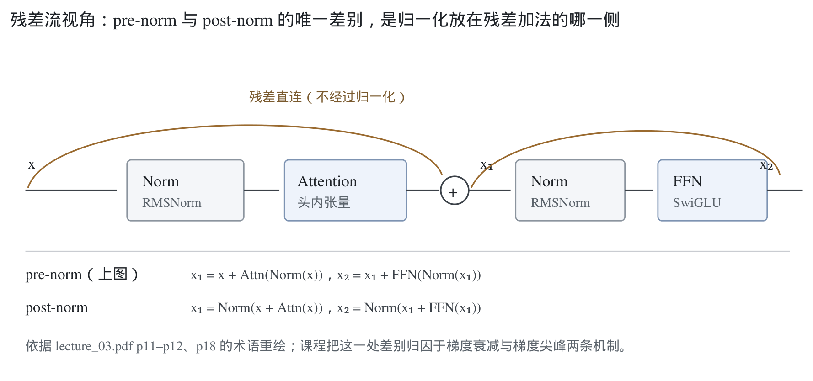

但这一处决定了残差流是否"干净"：pre-norm 的残差主干上没有任何归一化，梯度可以从输出一路直连到输入；post-norm 则每一层都在主干上插入一个归一化，深层网络的梯度容易被反复缩放（因此出现"梯度衰减"与"梯度尖峰"两种现象，对应上面两篇文献的两个解释）[6]。

此外，第三种折中：

即把归一化放在残差流**之外**再加一次。这是"既要残差干净、又要 post-norm 的稳定性"的工程折中。

## 3.2 RMSNorm：均方根归一化

公式上，RMSNorm 只做缩放：

$$
\mathrm{RMSNorm}(x)=\frac{x}{\sqrt{\frac{1}{d}\sum_{i=1}^{d}x_i^{2}+\varepsilon}}\odot\gamma ,
$$

对比 LayerNorm：

$$
\mathrm{LN}(x)=\frac{x-\mu}{\sqrt{\sigma^{2}+\varepsilon}}\odot\gamma+\beta .
$$

收益主要体现在两个方面：

这一点可以归结为一句话：

省掉的 FLOPs 微乎其微（矩阵乘才是大头），真正的收益来自**少搬运数据**——少读一遍 bias、少一次归约。这个判据第 5、6 章会反复用到。RMSNorm 的原始论文见 [7]。

## 3.3 激活：从 ReLU 到门控

标准 FFN 是"线性 + 激活 + 线性"。门控变体（GLU 家族）把第一个线性层拆成两路，其中一路当门：

写成统一形式：

$$
\mathrm{FFN}_{\text{SwiGLU}}(x)=\big(\mathrm{swish}(xW_1)\odot xV\big)W_2 ,
\qquad \mathrm{swish}(z)=z\cdot\sigma(z).
$$

代价是多一个 $V$，所以门控模型的 $d_{\text{ff}}$ 要缩小：

这解释了为什么"4 倍"与"8/3 倍"会同时出现在文献里：见 3.5。GLU 家族的出处是 [8]。

## 3.4 位置编码：RoPE 的旋转表示

原版把位置向量**加到**词嵌入上；RoPE 则把 Q/K **旋转**一个与位置相关的角度，使内积只依赖相对位置：

二维情形最直观。把相邻两维当成一个复数对 $(x_{2i}, x_{2i+1})$，乘上旋转矩阵：

$$
\begin{pmatrix}x'_{2i}\\ x'_{2i+1}\end{pmatrix}
=
\begin{pmatrix}\cos m\theta_i & -\sin m\theta_i\\ \sin m\theta_i & \cos m\theta_i\end{pmatrix}
\begin{pmatrix}x_{2i}\\ x_{2i+1}\end{pmatrix},
\qquad \theta_i=\text{base}^{-2i/d_h}.
$$

其中 $m$ 是 token 位置。于是

$$
\langle R_m q,\ R_n k\rangle=\langle q,\ R_{n-m}k\rangle ,
$$

注意力分数只看到相对位移 $n-m$——这就是"旋转不变性"的用处 [9]。

**常见误解**：RoPE 不是"$X = X_{\text{token}} + P$"。加法式位置编码（正弦、可学习）与 RoPE 是两条不同的路；RoPE 不改词嵌入，只在每一层注意力里旋转 Q/K。

## 3.5 超参数：两条经验规律

但门控激活让参数量翻倍（多一个 $V$），为了保持总参数量，$d_{\text{ff}}$ 要乘 $2/3$：

$$
d_{\text{ff}}=4d_{\text{model}}\times\frac{2}{3}=\frac{8}{3}d_{\text{model}} .
$$

第二条是关于头的：

实测结果如下：

| 模型 | 头数 | 头维 | $d_{\text{model}}$ | 比值 |
| --- | --- | --- | --- | --- |
| GPT-3 | 96 | 128 | 12288 | 1 |
| T5 | 128 | 128 | 1024 | 16 |
| LLaMA2 | 64 | 128 | 8192 | 1 |
| PaLM | 48 | 256 | 18432 | 1.48 |
| Qwen 3.5 (27B) | 24 | 256 | 5120 | 1.2 |

读法是：**头维通常取 64～256，比值通常接近 1**；偏离 1 的实现（如 T5 的小模型）需要额外投影，工程上不划算。

## 3.6 形状契约

以 $B=8$、$T=4096$、$d=4096$、$H=32$、$d_h=128$ 为例：

| 张量 | 形状 | 说明 |
| --- | --- | --- |
| 输入 $X$ | $(8,4096,4096)$ | $B\times T\times d$ |
| $Q,K,V$ | $(8,32,4096,128)$ | $B\times H\times T\times d_h$ |
| $QK^{\top}$ | $(8,32,4096,4096)$ | 注意力分数，$T^{2}$ 项在这里 |
| $\mathrm{softmax}(QK^{\top})V$ | $(8,32,4096,128)$ | 加权求和 |
| 合并多头 | $(8,4096,4096)$ | 拼接 + $W_O$ |

这些维度可以用 PyTorch 的 `reshape` 与 `transpose` 明确写出。使用 Einops 的 `rearrange` 时，同一步也可读成 [61]

```python
from einops import rearrange
q = rearrange(x @ W_Q, 'b t (h d) -> b h t d', h=H)
scores = q @ k.transpose(-2, -1)  # (B, H, T, T)
```

`(h d)` 表示把最后一维拆成头数和头维；`b,t` 保留原有批次与序列轴。改形状不会改变数值，但转置会改变轴的顺序，且可能产生非连续视图；后续若要求连续内存，需要显式处理，不能只凭形状相同就假定布局相同。

参数量可以按层速算：注意力约 $4d^{2}$（$W_Q,W_K,W_V,W_O$），SwiGLU 的 FFN 约 $8d^{2}$（$3\times\tfrac{8}{3}d\times d$），合计每层约 $12d^{2}$；再加上词嵌入 $V\cdot d$ 与输出层。于是 $N\approx 12\,L\,d^{2}+2Vd$——$d$ 翻倍，参数就是四倍，这也是为什么"加宽"比"加深"更贵。

这张表是后面所有优化的坐标系：KV cache（第 10 章）缓存的是 $K,V$；GQA（第 4 章）让 $H_{kv}<H$；FlashAttention（第 6 章）避免落盘 $T\times T$ 的矩阵。

## 3.7 GQA 与 MQA

训练时 $b n$ 很大，算术强度高，GPU 跑得满；生成长序列时 $n$ 大而 $b$ 小，访存占主导。减少 $H_{kv}$ 直接降低 $K,V$ 的搬运与缓存——这是 GQA 的动机，细节见第 4、10 章。

## 3.8 Transformer Block 的组成与检查

把上面的零件装成一个 Block 时，最容易错的是形状与归一化的位置。一份可执行的检查清单：

```python
class Block:
    def __init__(self, d, H, d_ff):
        self.n1 = RMSNorm(d)
        self.attn = Attention(d, H)      # 内部含 RoPE 与 Q/K/V/O 投影
        self.n2 = RMSNorm(d)
        self.ffn = FFN(d, d_ff)          # SwiGLU：W1, V, W2

    def forward(self, x):                # x: (B, T, d)
        x = x + self.attn(self.n1(x))    # pre-norm：先归一化再进子层
        x = x + self.ffn(self.n2(x))
        return x
```

四个自检点：

1. **残差分支不含归一化**：`x + ...` 里的 `x` 必须是原始残差流。
2. **每个子层只有一个归一化**：pre-norm 是"子层前归一化"，不是"子层后归一化"。
3. **RoPE 只作用于 Q/K**，且在 softmax 之前；作用在 V 上会破坏加权求和的语义。
4. **$d_{\text{ff}}$ 与激活配套**：SwiGLU 用 $\tfrac{8}{3}d$，ReLU 用 $4d$，否则参数量对不上。

层数与宽度通常依经验选择，并不存在适用于所有任务的最优配置：$d$ 常用 4096/8192，$L$ 从 12 到 96，头维 128 左右——这些数字的合理性来自"在固定算力下参数与数据的分配"（第 9、11 章）。

## 3.9 架构选择中的共识与分歧

几类架构的共识与分歧可以概括为：

四条可以直接当结论用：**非残差归一化是共识、RMSNorm 有明确的计算收益、门控 FFN 已成共识、并行层大多回退到串行**。

位置编码可按两组维度划分：加法或乘法、绝对或相对。

| 方案 | 施加位置 | 代表模型 |
| --- | --- | --- |
| 正弦式（Sine） | 加到词嵌入 | 原版 Transformer |
| 绝对可学习（Absolute） | 加到词嵌入 | GPT-1/2/3、OPT |
| 相对（Relative） | 加到注意力计算 | T5、Gopher、Chinchilla |
| RoPE（乘性旋转） | 作用在 Q/K | GPT-J、PaLM、LLaMA、2024 年后多数模型 |

这组分类容易混淆：前两类都改词嵌入，后两类改注意力。**RoPE 属于后者**，这也是为什么"把位置加进 embedding"的直觉在 RoPE 上是错的。

## 3.10 注意力计算的实现细节

自注意力（self-attention）在同一序列内计算位置间的信息交换。设输入 $X\in\mathbb{R}^{B\times T\times d_{\text{model}}}$，每个头先作线性投影 $Q=XW_Q$、$K=XW_K$、$V=XW_V$。查询与所有键的点积产生匹配分数；除以 $\sqrt{d_h}$ 并加上因果掩码 $M$ 后，沿键的位置做 Softmax 得到权重 $A$，再计算 $AV$。掩码使位置 $t$ 看不到未来位置 $j>t$。Softmax 只把分数归一化，注意力输出还包括对 $V$ 的加权求和。 [62]

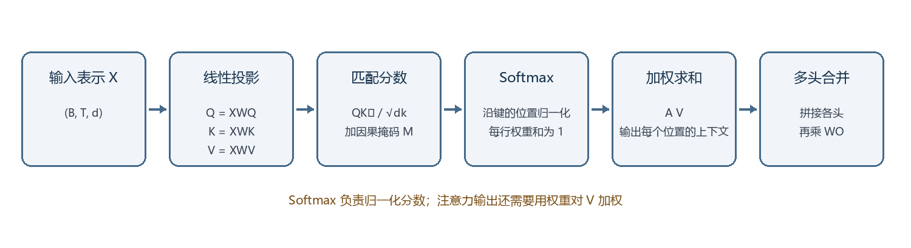

单头和多头的计算可以写成：

$$A_h=\mathrm{softmax}\!\left(\frac{Q_hK_h^{\top}}{\sqrt{d_h}}+M\right),\qquad \mathrm{head}_h=A_hV_h,\qquad \mathrm{MHA}(X)=\mathrm{Concat}(\mathrm{head}_1,\ldots,\mathrm{head}_H)W_O.$$

多个头使用不同的投影矩阵，在各自的特征子空间计算，再拼接并投影回模型维度。实际实现常将各头的投影合并为较大的矩阵运算，并通过批量矩阵乘法或融合 kernel 计算注意力；多头的数学定义不意味着每个头都必须单独启动一个 GPU kernel。实现中还应检查 Softmax 的轴：它沿键所在的最后一维归一化。若 `q`、`k`、`v` 的形状均为 $(B,H,T,d_h)$，则 `scores` 和 `weights` 的形状为 $(B,H,T,T)$，`context` 回到 $(B,H,T,d_h)$。

```python
scores = q @ k.transpose(-2, -1) / math.sqrt(d_h)  # (B, H, T, T)
scores = scores + causal_mask                    # 未来位置加 -inf
weights = torch.softmax(scores, dim=-1)           # 对键位置归一化
context = weights @ v                            # (B, H, T, d_h)
```

公式写对不等于实现写对。以下三处是复现时最常出问题的地方。

**其一，缩放因子。** 查询向量与键向量的点积由 $d_h$ 项相加。若各分量近似独立、均值为 0 且方差为 1，点积方差随 $d_h$ 增长，典型幅度约为 $\sqrt{d_h}$；除以 $\sqrt{d_h}$ 后，softmax 输入的尺度不会仅因头维变大而膨胀。因而应使用 $\frac{1}{\sqrt{d_h}}$，而不是 $\frac{1}{d_h}$：

$$
\mathrm{Attn}(Q,K,V)=\mathrm{softmax}\!\left(\frac{QK^{\top}}{\sqrt{d_h}}+M\right)V,
$$

$d_h$ 是**单头**维度，不是 $d_{\text{model}}$。写错会让 softmax 进入饱和区，梯度消失。

**其二，因果 mask。** 训练时要遮住未来位置，可在分数矩阵中把未来位置设为 $-\infty$；Softmax 后这些位置的权重为 0。每行至少要保留一个可见位置，否则对全 $-\infty$ 行计算 Softmax 会产生未定义结果。低精度 kernel 也可使用足够大的负值，但要验证它在目标数据类型下确实将权重压到零。掩码形状可为 $(T,T)$，也可按 batch 与头广播。

**其三，softmax 把分数变成权重。** 对一个查询，$QK^\top$ 给出它与各位置键向量的匹配分数；沿键所在的轴做 softmax 后，得到非负且总和为 1 的权重，再用这些权重对 $V$ 作加权平均。例如，分数 $[0,0,\ln 2]$ 对应权重 $[1/4,1/4,1/2]$。加一个相同常数不会改变权重，但把分数整体放大，会让最大分数占据更多权重。为提高数值稳定性，可以先从每行 logits 中减去该行最大值，再计算指数：

$$
\mathrm{softmax}(z)_i=\frac{e^{z_i-\max_j z_j}}{\sum_j e^{z_j-\max_j z_j}}.
$$

直接计算指数时，较大的 logits 可能溢出；减去行最大值能降低这种风险。具体数值范围取决于数据类型和实现。

缩放因子、掩码和归一化轴都会影响计算结果。实现与公式不一致时，模型输出可能偏离预期，因此 kernel 的正确性需要单独验证。

## 3.11 初始化与残差缩放：深度带来的第三个问题

pre-norm 解决了"梯度能不能传回去"，但没有解决"传回去的幅度是否合适"。层数一多，残差流上的累积会让方差随深度线性增长，训练早期就发散（属于实践层）。

三类常用手段：

1. **小方差初始化**：权重按 $\mathcal{N}(0,\sigma^{2})$ 采样，$\sigma$ 取 $0.02$ 量级；embedding 与输出层共享时再乘一个系数。
2. **残差缩放**：把每个子层的输出乘 $1/\sqrt{2L}$ 再加回主干，使累积方差与层数无关。这个 $1/\sqrt{2L}$ 来自"每层有两个子层"的方差叠加假设。
3. **QK-Norm**：在算 $QK^{\top}$ 之前对 $Q,K$ 各做一次归一化，压住分数矩阵的量级；对长序列与低精度训练尤其有效（第 3 章引用的 qk-norm 工作）。

这些手段都不是"调参技巧"，而是**对深度的补偿**：层数越多，越需要把每层的贡献压小，让残差主干的方差保持在可控范围。

一个可以自测的判据：训练前几步 loss 若出现尖峰或 NaN，先查初始化与缩放系数，再看学习率——两者的症状相似，但修法完全不同。

## 本章回顾与练习

一个 Transformer Block 将注意力和前馈变换接到残差流上。位置编码提供顺序信息；注意力分数经缩放和 Softmax 归一化后，才成为对 $V$ 的加权系数。

**练习**

1. 若 $d_h=64$，说明为何缩放分母是 $\sqrt{64}$，并指出推导所需的独立性假设。
2. 写出 $(B,T,d)$ 到 $(B,H,T,d_h)$ 的形状变换，并标注每步维度。
3. 说明 LayerNorm、残差连接和 RoPE 分别作用于计算图的哪个位置。

# 第 4 章　注意力替代方案与 MoE

## 本章导读

序列变长时，注意力的 $T^2$ 计算和 KV 缓存会逐渐成为限制。本章比较减少缓存、改变计算顺序、限制可见位置和稀疏激活等路线，辨认每种方法改变了哪笔成本。

学完本章后，你应能：

- 计算 MHA、MQA、GQA 的 KV 缓存大小；
- 解释线性注意力与 softmax 注意力在计算形式上的差异；
- 描述 MoE 路由、负载均衡和专家并行的代价。

## 注意力计算的主要成本项

第 3 章组装出的主干里，attention 是唯一一个代价随序列长度**平方**增长的算子。一层、$T$ 个 token、隐藏维 $d$ 的账是两项相加（按矩阵乘的乘加次数计）：

$$8Td^{2}+4T^{2}d\quad\text{FLOP}.$$

前一项是四个投影（$Q,K,V$ 与输出各 $2Td^{2}$），后一项是 $QK^{\top}$ 与随后乘 $V$ 各 $2T^{2}d$。形状上，$Q,K,V\in\mathbb{R}^{T\times d}$，中间矩阵 $QK^{\top}\in\mathbb{R}^{T\times T}$——二次项的来源就是这个 $T\times T$。

令两项相等，得到交叉点

$$T^{*}=\frac{8d^{2}}{4d}=2d .$$

$d=8192$ 时 $T^{*}=16384$。这条线解释了一个常见困惑：短上下文时代没人关心 attention 的复杂度，因为投影项一直是主导；一旦 $T$ 过万，二次项才开始吃掉预算。

第二笔账在推理侧。每层要缓存 $K$ 和 $V$：

$$\text{KV bytes}=4\,L\,T\,d\quad(\text{bf16}).$$

取 $L=80$、$T=32768$、$d=8192$，得 $8.6\times10^{10}$ B，即**单条序列 86 GB**——比一张 H100 的 80 GB 显存还大。所以长上下文的第一道墙不是算力，是显存。

我们将已有手段归成三类，并明说这些只是"基本工具箱"：

本章按"改动的深度"排序：先讲只改缓存形状的（MQA/GQA），再讲改结合顺序的（线性注意力与门控变体），再讲只改注意力模式的（稀疏注意力），最后讲改 FFN 的（MoE）。

## 不改公式，先改存多少：MHA/MQA/GQA

多头注意力把 $K,V$ 按头切分，于是缓存随头数线性增长。让 $K,V$ 只保留 $g$ 组、每组 $d_h=d/H$ 维，就得到一族连续可调方案：

$$\text{KV bytes}=2\,L\,T\,g\,d_h\,b,\qquad g\in\{1,\dots,H\}$$

形状：$K,V\in\mathbb{R}^{T\times gd_h}$；$g=H$ 是 MHA，$g=1$ 是 MQA，中间是 GQA。$b$ 是每元素字节数。

取 $L=80$、$T=32768$、$d=8192$、$H=64$、$b=2$：

| 方案 | KV 组数 $g$ | 每 token 每层 KV 元素 | 单序列 KV |
| --- | --- | --- | --- |
| MHA | 64 | 16384 | 86 GB |
| GQA（8 组） | 8 | 2048 | 10.7 GB |
| MQA | 1 | 256 | 1.3 GB |

判断这一点不能只看字节数，还要计算**算术强度**（FLOPs 除以搬动的字节数）：

这里 $k=d/h$ 就是 $d_h$。将分子分母相除，强度等于 $\dfrac{bd}{1+n/d_h+d/(bn)}$；在 $n\ll d$ 且 $bn\ll d$ 时它退化为 $O(bn)$，与写出的 $\left(\frac{1}{k}+\frac{1}{bn}\right)^{-1}$ 同阶。**prefill 阶段只要 batch 够大，attention 是算力受限的，可以喂满 GPU。**

生成阶段完全反过来：

这个式子可以精确复现——$\dfrac{bnd^{2}}{bn^{2}d+nd^{2}}=\left(\dfrac{n}{d}+\dfrac{1}{b}\right)^{-1}$。它说明 decode 的强度与隐藏维无关，只随 $n/d$ 恶化；而 $n/d$ 是"上下文相对于模型的长度"，这就是"KV cache 是长上下文第一瓶颈"的定量版本。

于是三条路的定位很清楚：$g$ **只改字节数、不改 FLOPs**。GQA/MQA 把强度整体乘上 $H/g$，是唯一不牺牲算力的省法，代价写在表达能力上：

GQA 的工程价值还在于它能从已训好的 MHA 检查点"改造"出来，只需少量继续预训练 [10]；MQA 的实测对照见引用的一组图。实际选择时，可以先**确定 $g$，再比较其他省法**，因为它不改变任何数值行为，只改变缓存布局。

## 改结合顺序：线性注意力

一句话：矩阵乘有结合律，先算 $K^{\top}V$ 就把 $T\times T$ 的中间矩阵换成了 $d_k\times d_v$ 的状态。

$$(QK^{\top})V:\ n^{2}d_k+n^{2}d_v\ \text{次乘加},\qquad Q(K^{\top}V):\ 2nd_kd_v\ \text{次乘加}.$$

形状：$K^{\top}V\in\mathbb{R}^{d_k\times d_v}$，$Q(K^{\top}V)\in\mathbb{R}^{n\times d_v}$——中间量从"随 $n^{2}$ 长"变成"固定大小"。

两者之比（取 $d_k=d_v=d_h$）是

$$\frac{n^{2}(d_k+d_v)}{2nd_kd_v}=\frac{n}{d_h}.$$

$n=32768$、$d_h=128$ 时是 **256 倍**。这个式子同时给出了收益的边界：上下文越长收益越大，头维越小收益越大——**收益与模型宽度无关**，这是它和 GQA 最大的不同。

代价藏在那句 "when $\rho$ is the identity" 里。softmax 不是恒等映射，所以线性注意力的前提是**去掉 softmax**，而不是"把 softmax 挪个位置"（依据是结合律只在 $\rho=\mathrm{id}$ 时成立）。这一点常被误读成"线性注意力是 softmax 的近似"，其实它是**另一个函数族**：用 $d_k\times d_v$ 的状态做加性记忆，而不是用 $T\times T$ 的相似度矩阵做归一化加权。

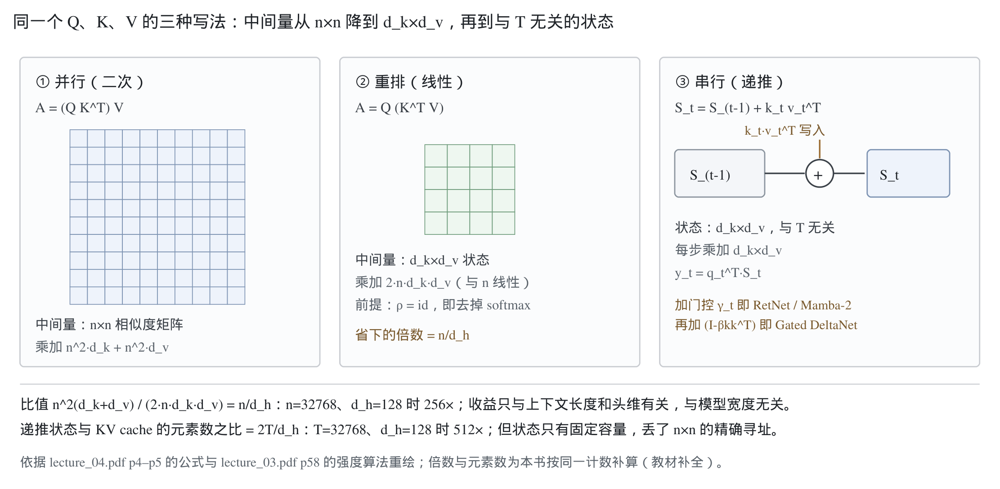

## 线性注意力的递推形式与门控

形状：$k_t,v_t\in\mathbb{R}^{d_h}$，$S_t\in\mathbb{R}^{d_h\times d_h}$，$y_t\in\mathbb{R}^{d_h}$。状态大小与 $T$ 无关，这是它与 KV cache 的根本差别。取 $T=32768$、$H=64$、$d_h=128$：一层线性注意力的状态是 $64\times128\times128=1.05\times10^{6}$ 个数（2.1 MB），同一层的 KV cache 是 $2\times32768\times8192=5.4\times10^{8}$ 个数（1.07 GB），相差约

$$\frac{2Td}{Hd_h^{2}}=\frac{2T}{d_h}=512\ \text{倍}$$

（$T=32768$、$d_h=128$）。这个比值同时说明：**上下文越长，递推状态越划算**；它不是免费的，下面的门控就是在补它丢掉的东西。

三级递推呈现了不同程度的记忆控制：

$$S_t=S_{t-1}+k_tv_t^{\top}\qquad\text{(线性注意力)}$$

$$S_t=\gamma_tS_{t-1}+k_tv_t^{\top},\quad\gamma_t=f(x_t)\qquad\text{(RetNet / Mamba-2)}$$

$$S_t=\gamma_t(I-\beta_tk_tk_t^{\top})S_{t-1}+\beta_tk_tv_t^{\top}\qquad\text{(Gated DeltaNet)}$$

$(I-\beta kk^{\top})$ 的形状是 $d_h\times d_h$。当 $\|k\|=1$、$\beta=1$ 时它是到 $k$ 正交补的投影算符，作用是把状态里"沿当前 key 方向"的分量减掉；$\beta=0$ 时整个更新项消失，等于这一步不写入——这就是所谓的 "no input operation"。$D$ 项是对 $v$ 的逐通道短卷积，不改变状态。

RetNet 只是给衰减加了个系数：

"对偶"的工程含义值得单独说清：训练走并行二次形式（GPU 喜欢的大矩阵乘），推理走串行线性形式（每步只更新一个 $d_h\times d_h$ 状态）。串行递推本身也能并行化——加法与门控乘法都可结合，用并行前缀和（associative scan）可在 $O(T\log T)$ 步内算完，所以"串行形式"不妨碍训练，它只是**另一种算法**。这一点是理解 RetNet/Mamba 系列实现的前提。

## 混合架构的工程实践

| 模型 | 混合比（线性 : 全注意力） | 线性层类型 |
| --- | --- | --- |
| MiniMax M1 / minimax-text-01 | 7 : 1 | 线性注意力 |
| Nemotron 3 | 约 3 : 1 | Mamba |
| Qwen 3.5 / Qwen Next | 3 : 1 | Gated DeltaNet |

为什么不押纯线性？现有证据主要说明哪些结论还不能成立：

按字面读：**没有多少受控消融**，只有"小比例混合时损失不高"的证据。因此，现有证据不足以支持"7:1 是最优比例"的结论。

一种常见解释是两类层分工——线性层提供每 token $O(1)$ 的压缩记忆，全注意力层提供精确的内容寻址（复制、检索、指代）。这与 MoE 的设计思路相似：稀疏机制可以增加容量，但不能独自解决所有问题。本书不把这条解释当作结论；它目前是解释，不是测量结果。

## 稀疏注意力：只改谁看谁

"post hoc" 是这里的工程要点：不必从头训练，可以在稠密短上下文预训练**之后**再加稀疏化。这让它成为一条低风险路径——先按稠密模型训完，再改注意力模式。

少数方法会直接改变注意力头的配置：

若每 token 只看 $w$ 个位置，二次项从 $4T^{2}d$ 降到 $4Twd$，节省倍数 $T/w$。若实现仍为全部历史位置保留 KV cache，稀疏计算本身不会减少这部分缓存；若采用窗口化或淘汰策略，缓存占用则可能下降。因而，稀疏注意力是否降低总显存，取决于缓存策略和具体实现。目前缺少足够的消融数据，无法判断 DSA 的独立贡献。

## MoE 的参数量、激活量与专家粒度

公式：两层 FFN（隐藏维 $d_{ff}$）参数 $2dd_{ff}$；$E$ 个专家的 MoE 总参数 $2Edd_{ff}$，每 token 激活 $k\cdot2dd_{ff}$，于是

$$\frac{\text{总参数}}{\text{激活参数}}\approx\frac{E}{k}.$$

SwiGLU 把每个专家换成三个矩阵，系数由 2 变 3，比值不变。MoE 允许模型总参数量大于每个 token 实际激活的参数量，因此可在一定计算预算下增加模型容量；同时会增加参数存储、路由和跨设备通信开销，实际收益取决于实现与工作负载。

比较 MoE 配置时，要区分 Routed（路由专家数）、Active（每 token 激活的专家数）和 Shared（常开共享专家）：

| 模型 | Routed | Active | Shared | 细粒度比 |
| --- | --- | --- | --- | --- |
| GShard | 2048 | 2 | 0 | — |
| Switch Transformer | 64 | 1 | 0 | — |
| ST-MOE | 64 | 2 | 0 | — |
| Mixtral | 8 | 2 | 0 | — |
| DBRX | 16 | 4 | 0 | — |
| Grok | 8 | 2 | 0 | — |
| DeepSeek v1 | 64 | 6 | 2 | 1/4 |
| Qwen 1.5 | 60 | 4 | 4 | 1/8 |
| DeepSeek v3 | 256 | 8 | 1 | 1/14 |
| OlMoE | 64 | 8 | 0 | 1/8 |
| MiniMax | 32 | 2 | 0 | 约 1/4 |
| Llama 4 (maverick) | 128 | 1 | 1 | 1/2 |


这张表呈现两项区别。第一，**"专家数"与"激活数"是两个独立旋钮**：GShard 把 $E$ 推到 2048 而每 token 只激活 2 个；Llama 4 maverick 反其道，128 个专家只激活 1 个。第二，**细粒度比**是专家隐藏维相对常规 FFN 的比例，$d_{ff}^{\text{expert}}=d_{ff}/r$；$r=1/14$ 表示单个专家只有常规 FFN 的十四分之一宽。DeepSeek v3 用 $256\times\frac{1}{14}$ 换来 671B 总参数、37B 激活参数，整体比值 18 低于 $E/k=32$——差额来自 attention 与共享专家在激活侧占比更大（由 $671/37\approx18$ 直接计算）。

细粒度与共享专家的证据并不一致，我们将两个来源都摆出来：

细粒度两边都支持，共享专家只有 DeepSeek 一家支持。写"共享专家有效"时必须带出处，否则就是在替一家公司的消融结果背书。

## 专家路由与 Top-k 选择

top-k 的 $k$ 值分布：

这里有一处**不同报告之间的数字不一致**： 写 "DeepSeek (7)"，而  的表里 DeepSeek v1 是 6、v3 是 8。

门控有两种写法：

$$y=\sum_{i\in\text{TopK}(p)}g_i\,\mathrm{FFN}_i(x),\qquad p=\mathrm{softmax}(W_rx)$$

形状：$W_r\in\mathbb{R}^{E\times d}$，$p\in\mathbb{R}^{E}$，$g_i$ 是归一化后的门控权重。

softmax-after-topk 与全 softmax 的差别只在**归一化分母**。前者让被选中专家的权重和恒为 1，梯度只落在选中的 $k$ 路上；后者让权重携带"专家之间的竞争"信息。DeepSeek v3 用 sigmoid 再事后归一化，是为了让每个专家的门控可以独立地"想开多大就开多大"，这与它的 aux-loss-free 偏置配合使用（见下节）。

共享专家是另一条支路：

## 专家路由的优化方法

三条路的结果：第一条在原理上最干净，但代价高——

第二条是加噪声，后来被拿掉了：

实际训练中常用第三种形式，其导数为：

Switch 的辅助损失是

$$L_{aux}=\alpha N\sum_{i=1}^{N}f_iP_i,\qquad f_i=\frac{1}{T}\sum_{t=1}^{T}\mathbf{1}[\arg\max p_t=i],\quad P_i=\frac{1}{T}\sum_{t=1}^{T}p_{t,i},$$

其中 $f_i$ 是分到专家 $i$ 的 token 比例、$P_i$ 是平均门控概率、$\alpha$ 是系数。对单个 $p_{t,i}$ 求导：$\partial L_{aux}/\partial p_{t,i}=\alpha Nf_i/T=\frac{\alpha N}{T^{2}}\sum_{t}\mathbf{1}[\arg\max p_t=i]$。机制上它惩罚"用得多且门控大"的组合：$f_i$ 越大，同一 $p_i$ 被压得越狠。这解释了为什么这个损失只要一行代码就能稳定训练，而 RL 版本调不动。

粒度可以按专家也可以按设备聚合：

DeepSeek v3 换成偏置：

"无辅助损失"容易引起误解：这里是把主损失中的平衡项换成对偏置的在线更新，序列级平衡与通信平衡仍然存在 [11]。

去掉平衡损失是否会导致路由坍塌，取决于路由器、负载与训练配置，不能仅凭这一项断言。

## MoE 的并行方式与通信开销

专家并行下每一步要把 token 按路由发出去、算完再收回来，字节数约

$$\text{bytes}\approx 2\,N_{\text{tok}}\,k\,d\,b .$$

取 $N_{\text{tok}}=8192$、$k=8$、$d=7168$、bf16，得约 $1.9$ GB/层/步。这就是为什么 MoE 的系统工作几乎全在压这一项：降维投影、稀疏矩阵乘、top-M 设备路由都是同一场战役的不同打法。

另一个容易忽略的随机性来源是：

工程后果是：MoE 的输出对 batch 组成敏感，同一请求在不同 batch 下可能得到不同结果。这一效应增加了输出的不确定性，但其幅度还需要定量分析。

稳定性建议只有一句：

紧接着又是一个只有问题没有答案的页面：

常见做法是将路由 logits 转为 fp32，并视需要加入辅助 z-loss。去掉平衡损失会产生什么影响，仍需由具体实验判断。

微调侧的坑：

## 从稠密模型升级：upcycling 与 DeepSeek 三代

两个已公开的例子：

| 模型 | 起点 | 配置 | 训练量 |
| --- | --- | --- | --- |
| MiniCPM | 稠密 MiniCPM | top-2 / 8 专家 / 约 4B 激活 | 约 520B token |
| Qwen MoE | Qwen 1.8B | top-4 / 60 专家 + 4 共享 | 未公开 |

DeepSeek 三代是本章最好的综合案例（规模单位是参数）：

| 代 | 总/激活 | 路由专家（细粒度） | 激活 | 共享 | 新增机制 |
| --- | --- | --- | --- | --- | --- |
| v1 | 16B / 2.8B | 64（1/4） | 6 | 2 | 标准辅助损失（专家 + 设备） |
| v2 | 236B / 21B | 160（1/8） | 6 | 2 | 通信平衡损失、top-M 设备路由 |
| v3 | 671B / 37B | 258（1/14） | 8 | 1 | aux-loss-free + 序列级辅助 |

671B/37B 是 v3 的规模，引用时应按标题读，不要照抄那个 "V2"。

两个"造出 v3 还需要什么"的部件：一个是 MLA（下一节），另一个是多 token 预测——

多 token 预测的动机与消融见 [12]。

## MLA：省 KV 的另一条路

形状：$c_t^{KV}\in\mathbb{R}^{d_c}$，$d_c\ll d$。缓存从 $2LTd$ 降到约 $LTd_c$（每 token 每层一个 latent 向量），这是把"按头存 KV"换成"存一份压缩表示"。

代价是位置编码：

冲突的根源是 RoPE 必须作用在**具体的 key 向量**上，而 MLA 缓存的是 latent；若每次都先解压、再旋转、再重算，缓存就失去意义。留出少量不压缩的维度专门承接旋转，等价于"位置信息走旁路"，其余维度继续走 latent。这也解释了为什么 MLA 的缓存大小是两项之和而不是一个数：$d_c$ 加位置维。


MLA 的完整设计与 v3 的配置见 [13]。

## 本章回顾与练习

注意力替代方法分别改变缓存、计算顺序、连接模式或激活参数量。没有一种方法在质量、速度、显存和实现难度上同时占优。

**练习**

1. 对给定 $L,T,d,H$ 计算 MHA 与 8 组 GQA 的 KV 缓存，并说明量化数据类型的影响。
2. 指出线性注意力改写所需的代数条件，以及它与 Softmax 公式的差异。
3. 画出 top-2 MoE 的 token 路由和专家输出汇合过程，并标注可能出现的负载不均。

# 第 5 章　GPUs 与 TPUs

## 本章导读

硬件性能取决于运算速度，也取决于数据移动速度。同一个模型在不同硬件上的表现，往往由存储层级和算术强度决定。

学完本章后，你应能：

- 区分寄存器、片上存储与 HBM 的作用；
- 用 Roofline 判断算子受算力还是带宽限制；
- 解释低精度、融合、分块和重算如何改变瓶颈。

## 硬件特性对模型实现的影响

第 2 章算过 FLOPs 与显存，第 3、4 章选了架构。但同一份公式，在不同硬件上能差十倍——差别不在数学，在数据搬运。理解这个差异，需要把硬件的计算能力与数据搬运能力放在一起分析：

算力本身也能提升性能；关键在于计算单元是否获得了足够的数据。

这条经验背后的历史是：1980–2000 年代的 Dennard 缩放（频率红利）已经结束，

于是增长改由"堆并行"提供：

这句话在工程上的推论是：**硬件决定了哪些算法是"划算"的**。一个在 CPU 上合理的算法（例如逐元素地做归约）在 GPU 上可能因为访存而慢十倍；反过来，一个看起来"多算了"的算法（重算、分块重复读）在 GPU 上可能更快。本章就是把这条判断变成可计算的。

## 一次对比：延迟优化与吞吐优化

CPU 与 GPU 的分工不是"快与慢"，而是两种优化目标：

| 维度 | CPU | GPU |
| --- | --- | --- |
| 优化目标 | 单线程延迟 | 总吞吐 |
| 计算单元 | 少而复杂 | 多而简单（大量 ALU） |
| 分支与缓存 | 大量支持 | 支持很少 |
| 适合的负载 | 串行、分支密集 | 同构、数据并行 |

我们将 GPU 模型的优点归成三条：

注意第二条里的问号——SIMT 让"看起来并行"很容易，让"跑得快"并不容易。

## 解剖一台 GPU：SM、warp 与三级存储

执行侧的三个概念：

理解存储层级，需要同时比较容量与带宽：

"贵 100 倍、快 8 倍"这个比值决定了整个存储层级的存在理由：容量必须按"每级缩小一个量级"来设计。下表列出具体器件及其单位：

H100 一列的关键数字整理如下：

| 层级 | 容量 | 带宽 | 与 HBM 的带宽比 |
| --- | --- | --- | --- |
| 寄存器（每 SM） | 256 KB | 约 401 TB/s | 约 120× |
| L1 + 共享内存（每 SM） | 256 KB | 约 33 TB/s | 约 10× |
| L2 | 50 MB | 约 12 TB/s | 约 3.6× |
| HBM | 80 GB | 3.35 TB/s | 1× |

（数值取自 ；L1/L2 带宽为粗略估计。）

把容量列与带宽列并排看，会得到一个很硬的约束——从寄存器到 HBM，容量涨了约 $1.6\times10^{5}$ 倍（$80\,\text{GB}/512\,\text{KB}$），带宽只降了约 120 倍。**容量与带宽不是同比例缩放的**，这正是"必须分块、必须复用"的物理原因：你不能把所有数据放在快的地方，只能让每个字节在被换出之前被用够多次。

## Roofline：一条线决定你能优化到哪

Roofline 模型用算术强度 $I=\text{FLOP}/\text{Byte}$ 估计性能上界：

$$P=\min\left(P_{\text{peak}},\; I\cdot B_{\max}\right),\qquad I^{*}=\frac{P_{\text{peak}}}{B_{\max}}.$$

$I^{*}$ 称为脊点（ridge point）。在 Roofline 模型的理想化假设下，低于该值时性能上界由带宽决定，高于该值时性能上界由峰值算力决定。实际性能还会受到占用率、访问模式、并行度、同步和 kernel 启动开销影响。

取 H100 的 $B_{\max}=3.35\times10^{12}$ B/s，并设 fp16 张量核峰值 $P_{\text{peak}}\approx10^{15}$ FLOP/s（取 H100 级器件的典型量级估算），得

$$I^{*}\approx\frac{10^{15}}{3.35\times10^{12}}\approx300\ \text{FLOP/byte}.$$

按这组假设，算术强度约需达到 300 FLOP/byte，Roofline 上界才转为计算受限。逐元素算子通常远低于这一数值，因此往往受带宽限制。

| 算子 | 算术强度 $I$（FLOP/byte） | 瓶颈 | 依据 |
| --- | --- | --- | --- |
| ReLU（fp32） | 0.125 | 带宽 | 8 bytes/FLOP |
| ReLU（fp16） | 0.25 | 带宽 | 4 bytes/FLOP |
| 朴素 GEMM（无复用） | 0.25 | 带宽 | |
| 分块 GEMM（$T\times T$ 块） | $T/4$ | $T{=}64$ 时 16，仍带宽受限 | |
| 大 batch attention（prefill） | 可达 $10^{2}$ 量级 | 接近算力 | 第 4 章 |

ReLU 的例子可以直接看出算术强度的含义：

这里的强度定义为"字节/FLOP"，与 Roofline 常用的"FLOP/字节"互为倒数，读的时候不要混。$8$ bytes/FLOP $=0.125$ FLOP/byte；换成 fp16 就是 $0.25$。逐元素算子的算术强度通常较低。优化时可减少读写字节数、提高数据复用率或融合多个算子；具体收益取决于硬件和工作负载。

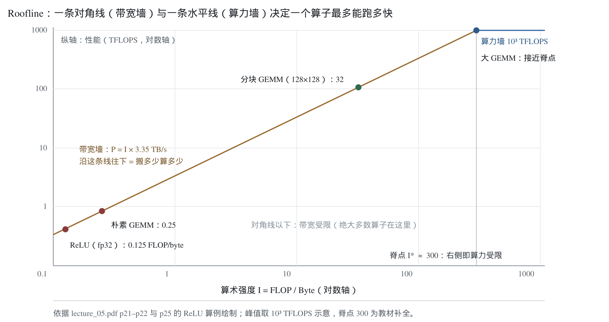

## 六类性能优化方法

我们将"怎么让 GPU 跑快"列成六条，并按"是否与访存有关"分了两类：

| 手段 | 省的是什么 | 代价 |
| --- | --- | --- |
| 控制分歧 | 执行效率（与访存无关） | 改写代码结构 |
| 低精度 | 字节数 | 数值误差、转置变复杂 |
| 算子融合 | HBM 往返次数 | 编译器要能融合 |
| 重算 | HBM 读写（反向传播） | 额外前向算力 |
| 合并访存 | DRAM 事务数 | 布局/padding 约束 |
| 分块 | 全局访存总量 | 共享内存容量 |

控制分歧单独说明一句，因为它常被误当成访存问题：

warp 内若一半线程走 `if`、一半走 `else`，两条路径要**串行执行**，等价于把这段代码的吞吐砍半。所以"用 mask 代替分支"在 GPU 上是真实收益，不是风格偏好。

## 低精度：先减少要搬的字节

低精度同时改善两件事：字节数减半直接让强度翻倍；张量核只对低精度格式给满算力：

到了 FP8 这一代，细节开始咬人：

分块缩放（每 32 或每 16 个元素一个缩放因子）把"一个张量一个 scale"变成"一个块一个 scale"，动态范围问题缓解了，但**转置不再是免费的**——转置后元素的分组变了，原来的 scale 不再对应新块，必须单独量化一份。这就是 "transposes are now nontrivial" 的具体含义，也是低精度训练框架里额外那几份权重的来源。FP8 混合精度训练的公开实践可参考 [13]。

## 融合：把 HBM 往返压成一次

仓库存取比车间加工慢得多，所以每多一次"送回仓库再取出来"都是纯浪费：

$m$ 个串联的逐元素算子，不融合时每个算子一次读一次写，共 $2m$ 次 $n$ 元素访存；融合后是 2 次。$m=5$ 时字节数降到 $1/5$。这条估算与第 4 章计算 softmax 读写量时采用的口径一致（见 对 softmax 的读写账）。

三种实现的比较可以说明这一点：三种 GeLU 写法里，朴素实现的差别就是"多 kernel、多次 HBM 往返"。

## 重算：把 8 次 HBM 往返压到 5 次

反向传播要存激活，存与取都是访存。例子是三个 sigmoid 叠起来：

这是"用算力换带宽"的最干净例子——多算一次前向，换掉 3 次 HBM 读写，净收益 $3/8$。判断标准回到 Roofline：只要多出来的算力仍低于 $I^{*}$ 对应的余量，重算就是赚的。这也解释了为什么激活重算（activation checkpointing）在大模型训练里几乎默认开启：它省的不只是显存，还有带宽。

## 合并访存：DRAM 一次给你一整行

具体到数字，示例代码给的是 128 字节：

一个 warp 32 个线程、每线程 4 字节，正好 128 字节 = 一条缓存行。若访问沿行方向"跨步"，32 个线程会落到 32 条不同缓存行，事务数变成 32 倍——**带宽没变，有效带宽降到 1/32**。这也解释了行主序矩阵沿行访问时，线程地址并不连续：不是硬件挑食，是地址不连续。

## 分块提高数据复用率

$N\times N$ 的 GEMM，FLOPs 是 $2N^{3}$。不分块时每个输入元素被读 $N$ 次，总元素读 $2N^{3}$，按 4 字节算是 $8N^{3}$ 字节，于是

$$I_{\text{naive}}=\frac{2N^{3}}{8N^{3}}=0.25\ \text{FLOP/byte}.$$

分块后每个输入被读 $N/T$ 次，字节数降到 $8N^{3}/T$，强度变成

$$I_{\text{tiled}}=\frac{2N^{3}}{8N^{3}/T}=\frac{T}{4}.$$

$T=128$ 时 $I=32$——比朴素实现好 128 倍，但**离脊点 300 还差一个量级**。这不是推导错误，而是真实的工程处境：

| 方案 | 全局元素读 | 字节数（$N=4096$，fp32） | 带宽时间（3.35 TB/s） | 算力时间（$10^{15}$ FLOP/s） |
| --- | --- | --- | --- | --- |
| 朴素 | $2N^{3}=1.37\times10^{11}$ | 550 GB | 164 ms | 0.14 ms |
| 分块 $T=128$ | $1.07\times10^{9}$ | 4.3 GB | 1.3 ms | 0.14 ms |

结论就一句话：**单个 $128\times128$ 的共享内存块还不够**。要真的跑到算力受限，必须在共享内存之上再叠寄存器级分块（每个线程算 $8\times8$ 个输出）、并用张量核把 $P_{\text{peak}}$ 抬上去。这就是为什么手写 GEMM 至今仍是硬活——第 6 章的 Triton 例子只做到 $64\times64\times32$ 的块，正好停在这张表的第二行。

## 波量化与网格规模的关系

再看一个矩阵计算中的现象：同样规模的 GEMM，边长从 1792 变成 1793，耗时会出现台阶。答案是把矩阵切成多少个 block、以及 GPU 有几块 SM：

| 边长 | tile 数 | 波数 | 有效利用率 |
| --- | --- | --- | --- |
| 1792 | $7\times14=98$ | 1 | $98/108\approx0.91$ |
| 1793 | $8\times15=120$ | 2 | $98/216\approx0.45$ |

第二行里 98 是"真正算完的 block 数"，216 是"两波能提供的 block 槽位"：第一波 108 个槽位只用了 98 个，第二波 12 个 block 占着 108 个槽位。**尺寸只加了 1，利用率掉了一半**。这就是"让 block 数整除 SM 数"这条工程习惯的来历——它不是玄学，是波量化的直接后果。

## FlashAttention 对注意力计算的优化

难点在 softmax 是**全局**运算：要知道一行的最大值与归一化分母，才能算出这一行的输出。分块之后你只看得到一块，怎么办？

设已处理 $j-1$ 块，记当前最大值 $m^{(j-1)}$、归一化和 $\ell^{(j-1)}$、未归一化输出 $O^{(j-1)}$；新块给出 $\tilde m^{(j)}$、$\tilde S^{(j)}$、$V^{(j)}$。则

$$m^{(j)}=\max\left(m^{(j-1)},\tilde m^{(j)}\right),\qquad \ell^{(j)}=e^{m^{(j-1)}-m^{(j)}}\ell^{(j-1)}+\sum_{i}e^{\tilde S^{(j)}_{i}-m^{(j)}},$$

$$O^{(j)}=\frac{\ell^{(j-1)}e^{m^{(j-1)}-m^{(j)}}}{\ell^{(j)}}O^{(j-1)}+\frac{1}{\ell^{(j)}}e^{\tilde S^{(j)}-m^{(j)}}V^{(j)}.$$

三个式子的共同结构是：**每当 $m$ 变大，就把旧结果整体乘一个 $e^{m_{\text{old}}-m_{\text{new}}}$ 缩放回来**。因为 $m$ 只增不减，这个缩放因子恒 $\le1$，数值稳定；又因为求和满足结合律，"先分块再加"与"一次算完"结果相同——这正是"伸缩求和"（telescoping sum）的含义。

我们将三件事并列：

标准实现必须把 $T\times T$ 的 $S$ 与 $P$ 写回 HBM 再读回，流量是 $\Theta(T^{2})$ 字节；FlashAttention 把这两个矩阵留在 SRAM，代价是每个 Q tile 重读一遍 $K,V$。$T=8192$、$d_h=128$、tile 取 128–256 时，HBM 流量约为原来的 $1/2$ 到 $1/4$；更关键的收益在容量——单个头 $T^{2}=6.7\times10^{7}$ 个元素（fp16 约 134 MB），$H=64$ 个头都落盘就是 8.6 GB，根本放不下，而 FlashAttention 从不把这块矩阵实体化。

## TPU 与 GPU：同构多于异构

| 维度 | GPU | TPU |
| --- | --- | --- |
| 执行单位 | warp（32 线程锁步）+ block | 只有 block，无 warp |
| 矩阵单元 | tensor core，数量多、单体较小 | TC，数量少、单体较大 |
| 调度方式 | 多 warp 切换隐藏访存延迟 | 块级同步（本章暂不展开） |
| 非矩阵算子 | 相对便宜 | 相对更贵（matmul vs non-matmul 权衡） |
| 互联 | NVLink / InfiniBand | 第 7 章讨论 |


因为 TPU 没有 warp 这一层，程序以 block 为粒度提交矩阵乘，硬件可以把大块矩阵乘排得很满；代价是任何"不像矩阵乘"的算子（逐元素、归约、分支）都拿不到同样的效率。这解释了一个常见现象：同一套模型在 GPU 上靠 kernel 融合能救回来的地方，在 TPU 上通常要换写法（重写成更大的矩阵乘），而不是靠调 kernel。TPU 上的大规模训练实践可参考 [14] 与更早的 [15]。

## 本章回顾与练习

GPU 优化要先判断瓶颈，再决定是减少运算、减少访存还是改变数据局部性。Roofline 将峰值算力和带宽压缩成一个可比较的阈值。

**练习**

1. 某算子执行 $2\times10^{12}$ FLOPs 并搬运 $8\times10^{11}$ 字节，计算其算术强度并判断瓶颈。
2. 解释把 5 个逐元素 kernel 融合后，理论读写次数为何下降。
3. 举一个重算可以缩短运行时间的条件，并说明何时这个结论会反转。

# 第 6 章　Kernels 与 Triton

## 本章导读

理解硬件瓶颈后，下一步是把计算写成 kernel。实现必须同时通过数值正确性和性能测量两道检验。

学完本章后，你应能：

- 读懂 Triton 的 grid、program 和 tile 映射；
- 实现逐元素运算、归约和矩阵乘的基本结构；
- 设计能区分编译时间、启动时间和设备执行时间的基准测试。

## 从带宽分析到算子实现

上一章介绍了 Roofline、存储层级和分块。本章转向代码，处理 kernel 的正确性与运行速度。

本章的两个核心问题是：

**编程模型管正确性，硬件知识管性能。** 这两件事必须分开想：先写出一定对的版本，再让它变快；反过来做，你会同时 debug 两个问题。

## 三代 GPU 的关键参数

正文里有一张带具体数字的表，是本章所有估算的输入：

| 指标 | A100 | H100 | B200 |
| --- | --- | --- | --- |
| SM 数 | 108 | 132 | 148 |
| 寄存器（每 SM） | 256 KB | 256 KB | 256 KB |
| L1 + 共享内存（每 SM） | 192 KB | 256 KB | 256 KB |
| L2 | 40 MB | 50 MB | 96–126 MB |
| HBM 容量 | 80 GB | 80 GB | 192 GB |
| HBM 带宽 | 2 TB/s | 3.35 TB/s | 8 TB/s |

（L1/L2 带宽为粗略估计，并提到 B200 还有程序员不可见的 TMEM。）

读这张表只需要三列：**SM 数**决定你能同时跑多少个 block（第 5 章的波量化就卡在这）；**L1 + 共享内存**决定一个 tile 最大能多大；**HBM 带宽**决定性能下限。三点合起来，就是后面所有例子的取值依据。

## 编程模型：grid → block → thread

引入 block 的原因在于减少通信：

| 层级 | 硬件对应 | 可见内存 | 同步方式 |
| --- | --- | --- | --- |
| grid | 整卡 | HBM | 无（kernel 边界） |
| thread block（CTA） | 一个 SM | 共享内存 | block 内栅栏 |
| thread | 一个 ALU 槽位 | 寄存器 | 无 |

Triton 的设计选择是把 block 当成"你写代码的单位"，thread 交给编译器：

## warp 与占用率：两个可以算的数

"零成本切换"是 GPU 隐藏访存延迟的唯一手段：一个 warp 等 HBM 时，SM 换另一个 warp 去算。于是**能同时驻留多少个 warp**（占用率）直接决定延迟能不能被藏住。

占用率可由线程数和寄存器用量计算。参数如下：

128 线程/block、每线程 160 个寄存器，则

$$N_{\text{block}}=\left\lfloor\frac{65536}{128\times160}\right\rfloor=3,\qquad W=\frac{3\times128}{32}=12,\qquad \text{occupancy}=\frac{12}{64}=0.1875 .$$

即每 SM 只能同时驻留 3 个 block、12 个 warp，占用率 18.75%。还要结合计算量判断占用率是否构成瓶颈：

占用率低但每线程干得多，等价于"用寄存器换访存次数"——这正是第 5 章分块思想在寄存器级的翻版。判断标准仍然是 Roofline：只要把 HBM 流量压下来了，18% 的占用率完全可以是好的。

## Bank conflict 与波量化

共享内存不是"随便读都免费"。它被切成 32 个 bank：

32 路冲突意味着这条指令的共享内存访问要发 32 个周期，**有效带宽降到 1/32**——共享内存本来比 HBM 快 10 倍（第 5 章），冲突一上来就比 HBM 还慢。矩阵乘没法绕开这个问题，因为算 $A@B$ 必然要按行读 $A$、按列读 $B$，总有一边跨 bank：

第二个杀手是波量化，与共享内存无关，只与 block 数有关：

160 个 block 在 148 个 SM 上跑两波，有效利用率 $160/296\approx0.54$。这和第 5 章 1793 的 GEMM 是同一个现象，只是这里发生在 grid 层、那里发生在 tile 层。

## 先测量：benchmark 与 profile 的分工

两者回答不同问题：

基准测试要固定三个操作：先 warmup 再计时（避免把编译算进去）、用 `torch.cuda.synchronize` 等 GPU 真正跑完、用 CUDA event 而不是 CPU 时钟。少了任何一条，你测的都是 CPU 的提交时间。

尺度扫描的结论值得先记住：

小尺寸时时间被固定的 kernel 启动开销与波量化主导（所以"常数"），大到一定程度才露出 $O(N^{3})$。这就是为什么"我的 kernel 比 PyTorch 快"这类结论必须带尺寸。

profile 的价值是能看见**实际调用了哪个 kernel**：

kernel 名字本身就是一份实现说明：

看到 `64x64x16` 就知道它的分块尺寸，看到 `simt` 就知道它没走张量核——这两条信息足以解释大部分性能差异。

## 案例：GeLU 三种写法，差的是融合

用 GeLU 做对照实验：朴素实现、PyTorch 内置、`torch.compile` 后的朴素实现。

原因在 profile 里：

GeLU 的 tanh 近似式有 6 个逐元素算子（乘、加、三次方、exp、除、加），不融合就是十余次 HBM 往返；融合后固定为 1 读 1 写。按第 5 章的算法，字节数差一个数量级，而 FLOPs 完全一样——**这就是"带宽是墙"的最朴素例子**。现有报告只说实现"显著更快"，没有公布具体倍数，因此不作定量比较。

最后一行的信息量常被忽略：**`torch.compile` 生成的也是 Triton kernel**。也就是说下一节手写的东西，正是编译器自动生成的东西；理解它，才知道编译器什么时候救不了你。

## 第一个 kernel：GeLU

Triton 的 GeLU 分两步：host 侧算 grid，kernel 里只写"一个 block 做什么"。

```python
num_elements = x.numel
BLOCK_SIZE = 1024                                  # 每个 block 的线程数
num_blocks = triton.cdiv(num_elements, BLOCK_SIZE) # 向上取整，多出来的靠 mask 挡掉
kernel = triton_gelu_kernel[(num_blocks,)](x, y, num_elements, BLOCK_SIZE=BLOCK_SIZE)
```

kernel 本体只有四步：

```python
pid = tl.program_id(axis=0)              # 我是第几个 block
offsets = pid * BLOCK_SIZE + tl.arange(0, BLOCK_SIZE)
mask = offsets < num_elements            # 边界
x = tl.load(x_ptr + offsets, mask=mask)
a = 0.79788456 * (x + 0.044715 * x * x * x)   # tanh 近似里的线性项
exp = tl.exp(2 * a)
tanh = (exp - 1) / (exp + 1)             # Triton 没有 tl.tanh，用恒等式
y = 0.5 * x * (1 + tanh)
tl.store(y_ptr + offsets, y, mask=mask)
```

三个要点：

1. **grid 用 `cdiv` 向上取整**，代价是最后一个 block 有一部分线程落空，所以必须带 `mask`。
2. **`tanh` 要手写**：`tl.tanh` 不存在，用 $\tanh a=\frac{e^{2a}-1}{e^{2a}+1}$（的注释与实现）。这不是风格问题——写错这个恒等式，数值会在 $|a|$ 大时溢出。
3. **地址是"指针 + 偏移"**，不是下标。`x_ptr + offsets` 是向量化的指针运算，Triton 负责把它编译成合并访存。

编译产物可以直接看：

最后一条是重点：**你写的是 block 级代码，编译器替你做了"每线程 8 个元素"的线程粗化**。这就是 Triton 与 CUDA 的分工——你负责数据布局与分块，它负责把 block 映射到 32 个线程上。

粗化的收益不只是少算地址。每线程拿 8 个连续元素，编译器可以把 8 次访存合并成更宽的加载，并让 8 条独立指令互相填流水线；在 CUDA 里这要手写向量类型并手动展开，在 Triton 里由 `BLOCK_SIZE` 与元素总数自动决定。

GeLU 本身是现代 FFN 里最常用的激活之一，它的 GLU 变体家族见 [8]。

逐元素映射没有跨元素依赖；只要 mask 正确，线程就不会越界。可将 Triton 输出与参考实现比较：

## 归约（一）：整行放得下

逐元素算子的强度是 $O(1)$，归约稍微复杂一点：要跨元素通信。先看朴素实现花了多少字节——我们将每一行的读写都标了出来。softmax 在这里出现不是偶然：它是 attention 与"生成概率"共用的算子 [16]。

| 实现 | 读（元素） | 写（元素） | $M=N=4096$、fp32 的总字节 |
| --- | --- | --- | --- |
| 朴素（5 个算子） | $5MN+M$ | $3MN+2M$ | 约 537 MB |
| 融合（一个 kernel） | $MN$ | $MN$ | 约 134 MB |

（按 $M=N=4096$、每元素 4 字节计算。）

Triton 版本让**一个 block 处理一整行**：

```python
M, N = x.shape
block_size = triton.next_power_of_2(N)   # 整行必须放进一个 block
triton_softmax_kernel[(M,)](x_ptr=x, y_ptr=y, x_row_stride=x.stride(0), ...)
```kernel 里有两个关键细节：

```python
x_row = tl.load(x_ptrs, mask=col_offsets < num_cols, other=float("-inf"))
x_row = x_row - tl.max(x_row, axis=0)
numerator = tl.exp(x_row)
denominator = tl.sum(numerator, axis=0)
y_row = numerator / denominator
```

第一个细节：`other=float("-inf")`。超出列数的位置填 $-\infty$，因为紧接着要取 `max`——填 0 会把最大值污染成 0，softmax 就错了。**掩码填充值必须是对应归约的单位元**，这是归约类 kernel 最常见的错误来源。

第二个细节：先减最大值再取 exp。这是数值稳定性的标准做法，与第 3 章 softmax 的写法一致。

第三个细节：`block_size = next_power_of_2(N)`。Triton 的 block 维度要求是 2 的幂，所以整行放得下是有条件的——$N=4096$ 可以，$N$ 很大时就不行了，这正是下一节。

## 归约（二）：整行放不下

实现是"寄存器累加 + 最后一次归约"：

```python
acc = tl.zeros([BLOCK_SIZE], dtype=tl.float32)   # 每个 lane 一个累加器
for start in range(0, N, BLOCK_SIZE):
    cols = start + tl.arange(0, BLOCK_SIZE)
    mask = cols < N
    x = tl.load(x_ptr + row * N + cols, mask=mask, other=0.0)
    acc += x
result = tl.sum(acc, axis=0)                     # 把 BLOCK_SIZE 个累加器合成标量
tl.store(out_ptr + row, result)
```

这段代码的结构值得单独记——`acc` 是**跨 tile 的寄存器数组**，每个 lane 只累加自己那一列位置上的元素；循环结束时再做一次 block 内归约。它的访存是合并的（同一个 tile 内 `cols` 连续），而通信只有最后一次 `tl.sum`。这就是第 5 章"分块减少全局访存"在归约上的形态。

注意这里的填充值是 `other=0.0`——加法单位元。和上一节的 `-inf` 对照着看，规律很清楚：**填充值必须是对应运算的单位元**（加法 0、取最大 $-\infty$、取最小 $+\infty$）。

## 矩阵乘：把 tiling 写成代码

三种实现的访存开销如下：

| 做法 | 全局读（元素） | 全局写 | 强度 | 可行性 |
| --- | --- | --- | --- | --- |
| 朴素 | $MKN$ | $MN$ | $O(1)$ | 可行但慢 |
| 理想 | $MK+KN$ | $MN$ | $O(N)$ | A、B 放不进共享内存 |
| 分块 | $\frac{MN}{B_MB_N}(B_M+B_N)K$ | $MN$ | $O(\text{tile})$ | 实际采用 |

$M=N=K=1024$、块 $64\times64$ 时：朴素读 $1.07\times10^{9}$ 个元素（fp32 约 4.3 GB），分块读 $(1024/64)^2\times1024\times128=3.36\times10^{7}$ 个元素（约 134 MB）——**32 倍**（按上面的计数公式）。

把这个比值写成强度：

$$I_{\text{tiled}}=\frac{2MKN}{4\left[\frac{MN}{B_MB_N}(B_M+B_N)K+MN\right]}\approx\frac{B_MB_N}{2(B_M+B_N)} .$$

$B_M=B_N=128$ 时 $I=32$ FLOP/byte；$B_M=B_N=64$ 时 $I=16$。与第 5 章的 $T/4$ 是同一个结论的两种写法。

kernel 本体是本章最长的一段，但结构就四步：算索引、建指针块、循环累加、写回并顺手融合激活。

```python
BLOCK_M, BLOCK_N, BLOCK_K = 64, 64, 32
grid = (triton.cdiv(M, BLOCK_M), triton.cdiv(N, BLOCK_N))
```

```python
pid_m, pid_n = tl.program_id(0), tl.program_id(1)
indices_m = pid_m * BLOCK_M + tl.arange(0, BLOCK_M)
indices_n = pid_n * BLOCK_N + tl.arange(0, BLOCK_N)
indices_k = tl.arange(0, BLOCK_K)
a_ptrs = a_ptr + indices_m[:, None] * stride_am + indices_k[None, :] * stride_ak  # [BLOCK_M, BLOCK_K]
b_ptrs = b_ptr + indices_k[:, None] * stride_bk + indices_n[None, :] * stride_bn  # [BLOCK_K, BLOCK_N]
acc = tl.zeros([BLOCK_M, BLOCK_N], dtype=tl.float32)
for k in range(0, K, BLOCK_K):
    a = tl.load(a_ptrs, mask=(indices_m[:, None] < M) & (indices_k[None, :] + k < K), other=0.0)
    b = tl.load(b_ptrs, mask=(indices_k[:, None] + k < K) & (indices_n[None, :] < N), other=0.0)
    acc += tl.dot(a, b)
    a_ptrs += BLOCK_K * stride_ak
    b_ptrs += BLOCK_K * stride_bk
acc = tl.maximum(acc, 0.0)          # 融合 ReLU
```

三个技巧都在这一段里：

1. **指针块**（`[BLOCK_M, BLOCK_K]` 的二维指针数组）让"加载一个 tile"变成一次 `tl.load`，Triton 会把跨线程的访问合并。
2. **累加器留在寄存器**（`acc`），只有 $K$ 方向循环结束时才写回 HBM——这就是"分块后每字节被用 $T$ 次"的实现形式。
3. **指针增量推进**（`a_ptrs += BLOCK_K * stride_ak`）而不是每次重算地址，把地址算术从内层循环里拿出去。

此外，顺手点了一条工程习惯：

`acc = tl.maximum(acc, 0.0)` 就是它的最小版本：ReLU 不额外读写 HBM，因为结果还在寄存器里。

为什么取 $B_M=B_N=64$、$B_K=32$？$B_K$ 决定 $K$ 方向的循环次数与每个 tile 的共享内存占用（$64\times32+32\times64$ 个 float 约 16 KB）；块越大，全局读越少、占用率越低。这是本章唯一需要手工调的超参，也是自动调优工具存在的理由。

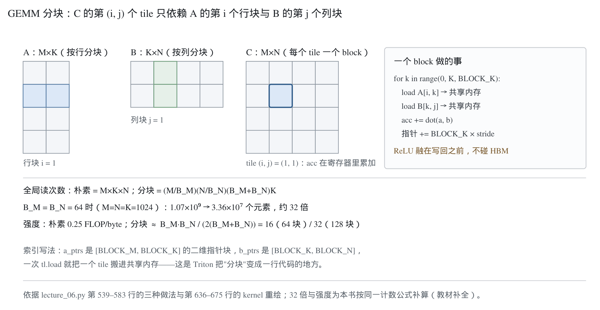

## Kernel 正确性检查

kernel 的正确性不能靠"跑一遍看着对"。给出四类检查，正好覆盖本章四个例子：

| 例子 | 检查什么 | 实现方式 |
| --- | --- | --- |
| GeLU | 与朴素实现逐元素一致 | `check_equal_1d`，`atol=1e-6` |
| softmax | 与 `torch.nn.functional.softmax` 一致 | `check_equal_2d`（$2048\times2048$） |
| 行和 | 与 `x.sum(dim=1)` 一致 | 对比 builtin 结果 |
| matmul | 与 `relu(a @ b)` 一致 | 逐 tile 的 mask 边界 |

除了跑对拍，还有三条结构性的理由必须自己说清：

1. **边界**：`mask` 覆盖了两种越界——超过张量末尾（逐元素 kernel）和超过矩阵维度（matmul 的 $M$、$N$、$K$ 三个方向）。少了任何一条，padding 出来的行会污染累加。
2. **单位元**：填充值必须是运算的单位元（加法 0、取最大 $-\infty$）。
3. **语义不变**：融合不能改变语义。比较朴素实现与编译版本时，也要检查语义是否保持不变：

这也解释了为什么所有例子都拿 PyTorch 的实现当基准：Triton 版本再快，只要与基准在 `1e-6` 内不一致就是错的。

## 本章回顾与练习

Triton kernel 将程序实例映射到网格和 tile。正确性检查、硬件同步和重复计时是性能结论成立的前提。

**练习**

1. 为长度 1000 的向量设计一个分块 GeLU kernel，标出 mask 的用途。
2. 比较 `max` 和 `sum` 归约时 padding 区域应使用的值。
3. 设计一个对照 PyTorch 参考实现的测试，并解释误差容限的含义。

# 第 7 章　并行训练 I：张量切分与通信开销

## 本章导读

多卡训练通过复制或切分张量扩展计算。选择并行方式时，要同时计算每张卡保存什么、每步通信多少，以及通信是否抵消计算收益。

学完本章后，你应能：

- 解释数据并行、FSDP/ZeRO、张量并行和流水线并行；
- 估算通信字节数与计算时间的关系；
- 根据模型状态、序列长度和互连带宽筛选并行策略。

## 多卡训练的两类需求

第 2 章算过一张卡的账：参数量乘以每参数字节数，加上优化器状态与激活，很快就会撞上 80 GB 的 HBM。第 5 章算过另一笔账：单卡算力有限，想更快只能堆卡。我们将这两件事并列成多卡训练的两个动机：

这两个动机对应两种完全不同的切法。**省显存**要求把参数或状态切开，**要速度**要求把样本或计算切开。后面所有策略都是这两件事的组合，没有第三种。

资源核算需要估计显存占用、计算时间和训练成本。单卡 kernel 优化主要减少片上与显存之间的数据传输；多卡并行则通过复制或切分张量分配计算，并引入跨设备通信。

"replication/sharding" 这两个词是全章的骨架。多卡世界里只有两种动作：**复制**（每张卡留一份）与**切分**（每张卡留一片）。而可以拿来切或复制的东西只有五样：

| 对象 | 大小（参数量记作 $P$） | 切它会怎样 |
| --- | --- | --- |
| 参数 | $P$ 个元素 | 前向时别的卡没有权重，必须临时通信补上 |
| 梯度 | $P$ 个元素 | 反向时只有本卡那份，求和必须跨卡 |
| 优化器状态 | $2P$～$4P$ 个元素（Adam 动量+方差） | 更新步骤被摊到不同卡上 |
| 激活 | $b \cdot s \cdot h$ 量级，随层数累积 | 省显存最有效，但要重算或搬运 |
| batch | $B$ 条样本 | 几乎免费，但只扩吞吐不省单卡显存 |

记住这张表，后面每一种 "-parallelism" 都只是在回答：**这五样里，我切哪几样、复制哪几样、为此每步要搬多少字节**。

## 设备互连带宽的限制

已报告的硬件层级不是背景介绍，而是全章的约束条件：

家用/经典场景作为对照：

把数字排在一起，墙的形状就出来了：

| 层级 | 范围 | 已报告的带宽 | 相对 HBM |
| --- | --- | --- | --- |
| HBM | 单卡内 | 8 TB/s | 1 |
| NVLink 5.0 + NVSwitch | 节点内 8 卡 | 1.8 TB/s | 0.22 |
| PCIe 7.0 ×16 | 卡到主机 | 242 GB/s | 0.03 |
| InfiniBand | 跨节点（pod 内 256 节点） | ≈0.05 TB/s | $6\times10^{-3}$ |
| Ethernet | 跨机架 | ≈200 MB/s | $2.5\times10^{-5}$ |

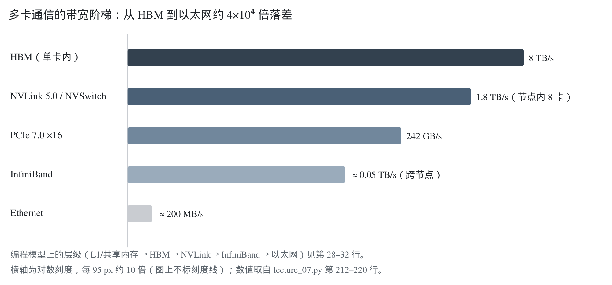

从 HBM 到以太网约 $4\times10^{4}$ 倍。这个数字解释了本章后面几乎所有的取舍：**能用节点内就不用节点间，能用点对点就不用全归约，能重叠就不用等**。

再建立一个"搬运 1 GB 要多久"的直觉（由表中数字直接相除）：

$$
t=\frac{1\ \text{GB}}{\beta}:\quad
0.125\ \text{ms}\ (\text{HBM}),\ 0.56\ \text{ms}\ (\text{NVLink}),\ 4.1\ \text{ms}\ (\text{PCIe}),\ 20\ \text{ms}\ (\text{IB}),\ 5\ \text{s}\ (\text{以太网}).
$$

千亿参数模型的梯度是 $2P=200$ GB 量级（bf16），跨节点同步一次就是秒级；而千卡规模下一次前向反向也是秒级。**通信不是"慢一点"，它是同一量级**——这是本章所有结论的物理基础。

## 集合通信的语言

多卡编程的坐标只有两个：

我们将原语分三档，并说明哪一档才是真正天天用的：

八个原语的语义与用途如下：

| 原语 | 做什么 | 单卡视角的输入 → 输出（world size = 4） | 用在哪 |
| --- | --- | --- | --- |
| broadcast | rank 0 复制给所有卡 | $[0,1,2,3]\to[0,1,2,3]$ | 加载 checkpoint 后分发 |
| scatter | rank 0 切片分给各卡 | $[0,1,2,3]\to[0]$ | 理解 reduce-scatter 的台阶 |
| gather | 各卡切片汇到 rank 0 | $[0]\to[0,1,2,3]$ | 理解 all-gather 的台阶 |
| reduce | 各卡归约到 rank 0 | $[0],[1],[2],[3]\to 6$ | 理解 all-reduce 的台阶 |
| all-gather | 每卡都拿到全部切片 | $[0]\to[0,1,2,3]$ | 前向取回被切开的参数 |
| reduce-scatter | 先按位置归约再分散 | 四行 → 每卡一列和 | 反向聚合梯度且分摊存储 |
| all-reduce | 归约结果人人一份 | 四行 → 每卡 $[6,10,14,18]$ | DP 同步梯度 |
| all-to-all | 每卡给每卡发一段 | 平衡时相当于转置 | MoE 的 token 路由 |

最重要的一条恒等式：

它不是数学趣闻，而是 FSDP/ZeRO 能成立的原因：

PyTorch 分布式接口提供 `dist.all_reduce`、`dist.reduce_scatter_tensor`、`dist.all_gather_into_tensor` 等操作；后端可按设备选择 NCCL 或 Gloo。NCCL 本身做三件事：探测拓扑、选路径、发射收发 kernel。

## 通信时间的估算

估算通信开销只需要两个量：要搬的字节数 $V$ 与链路有效带宽 $\beta$，即 $T=V/\beta$。麻烦在 $V$ 怎么算——同一份数据，环状算法下每张卡搬的量并不等于数据总大小。

以 all-reduce 为例（依据集合通信的分解方式与代码中的字节记账）。设梯度张量有 $S$ 字节、world size 为 $N$。环状 reduce-scatter 走 $N-1$ 步，每步每卡发送 $S/N$ 字节，合计 $S(N-1)/N$；随后的 all-gather 再走 $N-1$ 步，量相同。所以每卡搬

$$
V_{\text{all-reduce}}=\frac{2S(N-1)}{N}\ \text{字节},\qquad
T_{\text{all-reduce}}=\frac{2S(N-1)}{N\beta}.
$$

这个式子与 benchmark 代码采用的记账方式一致：

```python
size_bytes = data.element_size * data.numel
sent_bytes = size_bytes * 2 * (world_size - 1)  # 2x because send + receive, world_size-1 steps in all-reduce
total_duration = world_size * duration
bandwidth = sent_bytes / total_duration
```

"与 world_size 无关、与拓扑无关"这个结论值得停下来想：它说的是**有效带宽是一个硬件常数**，你无法通过换算法变出带宽。工程上能做的只有减少搬运的字节数（切分）或把搬运藏进计算（重叠）。

于是"墙"可以写成一个比例。设每步处理 $T_{\text{tok}}$ 个 token、单卡峰值 $F$ FLOPs/s、梯度 $S=2P$ 字节（bf16）。一个训练步的计算量是 $6PT_{\text{tok}}$，摊到 $N$ 张卡上：

$$
T_{\text{comp}}=\frac{6PT_{\text{tok}}}{NF},\qquad
\rho=\frac{T_{\text{comm}}}{T_{\text{comp}}}
\approx\frac{2S/\beta}{6PT_{\text{tok}}/(NF)}
=\frac{2NF}{3\beta T_{\text{tok}}}.
$$

（代入 $S=2P$，取 $N\gg1$ 时 $(N-1)/N\to1$。这个量级估算只保留主项，忽略延迟与协议开销。）

$P$ 被约掉了，这是本节最有用的一句话：**DP 的通信占比只取决于每步 token 数与卡数，与模型多大无关**。代入一组具体数字：$F=4\times10^{14}$、$\beta=5\times10^{10}$（InfiniBand）、$T_{\text{tok}}=4.19\times10^{6}$（$b=512$、$s=8192$），得

$$
N=64:\ \rho\approx8\%;\qquad N=512:\ \rho\approx65\%;\qquad \rho=1\ \text{时}\ N\approx786 .
$$

在 4M token/步的预算下，纯 DP 扩到 800 卡左右，通信时间就会追平计算时间。想再扩，只有两条路——增大每步 token 数（梯度累积），或者换一种切法（下面五节）。

这个估算只在**带宽受限**区间成立，工程上还有两个它没描述的效应（依据的测量注解）：

1. **小消息看延迟，大消息看带宽。** 上式假设 $V$ 足够大，传输时间线性于字节数。当参数被切得很碎、每层只发几 MB 时，固定延迟（kernel 启动、握手、同步）才是主项，此时"通信量小"并不等于"快"。这就是真实实现要把许多小梯度**打进一个 bucket 再一次发**的原因：把 $m$ 次小传输合并成一次，延迟只付一次。
2. **能重叠就不算墙。** 上式算的是串行时间。如果 all-reduce 能与反向计算重叠（反向是一层算完就能发一层），有效开销可以远低于 $\rho$。这也是 DDP 用 `async_op=True` 与 hook 的原因；本章的实现为了讲清楚语义，一律用 `async_op=False` 同步等待。

另外要区分两种"大 batch"：$\rho$ 里出现在分母的 $T_{\text{tok}}$ 是**每步**处理的 token 数，用梯度累积（多个 micro-step 攒一次 `optimizer.step`）就能把它变大，而显存不变。代价是每个 micro-step 都要重新做一次前向反向，但无论如何这是把 $\rho$ 压下去最便宜的手段——它不需要任何新的切分，只需要你等得起。当然 batch 也不能无限大：越过临界 batch 之后，同样的算力换来的损失下降会迅速递减 [17]，而临界 batch 本身正是第 9 章要拟合的量之一。

## DP：切 batch

最自然的切法是切数据。我们将它作为第一个完整实现：

每张卡只取自己那一段 batch，其余代码与单卡训练完全相同：

```python
local_batch_size = int_divide(batch_size, world_size)
start_index = rank * local_batch_size
end_index = start_index + local_batch_size
data = data[start_index:end_index].to(cuda_if_available(rank))
```

与单卡训练的唯一差别，是反向之后多一行梯度同步：

```python
# Sync gradients across workers (ONLY difference between standard training and DDP)
for param in params:
    dist.all_reduce(tensor=param.grad, op=dist.ReduceOp.AVG, async_op=False)
```

注意这里用的是 `ReduceOp.AVG` 而不是 `SUM`，这不是随手写的。设第 $i$ 张卡上的损失是本地 batch 的均值 $\mathcal{L}_i=\frac{1}{b}\sum_{j\in\text{local}}\ell_j$，我们想要的全局目标是全体样本的均值

$$
\mathcal{L}=\frac{1}{Nb}\sum_{i=1}^{N}\sum_{j\in\text{local}_i}\ell_j=\frac{1}{N}\sum_{i=1}^{N}\mathcal{L}_i ,
$$

即"先各卡求均值，再对各卡取平均"。若用 `SUM`，得到的是 $N$ 倍全局均值，梯度也会大 $N$ 倍，等效学习率随卡数漂移——这是把 DP 从 8 卡扩到 64 卡时最常见的一种"训练莫名发散"。

数据并行有三个主要特征：

由此可以读出 DP 的账本：

| 项 | DP 的取值 |
| --- | --- |
| 切的 | batch |
| 复制的 | 参数、梯度、优化器状态、激活（全都要一份） |
| 每步通信量 | all-reduce 梯度：$2S(N-1)/N\approx 2S=4P$ 字节 |
| 显存收益 | 零：参数量与激活都不降 |
| 能扩什么 | 吞吐（global batch 随 $N$ 线性增长） |
| 何时不适用 | 模型单卡装不下；或 batch 已到临界 batch 上限 |

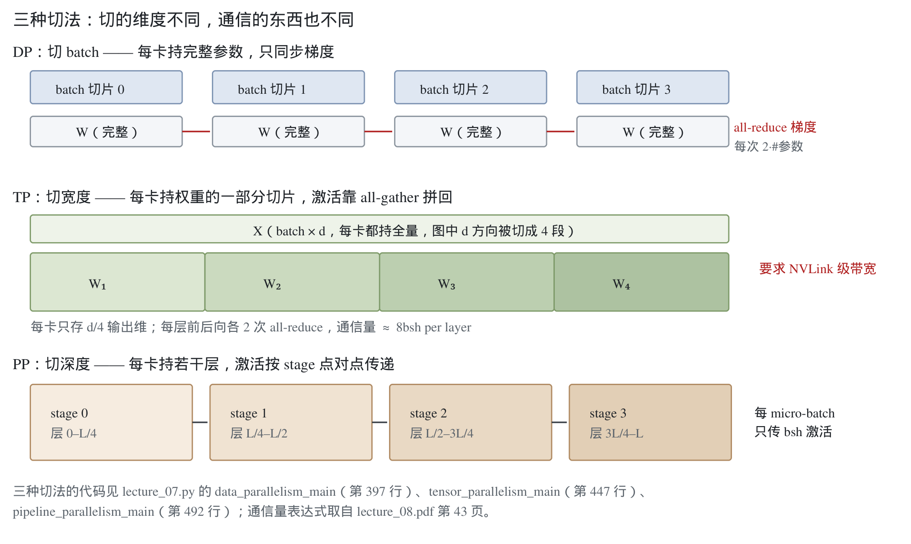

"显存收益为零"这一行是下一节的引子。DP 帮你更快，但一点也没帮你装下更大的模型：每张卡仍然持有完整的 $P$ 个参数、完整的梯度、完整的 Adam 状态。按 bf16 权重 + bf16 梯度 + fp32 主权重 + 两个 fp32 矩估计计算，每参数 16 字节；$P=70$B 时单卡需要 1120 GB，这已经远超任何一张卡。DP 的瓶颈不在通信，而在"复制"这两个字。

## FSDP/ZeRO：连状态也切开


其通信原语组合如下：

FSDP（Fully Sharded Data Parallel）与 ZeRO（Zero Redundancy Optimizer）说的是同一件事的两种实现，核心动作只有三条：

1. **参数按 rank 切开**，每卡只常驻 $P/N$；前向走到某一层时，用一次 all-gather 把该层参数临时拼齐，用完立刻释放。
2. **梯度按 rank 切开**，反向算完某层立刻 reduce-scatter，只保留自己负责的那一片，其余丢掉。
3. **优化器状态按 rank 切开**，每卡只更新自己那 $P/N$ 个参数，然后进入下一轮。

代价是多少？把一次数据并行的 all-reduce 拆成 reduce-scatter + all-gather 之后，字节数和原来一样，因此 ZeRO-1/2 的通信量与 DP 相同（$2S$）；ZeRO-3 因为前向要多做一次 all-gather，总通信量约为 DP 的 1.5 倍（$3S$）。这个"几乎免费"的结论需要一条前提——处于带宽受限区间，此时 $2S$ 已经是下界。三阶段的精确账目、以及"在 8×A100 80G 上最大能装多少参数"，第 8 章将按具体模型配置核算三阶段的通信与显存开销 [5]。

这里只需要记住判据：**DP 让训练变快，FSDP 让模型装得下；两者的通信量在同一量级，但 FSDP 用"按需取参数"换来了 $N$ 倍的显存下降**。

## TP：切宽度

如果模型连"一层都放不下"，切数据与切状态都不管用，只能切一层内部的计算。这就是张量并行。张量并行与 DP 的关键差别在于切分对象：

矩阵乘法的分块给了两种切法（标准的分块恒等式）：

$$
XW=X[W_1\ W_2\ \cdots\ W_N]=[XW_1\ XW_2\ \cdots\ XW_N],
$$

$$
XA=[X_1\ X_2\ \cdots\ X_N]\begin{bmatrix}A_1\\ A_2\\ \vdots\\ A_N\end{bmatrix}=\sum_{i=1}^{N}X_iA_i .
$$

左式是**列切**：各卡独立算出一段输出，前向不需要通信，拼起来即可（all-gather）；右式是**行切**：各卡算的是部分和，必须 all-reduce 才能得到完整结果。示例实现选的是列切，每层算完就把激活拼回来：

```python
local_num_dim = int_divide(num_dim, world_size)  # Shard `num_dim`
params = [get_init_params(num_dim, local_num_dim, rank) for layer in range(num_layers)]
...
dist.all_gather(tensor_list=activations, tensor=x, async_op=False)
x = torch.cat(activations, dim=1)
```

代价很清楚：**参数按 $N$ 切，激活按 $N$ 复制**。每个 Transformer 块有两次需要 all-reduce 的地方（attention 输出投影后、MLP 下投影后），前向两次、反向两次，每次搬 $b\cdot s\cdot h$ 字节（bf16 两字节已含在内时按 $2bsh$ 计），合计每层 $8bsh$ 量级——第 8 章将这个表达式与流水线并行的 $bsh$ 直接比较。

TP 的适用条件决定了它的工程形态：

这一行切法在 Megatron-LM 里被固定为"列切—行切"成对出现：QKV 与 up-projection 列切，attention 输出投影与 down-projection 行切，于是每个块恰好需要两次归约、且可以合并成一次通信 [18]。

NVLink 1.8 TB/s 对 InfiniBand 0.05 TB/s，差 36 倍；而 TP 的通信量又比 PP 大 8 倍（每层比每 micro-batch）。两个因子相乘，就是"TP 只在节点内做、且一般不超过 8 卡"的全部理由。

TP 还有一个别处没有的优点：**没有气泡**。所有卡在每一层都同时干活，利用率不随 $N$ 下降——这是它敢用昂贵带宽的底气。

## PP：切深度

第三种切法沿层数切：每张卡拿一段连续的层，激活像接力一样往下传。

如果每张卡一次只处理一个完整 batch，$N$ 段流水线上同时只有一段在算，利用率是 $1/N$——此时每张卡只有约 $1/n$ 的时间在工作。修法是**把 batch 切成 micro-batch**，让不同段同时处理不同的 micro-batch：

```python
micro_batch_size = int_divide(batch_size, num_micro_batches)
if rank == 0:
    micro_batches = data.chunk(chunks=num_micro_batches, dim=0)
...
if rank - 1 >= 0:
    dist.recv(tensor=x, src=rank - 1)     # 等上一段的激活
for param in local_params:                # 只算自己这段层
    x = x @ param
    x = F.gelu(x)
if rank + 1 < world_size:
    dist.send(tensor=x, dst=rank + 1)     # 交给下一段
```

流水线的代价是一个**填不满的三角形**：开头 $N-1$ 个时间片里，后面的段在等数据；结尾 $N-1$ 个时间片里，前面的段已经没活干。气泡占的比例是

$$
\text{bubble}=\frac{n_{\text{stages}}-1}{n_{\text{micro}}},
$$

代入 $n_{\text{stages}}=8$ 就明白为什么：要气泡低于 10%，需要至少 71 个 micro-batch；如果每 micro-batch 装 8 条样本，global batch 就得 568 起步。这种"先填满、再排空"的调度就是 GPipe 引入的 micro-batch 流水线 [19]。

也如实说明了它没做完的部分：

这行注释很重要：本章的流水线实现是**串行**的（算完再发、收到再算），所以它演示的是语义而非性能。真正的 PP 实现会把发送与下一段计算重叠，气泡与重叠的量化是第 8 章的主题。

PP 的经济性来自它的通信量：每传一个 micro-batch 只搬一份激活 $bsh$，与层数无关，而且是**点对点**而非全归约。所以这意味着它可以跑在慢链路上：

## 70B 模型的四种并行配置估算

在把四种策略拼起来之前，先把同一笔账算完。激活值只能在重算、存储和搬运之间取舍：

也就是说，显存不够时只有三种换法：**重算**（不存激活，反向时重做前向，用算力换显存）、**存**（多买显存，用钱换通信）、**搬**（放在别的卡上，用通信换显存）。四种并行策略全部落在"搬"这一支里，区别只在搬什么、走哪条链路 [20]。

统一设定：$P=70$B、bf16 通信、$L=80$ 层、$h=8192$、$s=8192$、micro-batch $b=8$，DP/FSDP 取 $N=64$，TP/PP 取组内 $N=8$。梯度字节数 $S=2P=1.4\times10^{11}$。

| 策略 | 每步通信字节（推导） | 链路 | 时间 |
| --- | --- | --- | --- |
| DP（64 卡） | $2S(N-1)/N=2.76\times10^{11}$ B ≈ 276 GB | IB 0.05 TB/s | 5.5 s |
| FSDP/ZeRO-3（64 卡） | $3S(N-1)/N=4.13\times10^{11}$ B ≈ 413 GB | IB 0.05 TB/s | 8.3 s |
| TP（8 卡） | 每层 $8bsh=4.3\times10^{9}$ 元素 ≈ 8.6 GB，乘 80 层 ≈ 687 GB | NVLink 1.8 TB/s | 0.38 s |
| PP（8 段） | 每 micro-batch $bsh=5.4\times10^{8}$ 元素 ≈ 1.07 GB，乘 8 ≈ 8.6 GB | IB 0.05 TB/s | 0.17 s |

三句话读完这张表：

1. **TP 字节数最多**（是 DP 的 2.5 倍），**时间却最短**——因为它在 NVLink 上。带宽差 36 倍、字节差 2.5 倍，净快约 14 倍。这解释了为什么"TP 通信量大"不是缺点，而"TP 跑在 IB 上"才是灾难。
2. **PP 最省字节**。它每个 micro-batch 只搬一次激活，与层数、参数量都无关；一句话，它搬的是 $bsh$ 而不是 $P$。所以 PP 天生适合跨节点。
3. **DP/FSDP 的字节数正比于参数量、与 batch 无关**。正因为与 batch 无关，它只能靠"把 batch 做大"来摊薄——这就是上一节 $\rho$ 里 $T_{\text{tok}}$ 出现在分母的意思。

这张表也解释了真实系统的形态：TP 与 PP 各自解决"一层装不下"和"模型装不下"，而它们一个吃带宽、一个吃 batch，恰好互补。把它们和 DP 拼在一起，就是第 8 章的主题 [21]。

## 并行策略的选择依据

四种策略其实是三个维度的切分加上一个"连状态也切"的加强版。把账本并排放在一起，判据就自己浮现了：

| 策略 | 切 | 复制 | 每步通信量 | 带宽要求 | 显存收益 | 能否扩 global batch |
| --- | --- | --- | --- | --- | --- | --- |
| DP | batch | 参数/梯度/状态/激活 | $2S\approx4P$ 字节（all-reduce） | 中 | 无 | 能，随 $N$ 线性 |
| FSDP/ZeRO-3 | batch + 参数/梯度/状态 | 激活 | $3S\approx6P$ 字节（AG+RS+AG） | 中～高 | 参数与状态降 $N$ 倍 | 能 |
| TP | 宽度（每层内） | 激活、部分权重 | 每层 $8bsh$（all-reduce ×4） | 极高（NVLink） | 权重降 $N$ 倍 | 不能 |
| PP | 深度（层） | 其余层的激活缓冲 | 每 micro-batch $bsh$（点对点） | 低 | 权重与激活都降 $N$ 倍 | 不能，且需大 batch 填气泡 |

四条判据按顺序问下来即可：

1. **单卡装得下吗？** 装得下就别并行参数，直接 DP 或 FSDP-1，通信量最小。
2. **一层装得下吗？** 装得下就优先 PP 跨节点（用便宜带宽），TP 留在节点内。
3. **带宽够不够？** 节点内 NVLink 才考虑 TP；跨节点走 PP 或 FSDP。
4. **batch 够不够大？** PP 需要足够多的 micro-batch 压气泡；batch 上不去时，PP 的收益会被气泡吃掉。

第 8 章将具体配置概括为先把 TP/EP 扩展到节点上限，再跨机扩展 PP，最后用 DP 填满设备，并用真实模型的并行布局验证。这些策略有一个共同的取舍：**没有一种并行是免费的，每一种都在用通信换显存或换速度；判断标准永远是"这次交换的字节数除以带宽，是否小于它省下的时间"**。

四个常见的误判，每一个都能用上面的账本反驳：

- **"TP 通信量比 DP 大，所以 TP 更差。"** 字节数大 2.5 倍，但链路快 36 倍，净快 14 倍。比较的是时间，不是字节。
- **"DP 是免费的。"** 它在显存上收益为零，而且 $\rho$ 随卡数线性增长；扩到一定规模，all-reduce 会吃掉三分之一以上的步时。
- **"PP 可以随便用。"** 气泡是 $(n_{\text{stages}}-1)/n_{\text{micro}}$，batch 上不去时 8 段流水线的利用率可以掉到 50% 以下。
- **"FSDP 通信贵很多。"** ZeRO-3 是 DP 的 1.5 倍字节，而不是数量级；换来的是参数、梯度、状态三项都降 $N$ 倍。

## 本章回顾与练习

并行训练策略的核心是决定哪些张量复制、哪些张量切分。切分能降低单卡状态占用，却会引入不同形式的通信和同步。

**练习**

1. 画出 DP、TP、PP 各自切分模型或数据的方向。
2. 用给定梯度大小与互连带宽估算一次 all-reduce 的通信时间下界。
3. 一个模型状态超出单卡显存但计算时间充足，应优先比较哪些策略？说明判断依据。

# 第 8 章　并行训练 II：组合、气泡与显存账

## 本章导读

实际训练通常组合多种并行方式。组合之后，显存占用、通信路径和流水线气泡会相互影响，必须按完整训练步核算。

学完本章后，你应能：

- 估算组合策略下的每卡显存与气泡比例；
- 说明序列并行和专家并行分别切分什么；
- 比较不同训练阶段的并行布局。

## 数据并行的三个限制

第 7 章把四种切法各自的账算完了，但真实训练不会只用一种。本章的任务是回答"为什么人们同时用好几种"，而起点是数据并行的三个缺口。先核算朴素 DP 的显存占用：

三句话分别是好消息、可接受、坏消息。计算随卡数线性增长；通信量正比于参数量、与 batch 无关，所以只要 batch 足够大就能摊薄；但**显存一点也没省**。后两条缺口又各自展开：

于是问题被切成三块，本章的三种模型并行正好对应三块：

此外，给了一句提纲挈领的判别：模型并行与 ZeRO-3 都切参数，差别在**通信的是什么**——ZeRO-3 传参数，模型并行传激活。

## 显存占用：每参数字节数与状态复制

要谈"省显存"，先得知道显存花在哪。我们将这笔账算到字节：

五份复制、每参数 16 字节。$P$ 个参数的单卡需求就是

$$
M_{\text{static}}=P\,(2+2+4+4+4)=16P\ \text{字节},
$$

70B 模型对应 1.12 TB。注意其中前三项（参数、梯度、主权重）是**必须**的，后两项（两个矩估计）才是 Adam 特有的——这就是为什么换优化器（如 Adafactor、Muon）能省显存，但省不到零。优化器状态占其中的 $8/16$，也就是一半。

这里的 16 B 按 fp32 优化器状态计算；若状态也用 bf16，可以降到 12 B。这个细节在本章后面会决定"到底能装多大"，但这个结论有一个前提：

也就是说，把动量与方差降到 bf16 之所以可行，靠的是 Kahan 补偿求和——否则上万步的累加会在低位上悄悄丢精度。省下的 4 字节不是白拿的，它用一个数值技巧换来。

## ZeRO：把状态也切开

ZeRO 的想法一句话说完：

三级是逐层加码的。**第一级只切优化器状态**：

执行四步：各卡先在自己的数据上算出完整梯度；一次 reduce-scatter 把梯度按切片聚合（通信量 $P$）；每卡用自己那份状态更新自己负责的参数；再一次 all-gather 把参数拼回完整（通信量 $P$）。合计 $2P$，与朴素 DDP 的一次 all-reduce（$2P$）**完全相等**。我们将这一点做成了一张对照表：

| 项目 | 朴素 DDP | ZeRO stage 1 |
| --- | --- | --- |
| 通信原语 | 一次 all-reduce（梯度） | 一次 reduce-scatter + 一次 all-gather |
| 通信量 | $2P$ | $2P$ |
| 显存 | $(4+K)\cdot P$ | $(4+K/N_{\text{gpu}})\cdot P$ |

"free" 这个词是有条件的：只有在带宽受限区间（消息足够大、延迟可忽略）里，$2P$ 才是下界，此时换一种走法不额外花钱。第 7 章推导过的 $2S(N-1)/N$ 正是这个下界的具体形式。

**第二级再切梯度**。麻烦在于"数据并行意味着每张卡都要算出完整梯度"，所以不能简单地只存一片；做法是把通信**增量化**：反向逐层进行，某层梯度一算完立刻 reduce 给负责该片的卡，然后立即释放这块显存。我们将这称为"incremental communication/computation"，它同时也是后面 FSDP 能工作的关键技巧。

**第三级连参数都切**。前向走到某层时 all-gather 该层参数、用完即弃；反向先 all-gather 一次拿回参数算梯度，再 reduce-scatter 把梯度送走。通信量因此变成

$$
V_{\text{ZeRO-3}}=2P\ (\text{前向 AG})+P\ (\text{反向 RS})+P\ (\text{反向重算 AG})\ \approx 3P .
$$

三级之间的关系可以一句话概括：**ZeRO-1 免费，ZeRO-2 近乎免费，ZeRO-3 贵 50%，但只有它让"能装的模型"随卡数线性增长**。这也正是我们将 ZeRO-3 与 FSDP 视为同义词的原因 [5]。

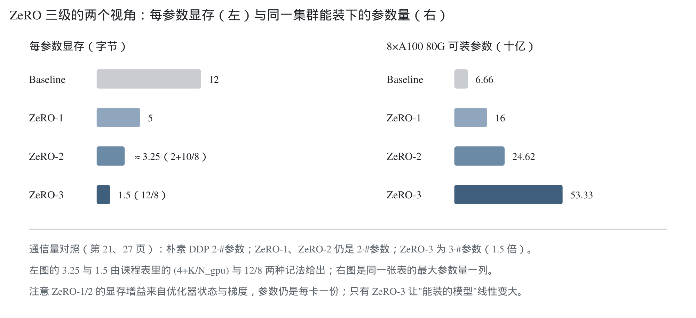

工程中还常用工程上最有用的那张表：在 8×A100 80G 上，纯 bf16（权重与状态都用 bf16、主权重保留 fp32）时每参数 12 字节，于是

| 方案 | 每参数字节 | 最大参数量 |
| --- | --- | --- |
| Baseline（无分片） | 12 | 6.66 B |
| ZeRO-1 | 5 | 16 B |
| ZeRO-2 | $2+10/8\approx3.25$ | 24.62 B |
| ZeRO-3 | $12/8=1.5$ | 53.33 B |

读法：8 卡 × 80 GB = 640 GB 总显存，Baseline 只能装 6.66B 参数（因为参数、梯度、状态各留一份），ZeRO-3 能装 53.33B（因为三项都按 8 分）。从 6.66 到 53.33 正好是 8 倍——**分片把"单卡容量"变成了"集群容量"**。

## 流水线：气泡与它的价格

按层切是最直观的模型并行，也是最差的：一次只算一个完整 batch 时，同一时刻只有一段流水线在干活。

修法是把 batch 切成 micro-batch，让各段错峰。报告显示了气泡的定量形式：

也给出了它的两个优点，这两条才是流水线至今仍在用的理由：

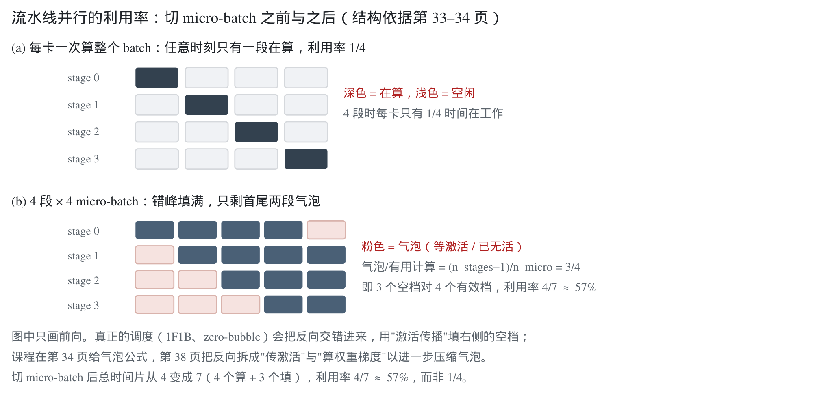

把这两句翻译成代价：每传一个 micro-batch 只搬 $bsh$ 字节，与参数量 $P$、层数 $L$ 都无关；而且是点对点，不是全归约。第 7 章那张 70B 的账里，PP 是四种策略中通信字节最少的（8.6 GB vs DP 的 276 GB），代价是气泡。所以我们将 PP 定位成"跨节点的省显存手段"，而把 TP 留给节点内：

流水线气泡对 batch 大小非常敏感。以 8 段流水线为例：

| micro-batch 数 | 气泡/有用计算 | 理想利用率 |
| --- | --- | --- |
| 8 | 7/8 = 0.875 | 53% |
| 16 | 7/16 = 0.44 | 70% |
| 32 | 7/32 = 0.22 | 82% |
| 64 | 7/64 = 0.11 | 90% |

（利用率 = $n_{\text{micro}}/(n_{\text{micro}}+n_{\text{stages}}-1)$，其中气泡/有效计算比可记为 $r=(n_{\text{stages}}-1)/n_{\text{micro}}$，因此利用率也可写成 $u=1/(1+r)$。）

要把气泡再压下去，就得改调度。此外， zero-bubble 的思路：反向其实包含两件可以解耦的事，

也就是说，权重的梯度计算不依赖后续层的激活，可以挪到任何空档里做，从而把气泡填满。这类调度的代价是实现复杂度陡增，收益是把利用率从 ~80% 推到接近 100%——是否值得，取决于你的 batch 能不能撑起足够多的 micro-batch。相关的标准调度（GPipe 的 fill-drain、1F1B）见 [19]。

## 张量并行：f 与 g 的分工

沿宽度切需要一点线性代数。矩阵乘可以按子块拆开再相加，于是一层线性变换可以被看成两个算子 $f$ 与 $g$ 的组合，而它们的身份在前向与反向之间恰好互换：

这句话是张量并行的全部精髓：**一次通信在正向和反向各被"用"了一次**，所以每个块只需要一个 all-reduce，而不是两个。落到 Transformer 上，切哪儿是固定的：

之所以能这么配，是因为"列切 → 行切"成对出现时，中间那一步的部分和正好可以在下一个算子处合并，整块只需一次归约 [18]。这也解释了为什么 $f$/$g$ 的分析值得单独讲：切错位置会多出一倍通信。

代价与收益并排：

| 维度 | 流水线并行 | 张量并行 |
| --- | --- | --- |
| 气泡 | 有，$(n_{\text{stages}}-1)/n_{\text{micro}}$ | 无 |
| 每单位通信量 | $bsh$（点对点，每 micro-batch） | $8bsh\cdot\frac{n-1}{n}$（每层，all-reduce） |
| 对带宽要求 | 低 | 极高 |
| 对 batch 要求 | 需要大 batch | 不需要 |

"大 8 倍还要多"的量级差异，加上第 7 章那条 36 倍的带宽差，共同锁死了 TP 的位置：

## 激活显存与重算

训练显存不只由参数决定，激活还会随 batch 大小和序列长度增长。Korthikanti 等（2022）给出了逐层核算方法：

也就是说，每层激活 = 线性项（正比于 $s$）+ 二次项 $5as^2h$（attention 的 $s^2$ 个分数矩阵及其掩码）。二次项可以靠**重算**丢掉：反向时不读存下来的 attention 矩阵，而是用存下的少量输入重算一遍（这正是第 6 章 FlashAttention 的副产品）。丢掉二次项之后，剩下的是

$$
M_{\text{act per layer}}=10sbh ,
$$

这是全章最容易被忽略的一句话：即使把参数切到每卡一份，这 $10sbh$ 的**逐点项**仍然不随卡数下降。$s=8192$、$h=8192$、每卡 $b=1$ 时，每层就要 0.67 GB（bf16），80 层就是 53 GB——正好吃掉一张 80 GB 卡。所以"参数切完还是 OOM"是常态，原因就在这里。

## 序列并行：把最后 10sbh 也切开

$10sbh$ 里没有任何一项依赖"完整的 $s$"，它们全是逐点运算——LayerNorm、Dropout、残差相加。既然逐点，就可以沿序列维切开：

注意这里的通信方向与 TP 正好互补：TP 在"宽度"上做 all-reduce，SP 在"序列"上做 all-gather（前向）。两者拼起来，一个 Transformer 块的每层激活就从 $10sbh$ 变成 $10sbh/n$：

$$
M_{\text{act}}=\frac{L\cdot 10sbh}{n_{\text{TP}}\cdot n_{\text{SP}}}+O(s^2)\ \text{（若重算则二次项消失）}.
$$

将三者叠加后，TP 切矩阵乘、SP 切逐点、重算去二次项，三者合起来得到"激活显存也随机器数线性下降"的完整版本。这就是为什么现代框架里 TP 与 SP 总是成对出现——只做 TP 会留下一块不缩的显存，训练照样 OOM。

## 专家并行

MoE 把 FFN 换成多个专家，于是有了第四种切法：不切矩阵，切专家。

行为上它像 TP（吃带宽、降激活显存），但实现上是 all-to-all 而不是 all-reduce：

组合并行策略时，必须同时核算各维度之间的约束：

"EP < DP"EP 组内各卡拿到的是**不同的 token**，所以这已经承担了一部分数据并行的职责；如果 DP 再独立复制，就等于把同一批 token 算了两遍。这也是后面规则里"DP 填满剩余卡"必须排在 EP 之后的原因 [22] [23]。

## 组合成 3D

把上面几种乘起来，一个集群的总卡数是各维度的乘积：

$$
n_{\text{total}}=n_{\text{TP}}\cdot n_{\text{PP}}\cdot n_{\text{DP}}\cdot n_{\text{EP}}\cdot n_{\text{CP}} .
$$

已报告的经验规则按"先装下、再加速"两步走：

这条规则背后的逻辑与第 7 章的账本完全一致：节点内带宽最高，所以把最吃带宽的 TP/EP 限制在节点内；跨节点带宽低，所以放通信量最小的 PP；剩下的卡用 DP 填满，因为 DP 的通信量只与参数量有关、可以用大 batch 摊薄。

此外，用 Megatron 的实际配置验证了两条经验：TP 一般在 8 卡封顶，64 机规模下 8×8 是最优配置；DP 随总规模增大而**递减**（Narayanan 2021 的曲线里最大模型只剩 DP=6）。这解释了一个常见困惑：为什么大模型训练不是"多买卡就多开 DP"——卡越多，DP 反而越少，省下来的维度都给了 TP/PP/EP。

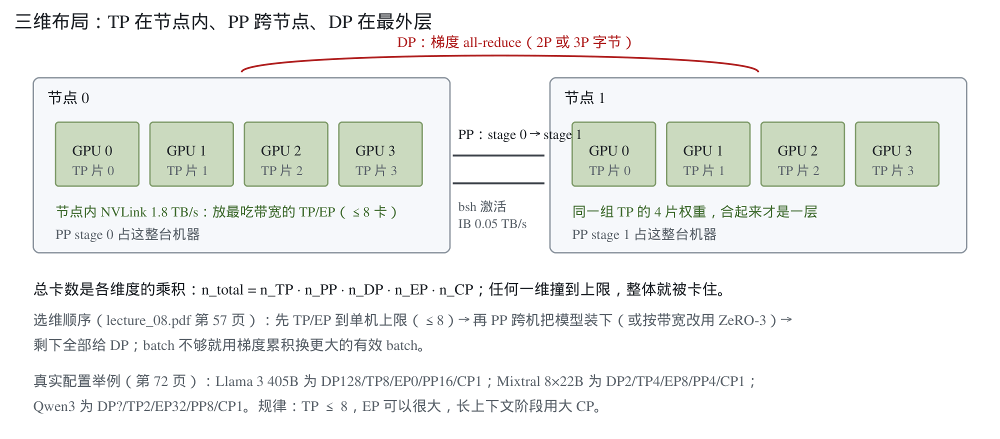

三个维度的乘积意味着**任何一个维度的上限都会卡住整体**：TP 卡在 8、PP 卡在气泡、DP 卡在 batch，所以真实配置总是某一维接近上限、另一维留有余量。Megatron 进一步按模块选择并行维度：attention 用 TP/CP/DP，MLP 用 ETP/EP/EDP，两套维度分开配。

最后一项工程取舍是重算换 batch：

用 33% 的额外计算换掉激活显存，从而把 batch 做大、把 TP/PP 的气泡与通信摊薄，净收益为正——这是一个典型的"用算力买带宽"的例子，与第 7 章那三条换法（重算 / 存 / 搬）闭合 [20]。

## 全策略对照

六种并行策略的通信、显存和适用范围如下：

| 方法 | 通信/同步 | 每卡参数显存 | 每卡激活/KV 显存 | 主要带宽成本 | 能否扩 global batch | 上手难度 |
| --- | --- | --- | --- | --- | --- | --- |
| DDP / ZeRO-1 | 每步梯度 all-reduce | 不降（ZeRO-1 只降优化器状态） | 不降 | 梯度流量 $\sim O(P)$ | 能，随 DP 线性 | 很容易 |
| FSDP / ZeRO-3 | 梯度 all-reduce，可重叠 | 参数/梯度/状态约 $1/n_{\text{DP}}$ | 不降 | 参数流量 $\sim O(P)$，高于 DDP，可重叠 | 能，随 DP 线性 | 中等 |
| 流水线并行 | 层间激活 + 气泡 | 约 $1/n_{\text{PP}}$ | 取决于缓冲的 micro-batch 数 | 阶段间激活流量 | 不能，且需要 micro-batch | 难 |
| 张量并行 | 阻塞式激活通信 | 被切权重约 $1/n_{\text{TP}}$ | 配合 SP 后约 $1/n_{\text{TP}}$ | 每个块一次激活规模的集合通信 | 不能 | 难 |
| 序列/上下文并行 | 每层交换序列分片 | 不降 | 约 $1/n_{\text{SP}}$ 或 $1/n_{\text{CP}}$ | 激活/KV 通信 | 不能 | 难 |
| 专家并行（MoE） | 每个 MoE 层 token 分发 all-to-all | 仅专家权重约 $1/n_{\text{EP}}$ | 不降 | token 路由 all-to-all | 不能，但需要每个专家有足够 token | 难 |

读这张表要抓住三件事。第一，**只有 DP 与 FSDP 能扩 global batch**，其余四种都只解决"装不下"，不解决"更快"——它们甚至要求你本来就有大 batch。第二，**"每卡参数显存"一列里只有 FSDP、PP、TP、EP 有分数**，而"激活/KV"一列只有 PP、TP+SP、SP/CP 有分数；两张列一交叉，就知道你的 OOM 到底该由谁来救。第三，**上手难度与通信量同向**：越难的方案通信越碎、越依赖拓扑，所以工程上总是在"先用容易的顶到上限，再上难的"。

还有一个隐蔽的对称性：TP 与 SP 在这张表里各占一行，但它们在实现里必须成对出现——TP 单独用会留下一块不随卡数下降的 $10sbh$（上一节），SP 单独用则没有矩阵乘可切。我们将二者合称 "MP (= TP + SP)"（对 Gemma 2 的描述），正是这个原因。

## 真实系统怎么配

不同模型需要不同的并行配置，布局要随模型结构和训练阶段调整。

| 模型 | DP | TP/SP | EP | PP | CP | 备注 |
| --- | --- | --- | --- | --- | --- | --- |
| Llama 3 405B | 128 | 8 | 0 | 16 | 1 | 三阶段：小 batch、预训练、长上下文 |
| Gemma 2（2/9/27B） | 768 | 8 | 0 | 0 | 0 | ZeRO-3 + MP + DP |
| Mixtral 8×22B | 2 | 4 | 8 | 4 | 1 | Megatron 文档给出的 TP/PP/CP/EP |
| Nemotron 3 120B（长上下文） | — | 2 | 64 | — | 64 | 长上下文阶段 CP 很大 |
| Qwen3（225B-A22B） | — | 2 | 32 | 8 | 1 | 小模型阶段 EP 到 8 卡 |

| 训练案例 | 并行布局 | 选择依据 |
| --- | --- | --- |
| Dolma 7B | FSDP | 7B 模型可放入 8 张卡，DP 与 FSDP 已足够，不需要模型并行。 |
| DeepSeek-V3 | ZeRO-1、TP/SP、PP(16)、EP(64，跨 8 节点) | EP 的 all-to-all 与 1F1B 重叠；MoE 专家占多数参数时，切专家比切矩阵更省通信。 |
| Yi / Yi-lightning | ZeRO-1、TP、PP；稀疏版改用 EP | 从稠密换为稀疏后，并行布局也随模型结构调整。 |
| Llama 3 405B | DP128 / TP8 / PP16 / CP1，分三个训练阶段调整 | 小 batch、预训练和长上下文阶段使用不同布局。 |
| Gemma 2 | ZeRO-3、MP(TP+SP)、DP；DP=768 | 模型相对集群较小，更多设备用于提高吞吐。 |
| Nemotron 3 Super 120B-A12B（长上下文） | TP/PP/CP/EP = 2/0/64/64 | 此配置用 CP 与 EP 处理长序列，未使用 PP。 |
| Qwen3 | 小模型阶段 EP 到 8 卡；大模型布局为 2/8/32 | 先按节点上限安排 EP，再分配 PP 与 DP。 |

这些配置显示，TP 通常不超过 8，EP 可扩至 64 但需要与 all-to-all 重叠；长上下文阶段会采用更大的 CP。并行度会随模型结构和训练阶段变化。

大规模训练还要考虑 GPU 故障。Llama 3 405B 的训练记录显示此类故障会发生，因而并行布局需要预留冗余。
## 四个反直觉点

分析并行配置时，有四个判断尤其容易出错：

1. **"ZeRO-1 有开销，等缺显存再开。"** 它是 $2P$ 对 $2P$，带宽受限区间内完全免费；代价只是实现上多一次 reduce-scatter 与一次 all-gather，而不是更多字节。在带宽受限条件下，这种分片方式不增加通信字节；是否默认启用仍取决于实现复杂度。
2. **"卡越多，DP 越大。"** 恰恰相反：Narayanan 2021 的曲线里 DP 从 32 一路降到 6，因为多出来的卡要分给 TP/PP/EP 去解决"装不下"，而 DP 只解决"更快"。一旦 batch 被临界 batch 卡住，继续加 DP 的边际收益也趋零。
3. **"重算是浪费算力。"** 它用约 33% 的额外前向换掉 $5as^2h$ 的二次项显存，换来更大的 batch 与更小的气泡，额外计算可能被显存节省带来的收益抵消。在带宽受限的系统里，用算力换显存几乎总是划算的——因为算力涨得比带宽快。
4. **"TP 通信量最大，所以最差。"** 它是唯一没有气泡的方案，而且通信落在 NVLink 域内。真正致命的不是"通信多"，而是"通信多还跑在慢链路上"。

此外：更激进的流水线模式（让不同 stage 交错处理更多 micro-batch）确实能提高利用率，但，但会增加带宽开销；利用率与带宽是一对可以互相兑换的量，不存在同时变好的调度。这与第 7 章的三选一（重算 / 存 / 搬）是同一件事的两种说法。

## 本章回顾与练习

组合并行需要同时计算切分收益与通信代价。流水线微批数量影响气泡，序列和专家并行则分别针对不同维度的负载。

**练习**

1. 给定流水线阶段数和微批数，计算理想流水线利用率。
2. 解释 ZeRO-1、2、3 分别切分哪些状态。
3. 设计一组 TP、PP、DP 的乘积分解，使其等于设备总数，并列出还需测量的指标。

# 第 9 章　Scaling Laws I：幂律、拟合变量与单位

## 本章导读

计算预算固定时，模型规模和训练数据量不能独立增加。缩放律把这种取舍写成可拟合的函数，但拟合区间和计量口径决定结论能否使用。

学完本章后，你应能：

- 解释幂律的指数和拟合变量；
- 用 IsoFLOP 思路寻找预算下的模型规模；
- 检查单位、残差和外推边界。

## 模型规模与数据规模的配置问题

固定算力预算下，模型规模与训练 token 数需要共同选择：

"哪一个大"不是修辞问题。给定一个固定的算力预算，模型越大则能喂的 token 越少，模型越小则训练得更充分；两者之间存在一个最优点，而这个点无法靠直觉猜。选错模型规模会直接增加损失：

Cargo cult 的意思是"照抄成功者的形状，却不知道为什么"。缩放律提供的替代方案是：**在小规模上测几条曲线，把曲线拟合出函数形式，再用它预测大规模**。

注意"over"那个问号。使用这套方法时仍需谨慎，本章后面会用两个反例（指数口径之争、下游不可预测）把这份谨慎落实。所以本章的目标不是"越大约好"，而是**读懂一个拟合出来的式子，知道它的每个符号量的是什么、单位是什么、能外推到哪**。

## 幂律：把指数读成斜率

在一定模型、数据与训练范围内，经验缩放关系常可用幂律近似描述。

当不可约损失项 $C$ 可忽略时，幂律关系在双对数坐标下呈线性：

$$
L(D)=A D^{-\alpha}+C ,
$$

其中 $D$ 是训练数据量、$\alpha$ 是指数、$C$ 是不可约损失。两边取对数（在 $C$ 可忽略的区间）：

$$
\log L=\log A-\alpha\log D ,
$$

于是**斜率就是 $-\alpha$，截距就是 $\log A$**。这就是"拟合缩放律"最朴素的操作：在双对数坐标下画点、做最小二乘、读斜率。

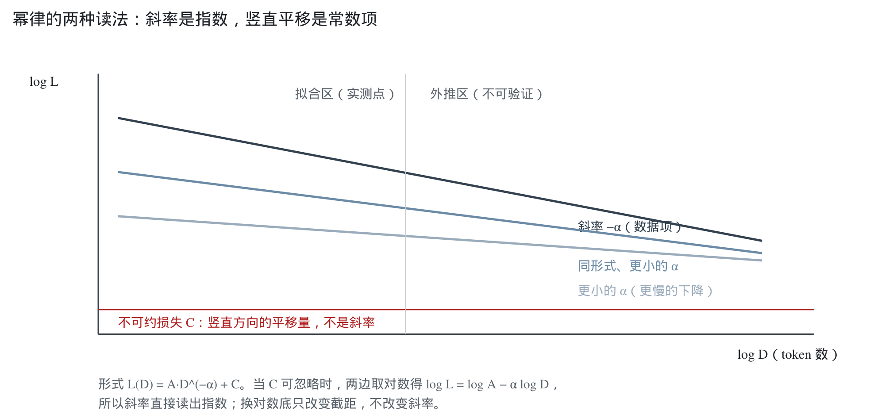

三个容易混淆的点，先说清楚：

1. **底数无关**。换 $\ln$、$\log_{10}$、$\log_2$ 只改变截距，不改变斜率。所以"指数是多少"与"用什么底"无关，而"常数 $A$ 是多少"必须连同底一起报告。
2. **$C$ 是平移，不是斜率**。$C$ 存在时曲线在高数据量处会向下弯、趋于平台；此时用低数据量区的直线外推会**低估**损失（因为真实曲线被 $C$ 托住了）。所以"不可约损失"必须显式建模，否则拟合出的 $\alpha$ 会偏大。
3. **"线性"是经验观察，不是定理。**

"下界"这个定位很关键：缩放律描述的是**按当前配方能做到的水平**，不是物理极限。数据质量、架构改动、训练技巧都能把整条曲线往下压——这也是为什么第 13、14 章（数据）与第 4 章（架构）能各自独立地改善结果。

## 幂律关系的两个简化推导

幂律可以从简单的统计估计中得到。先看样本均值：

设 $x_1,\dots,x_n\sim\mathcal{N}(\mu,\sigma^2)$，用样本均值 $\hat\mu=\frac{1}{n}\sum_i x_i$ 估计 $\mu$。由标准结论

$$
\mathbb{E}\left[(\hat\mu-\mu)^2\right]=\frac{\sigma^2}{n}.
$$

两边取对数：

$$
\log \mathbb{E}\left[(\hat\mu-\mu)^2\right]=-\log n+2\log\sigma .
$$

这正是"斜率 $-1$、截距 $2\log\sigma$"的缩放律。由此可以推广为："More generally, any polynomial rate $1/n^{\alpha}$ is a scaling law"——换句话说，缩放律不是一个新理论，而是把"误差以多项式速率下降"这件事画在双对数坐标上。

第二个玩具解释了为什么指数**不是** $1$：

在 $d$ 维空间里做非参数估计，误差按 $n^{-1/d}$ 下降。$d=2$ 时斜率是 $-1/2$，$d=10$ 时是 $-1/10$。因此，误差指数与数据的内在维度有关：

于是"神经网络的指数为什么不是古典的 $1$"有了一个候选答案：数据的内在维度大于 1。不过，这种解释仍只是候选假设：

目前还缺少能够可靠预测指数 $\alpha$ 的第一性原理。实际研究通常需要通过实验估计它，并报告数据范围、模型配置和拟合方法。拟合过程包含统计建模，也包含工程选择。

## 从数据到联合：两项之和

单独的数据缩放律不够用，因为真正的决策是"数据多一点还是模型大一点"。报告显示了两个联合形式，先看可加的那个：

Kaplan 的形式将数据项与模型项耦合到同一个幂函数中：

$$
L(N,D)=\left[\left(\frac{N_c}{N}\right)^{\alpha_N/\alpha_D}+\frac{D_c}{D}\right]^{\alpha_D},
$$

其中 $N$ 是非 embedding 参数量、$D$ 是 token 数、$N_c,D_c$ 是常数（依据 Kaplan 等 2020 的式 (2)；只给了缩写形式）[24]。

两种形式都能拟合得不错，这是本领域一个反复出现的现象：**函数形式的选择会影响参数的数值，但不影响"存在幂律"这个定性结论**。这说明联合误差可以用该形式较好拟合，但不意味着拟合形式具有唯一性。

要把联合律变成"该选多大的模型"，还需要一个约束：算力。标准近似是

$$
C\approx 6ND\ \text{FLOPs},
$$

即每个参数每个 token 前向 2 次、反向 4 次乘加（；这个 $6ND$ 的口径在第 2 章已建立，也是常用的训练计算量估算方式 [24]）。有了它，"在固定 $C$ 下最小化 $L(N,D)$"就变成一个单变量优化问题：

$$
\min_{N}\ L\left(N,\frac{C}{6N}\right)\quad\Longrightarrow\quad N_{\text{opt}}\propto C^{a},\ D_{\text{opt}}\propto C^{b},\ a+b=1 .
$$

采用的两组数正是这个问题的两个答案：

$$
\text{Kaplan：}N_{\text{opt}}\propto C^{0.73},\quad D_{\text{opt}}\propto C^{0.27}.
$$

$0.73+0.27=1$ 不是巧合，而是约束的直接后果：在 $C=6ND$ 下，两个指数必然相加为 1。这一点在核对任何"最优缩放"结论时都用得上——如果某篇报告的指数和不是 1，那它衡量的不是同一件事。

## 数据侧的三类缩放问题

"数据量与损失"只是数据侧最基本的一条。还需考虑三类相关问题，它们的共同点是：**答案会随规模变化，所以不能在小规模上一次定死**。

第一类是**配比**。采用的结论很干脆：

配比改变截距而不改变斜率，意味着"更好的配比"是把整条曲线往下平移，而不是让下降更快。这有个直接推论：**配比的收益不会随规模放大**，所以用小模型比较配比是有效的；但反过来，"斜率类"的改进（架构、优化器）在小模型上的收益会被规模放大，不能等比例外推。

第二类是**重复**。给出有效数据 $D'$ 与重复率 $R_d$、临界重复次数 $R_d^*$ 的定义；的结论是重复的边际价值递减，且

第三类是**有限性**：当高质量语料被用完，你只能在"重复高质量数据"与"引入低质量新数据"之间选择，而这个选择的最优解依赖你最终要训多大——这就是"adaptive to scale"的意思。

用缩放律选择数据配比并不容易（"Natural idea – build data scaling laws" 对 "Empirical eval – just take the best small dataset"）。这两条路的差别是：前者要拟合一个多维函数并外推，后者只用小模型做排序。经验上后者更稳，因为它不依赖函数形式的正确性。

## 拟合的三种方法

用三页讲了 Chinchilla 的三种拟合方式，它们的差别不在数学，而在"用哪些点"。

**方法 1：对所有训练曲线的并集取最小值**。把不同规模、不同数据量的所有训练曲线画在一起，取每个横坐标上的最低点，那条包络线是幂律。优点是简单、只依赖"最好的一次"，缺点是它把不同配方的结果混在了一起。

**方法 2：IsoFLOP**。固定若干个算力预算，每个预算下扫描参数量（数据量随 $C=6ND$ 联动），得到一族 U 形曲线；每条曲线的最低点就是一个"预算下的最优模型"，这些最低点连起来是幂律。

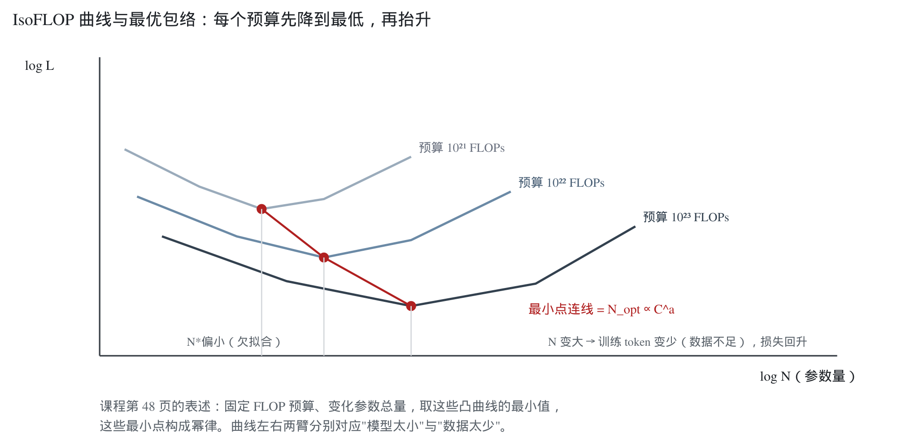

U 形的两条臂各有名字：左臂是"模型太小、数据太多"（欠参数化），右臂是"模型太大、token 不够"（欠训练）。这条曲线的存在本身就是对"越大约好"最直接的反驳——在固定算力下，更大的模型反而更差。

**方法 3：联合拟合**。在 $(\text{size},\text{data})$ 网格上跑一批模型，在 log 空间里对 $L(N,D)$ 做最小二乘。它用上了所有点，理论上最稳。联合拟合也有局限：

这件事值得单独记一笔：**同一个数据集，不同的拟合流程可以给出不同的指数**。所以读到"某模型的最优 token/参数比"时，第一个该问的不是数字，而是"三种方法里的哪一种、拟合区在哪、单位是什么"。

三种方法并排：

| 方法 | 用哪些点 | 优点 | 弱点 |
| --- | --- | --- | --- |
| 方法 1 最小包络 | 所有训练曲线在每个横坐标上的最低点 | 简单，只依赖跑得最好的那几次 | 把不同配方的结果混在一起，点不在同一条"配方线"上 |
| 方法 2 IsoFLOP | 每个算力预算内扫参数量，取 U 形曲线的最低点 | 与"给定预算该选多大"一一对应；曲线形状本身可检查 | 每个预算要跑一族模型，成本高 |
| 方法 3 联合拟合 | 整个 $(\text{size},\text{data})$ 网格上的所有点 | 用上全部信息，参数最少、最省实验 | 强依赖函数形式；原论文的实现疑似有误 |

## 可复现的拟合流程

把前面的工具串起来，一次完整的拟合是五步（将三种拟合方法落实为操作步骤）：

1. **固定口径**。先写下四个决定：$L$ 的底（nats/token）、$N$ 是否含 embedding 与最后一层、$D$ 是 unique 还是 effective、$C$ 是否含 attention 与重算。口径写不清的曲线，后面全部作废。
2. **选网格**。要么按 IsoFLOP 预算族跑（每个预算 $C$ 扫 4–8 个 $N$，$D=C/6N$ 联动），要么在 $(N,D)$ 二维网格上跑。前者点数少、后者信息全。
3. **拟合**。对 $L=A N^{-\alpha}D^{-\beta}+C$（或耦合形式）做非线性最小二乘。实操上取对数后残差变成加性的，用 `scipy.optimize.curve_fit`，初值取 log-log 直线的斜率即可；注意 $C$ 必须在原始尺度上相加，不能取对数，所以这不是一个"纯对数空间"的线性回归。
4. **看残差**。在 log 空间里画残差对 $\log D$ 的图：如果有系统性弯曲，说明缺 $C$ 或形式选错了；如果只有随机散布，才可以往下走。
5. **留出最大规模做盲测**。把最大的一个规模从拟合里拿掉，拟合后再预测它。预测误差（通常百分之一到几个百分点量级）比 $R^2$ 更能说明这条律能不能外推。

拟合时还要留意一个陷阱：**$\alpha$ 与 $C$ 强相关**。$C$ 取大一点、$\alpha$ 取小一点，可以在同样的数据上得到几乎一样的拟合优度。所以"$\alpha=0.34$"这类数字，脱离 $C$ 的值与拟合区间就没有意义——这正是那个"数据取证重拟合"事件能发生的原因。

## 拟合变量与单位：最容易被忽略的一节

本章要解决的问题是"说明拟合变量与单位"，因为同一个符号在不同论文里可能指不同的量。四个变量逐个过。

**$L$：损失用什么量。** 通常是验证集交叉熵，单位是 nats/token（自然对数）或 bits/token（以 2 为底）。两者只差一个常数因子 $\ln 2$，因此**斜率相同、截距不同**。如果论文报的是 perplexity，那是 $e^{L}$，在 log-log 上仍然是直线，但斜率会变成原来的 $1/\ln$ 关系——比较不同论文的 $\alpha$ 之前，先确认底数。这也是为什么"$\alpha=0.34$"这种数字脱离单位就没有意义（由对数的换底公式直接得到）。

**$N$：参数怎么数。** 这是分歧最大的一项。需要特别说明：

embedding 与输出层共享、且只被每个 token 触碰一次，而 FFN 参数被每个 token 全量使用，二者的"效率"不同。所以 $N$ 至少三种口径：总参数、非 embedding 参数、去掉最后一层后的参数。把这件事列为 Kaplan 与 Chinchilla 结论差异的首要解释：

**$D$：token 怎么数。** 表面上是"训练用了多少 token"，实际上有 unique 与 effective 之分。为区分这些概念，先定义四个量：

含义是：当语料被重复 $R_d$ 遍时，第二遍之后的新信息远少于第一遍，所以"有效数据" $D'$ 小于 $U_d\cdot R_d$；$R_d^*$ 标记"再重复也几乎无收益"的临界重复次数。定性上 $D'$ 随 $R_d$ 增长但迅速饱和（由这四个量的定义与"重复的价值递减"这一前提直接得到）。这解释了为什么 Llama 3 70B 要用 215 tokens/param，而小模型用 20 就够——**同样的 $D$，在不同重复率下的"有效值"不同**。

**$C$：算力怎么算。** $6ND$ 只统计矩阵乘，不含 attention 的 $s^2$ 项、不含重算带来的额外前向、不含通信。所以不同论文报的"用了多少 FLOPs"常常不可比；做交叉验证时，最好用同一套口径重算。

把这四项放在一起，可以给出一条实用检查清单：

| 检查项 | 要问的问题 | 出错后果 |
| --- | --- | --- |
| $L$ 的底 | nats 还是 bits？perplexity 还是交叉熵？ | 指数差一个 $\ln 2$ 因子 |
| $N$ 的口径 | 含不含 embedding、含不含最后一层？ | 常数项偏移，最优 $N$ 估计偏移 |
| $D$ 的口径 | unique 还是 effective？重复了几遍？ | 低估所需数据量 |
| $C$ 的口径 | 只算 6ND 还是含 attention/重算？ | 预算与最优点的对应关系错位 |

## Kaplan 与 Chinchilla 缩放律的差异

同一个问题，两个著名结论相差很大。我们将原因拆成三层：

1. **参数口径不同**：Kaplan 去掉了最后一层参数，Chinchilla 用非 embedding 参数。
2. **学习率调度不同**：小预算下 warmup 占比过高，可能扭曲小模型的损失，进而影响拟合斜率；若 batch 和学习率设置合适，衰减阶段的影响则可能较小。
3. **拟合方法不同**：对公开数据的重新拟合提示，原实现可能存在问题。

结论上的差别是：

$$
\text{Kaplan：}N_{\text{opt}}\propto C^{0.73}\ \Rightarrow\ \text{token/参数比随 }C\text{ 下降}；
$$

$$
\text{Chinchilla：两个维度近似等比例增长}\ \Rightarrow\ \sim20\ \text{tokens/参数}.
$$

（后者是采用的 Chinchilla 取值；"等比例"是指数相加为 1 且两项相近的推论，依据 [25]。）

两组结果使用的参数口径、学习率调度和拟合流程不同，对应的估计条件也不同。比较缩放律时，应同时核对变量定义、单位、数据范围和训练设置；这些选择会影响拟合参数及其外推结果。

## 训练最优不等于部署最优

Chinchilla 回答的是"固定训练算力下哪个模型最好"。但真实系统的总成本里，训练只是一次性的，推理是持续的。用一个列表把行业的实际选择摆出来：

表中 token/参数比从 2 增至 215。相关研究讨论了在训练成本与部署期推理成本之间进行权衡的情形；最优配置取决于预期推理量、硬件、训练数据和目标损失。有研究将这种配置称为 over-training：在部署期推理量较高时，训练阶段使用更多数据、训练较小模型可能降低生命周期总成本。该结论依赖相应的计算与部署假设。

这一条对本章的定位很重要：缩放律不是"越大越好"的辩护词，而是一套**把不同成本项放进同一个式子做权衡**的工具。训练算力、推理算力、数据可得性，三者权重变了，最优点就跟着变。近年的工作进一步把"过训练"本身也拟合成律，说明这条曲线在超过 Chinchilla 最优点之后仍然可预测 [26]。

## 其它量的缩放：临界 batch 与学习率

缩放律不只描述损失，也描述超参数。

**临界 batch**。定义为：在给定的目标损失下，训练所需的**步数** $S$ 与**样本数** $E$ 之间存在权衡；batch 越大，步数越少但样本越多。用一条曲线拟合

$$
\frac{S}{S_{\min}}=1+\frac{B_{\text{crit}}}{B},\qquad
\frac{E}{E_{\min}}=1+\frac{B}{B_{\text{crit}}} .
$$

（依据"fit for $S_{min}, E_{min}$ on this curve"的描述；这是该领域的标准形式 [17]。）两式的方向相反：batch 变大，步数趋近 $S_{\min}$，但样本数线性上升；$B=B_{\text{crit}}$ 时两者都等于最小值的 2 倍——因此，临界 batch 对应的步数和样本数约为各自最小值的两倍。此外，临界 batch 与"梯度协方差的迹除以梯度范数的平方"接近。还有一条方向性结论：

**学习率**。直接把小模型的最优学习率搬到大模型上会失败：

这正是 muP 一类参数化的动机：让超参数在规模变化时保持"可迁移"，从而避免为每个规模重新扫一遍 [27]。

把这两条放在一起看，"缩放律"的外延比"损失随规模下降"宽得多：它是一套**让超参数随规模可预测地移动**的方法，损失曲线只是其中最有名的一条。

## 下游：不要过度外推

还要注意：

也就是说，预训练损失的可预测性**不能**自动转移到下游任务上。这一点与第 12 章（评测）直接相连：损失降了 0.05，benchmark 涨不涨、涨多少，取决于任务、数据污染、提示格式等一堆因素。

还有一条更细的结论值得记：数据配比的变化主要影响曲线的**截距**而不是斜率：

这条区分很实用：如果某个改动只平移曲线（截距），说明它改变的是"数据里有多少可学的东西"；如果它改变斜率，说明它改变了"学习的效率"。两者对应完全不同的优化方向。

## 本章回顾与练习

缩放律是指定口径下的经验拟合。优化预算分配时，必须同时检查拟合范围、损失定义、参数口径和训练 token 的计算方式。

**练习**

1. 对 $L(N)=aN^{-\alpha}+c$ 取对数后，解释何时能得到直线关系。
2. 设计一组固定 FLOPs 的实验，说明怎样改变 $N$ 并联动 $D$。
3. 某论文把拟合结果外推到 100 倍模型规模；列出至少三项需要先核对的信息。

# 第 10 章　推理系统

## 本章导读

生成阶段和训练阶段使用同一组权重，却有不同的计算形态。区分 prefill 与 decode，才能解释 KV cache、批处理和投机采样分别改善什么。

学完本章后，你应能：

- 区分 prefill 与逐 token decode 的负载；
- 估算 KV cache 对显存和延迟的影响；
- 比较批处理、压缩缓存和投机采样的收益与代价。

## 推理阶段的计算特征

训练和推理用的是同一个模型、同一套权重，但它们的经济学完全不同。

用两个数字把这个"重复"具体化：OpenAI 每天处理约 8.6 万亿 token，而作为参照，DeepSeek v4 的训练数据是 32 万亿 token。也就是说，一次训练的成本，在几十天的推理量面前就不再是主要成本项。推理系统优化关系到持续发生的成本：**训练的账算一次，推理的账一直算**。

推理出现在三个地方，而它们的约束不一样：实际使用（聊天、代码补全、agent、批量数据处理）、模型评测、强化学习（采样大量生成再打分）。评测和 RL 都要求高频调用，这让"每次调用多花 20% 时间"在工程上是不可接受的。

更麻烦的是 token 的消耗结构在变。还需考虑两种使用场景：聊天场景里大部分 token 是给人看的，人是瓶颈；而 agent 场景是"查询 → 内部轨迹 → 输出给人"，**生成的 token 数可以无上界地增长**，而"tokens generated = compute spent"。这意味着推理成本不是随用户数线性增长，而是随"模型自己跟自己对话的轮数"增长——一个长任务 agent 可能为了给人看 500 个 token，先烧掉几十万个 token。

这也解释了为什么推理基础设施本身成了一个产业：既有服务闭源模型的厂商，也有服务开放权重模型的厂商（Together、Fireworks、Baseten、DeepInfra、Groq、Cerebras 等），还有四个被常见的开源推理栈——vLLM（首创 PagedAttention）、SGLang（首创 RadixAttention，适合 agent 负载）、TensorRT-LLM（NVIDIA，面向 GPU 深度优化）、llama.cpp（纯 C++，支持 CPU 推理，可本地跑）。本章后面提到的技术，基本都能在这四个栈里找到对应实现。

### 三个度量

我们将"快"拆成三个互不替代的度量：

| 度量 | 定义 | 关心它的人 |
| --- | --- | --- |
| TTFT（Time-to-first-token） | 用户发出请求到看到第一个 token 的时间 | 交互式应用 |
| 延迟（Latency） | 单个查询每秒产出多少 token（seconds/token） | 交互式应用 |
| 吞吐（Throughput） | 系统每秒为所有查询产出多少 token（tokens/second） | 批量处理 |

这三个数不是同一个数的三种写法。后面会看到，**提高吞吐的标准手段（加大 batch）会直接恶化单条延迟**，所以"优化推理"必须先说清优化的是哪一个。

### 与训练的根本差异

训练时手里有完整序列，一个矩阵乘就能并行处理所有位置；推理时第 $t$ 个 token 必须等第 $t-1$ 个 token 生成完才知道，生成过程天然串行。串行的直接后果是：每一步只有很少的"活"可干，而要把权重从显存搬进计算单元的字节数一点没少。这正是第 5 章的带宽墙，在推理场景里变成主要矛盾。

本章只处理**如何把 token 更快地生成出来**，不涉及"如何让模型更小"之外的训练问题。所有加速手段按一条硬线分成两类：**有损**（改架构、量化、剪枝，必须复核精度）与**无损**（投机采样，数学上保证采样分布不变）。

## 算术强度与推理瓶颈

### 定义与硬件阈值

算术强度（arithmetic intensity）是"每搬运一个字节做了多少浮点运算"：

$$
I=\frac{\text{FLOPs}}{\text{Bytes transferred}} .
$$

硬件的对应量是加速器强度（accelerator intensity），即峰值算力除以显存带宽。用 H100 的数算了一遍：

$$
I_{\text{H100}}=\frac{989\times10^{12}}{3.35\times10^{12}}\approx 295\ \text{FLOP/Byte}.
$$

判据只有一句话：

这里的 $B>295$ 是用最简单的 $X_{(B\times D)}W_{(D\times F)}$ 推出来的。推导值得完整写一遍，因为后面所有结论都是它的变体：读 $X$ 要 $2BD$ 字节、读 $W$ 要 $2DF$ 字节、写 $Y$ 要 $2BF$ 字节（bf16，每元素 2 字节），FLOPs 是 $2BDF$。于是

$$
I=\frac{2BDF}{2BD+2DF+2BF}.
$$

在 $D=cB$、$F=cB$ 且 $c\to\infty$ 的极限下（即权重矩阵远大于激活），分母里 $2DF$ 项主导，$I\to B$。所以"矩阵乘是否算力受限"等价于"batch 是否够大"。

极端情形是 $B=1$：

$I=1$ 意味着每读一个字节只做一次浮点运算，而硬件能做 295 次。差了两个多数量级——这就是推理慢的根源，不是"GPU 不行"，而是**每个权重被读进来只用了一次**。

## prefill 与 decode：同一个模型，两种负载

### 两阶段

用两个符号把两阶段统一描述：$S$ 是已经存在的上下文 token 数，$T$ 是这一次要产出 logits 的 token 数。prefill 时 $T=S$（整个 prompt 一次算完），decode 时 $T=1$（一次一个）。

### MLP 层

逐项计算：读 $X$ 为 $2BTD$；读三个权重 $W_{\text{up}},W_{\text{gate}},W_{\text{down}}$ 各 $2DF$，共 $6DF$；三次矩阵乘各 $2BTDF$；写中间结果 $U$、$G$、$Y$ 共 $4BTD+4BTF$。所以

$$
\text{FLOPs}_{\text{MLP}}=6BTDF,\qquad
\text{Bytes}_{\text{MLP}}=4BTD+4BTF+6DF .
$$

在 $B T\ll D,F$ 时强度退化为

$$
I_{\text{MLP}}\approx BT .
$$

由上式可得 `intensity == B*T`。这一个式子已经解释了 prefill 与 decode 的分野。

### 注意力层

注意力要读 $Q_{(B\times T\times D)}$、$K_{(B\times S\times D)}$、$V_{(B\times S\times D)}$，做两次 $2BSTD$ 的矩阵乘，写回 $Y$：

$$
\text{FLOPs}_{\text{attn}}=4BSTD,\qquad
\text{Bytes}_{\text{attn}}=4BSD+4BTD .
$$

于是

$$
I_{\text{attn}}=\frac{4BSTD}{4BSD+4BTD}=\frac{ST}{S+T}.
$$

两个阶段代进去：

| 阶段 | 代换 | $I_{\text{attn}}$ | 瓶颈 |
| --- | --- | --- | --- |
| prefill | $T=S$ | $S/2$ | "Good!" |
| decode | $T=1$ | $S/(S+1)<1$ | "Bad!" |

$S=1024$ 时 prefill 的注意力强度是 512，超过 295，算力受限；decode 时无论 $S$ 多大，$S/(S+1)$ 都严格小于 1，永远在阈值左侧，且**上不去**。

### 关键差异：批处理只能救一半

理解批处理对两类计算的影响，可以从权重是否共享来看。MLP 的权重由所有序列共用，$B$ 条序列同时计算时，同一份 $W$ 可服务 $B$ 条序列，算术强度因此从 1 增至约 $B$。注意力的 $K,V$ 则属于各自的序列；$B$ 翻倍，KV 读取量也随之翻倍，分子与分母同比例增加，算术强度基本不变。因此，增大 batch 能摊薄 MLP 的权重读取，却不能消除 decode 阶段注意力的带宽瓶颈。

判断这类系统时，可以从四个方面入手：

| 阶段 | MLP 强度 | 注意力强度 | 瓶颈 |
| --- | --- | --- | --- |
| prefill | $B\cdot S$ | $S/2$ | 算力（可优化到饱和） |
| decode | $B$（需要并发请求） | $<1$（"impossible to improve"） | 显存带宽 |

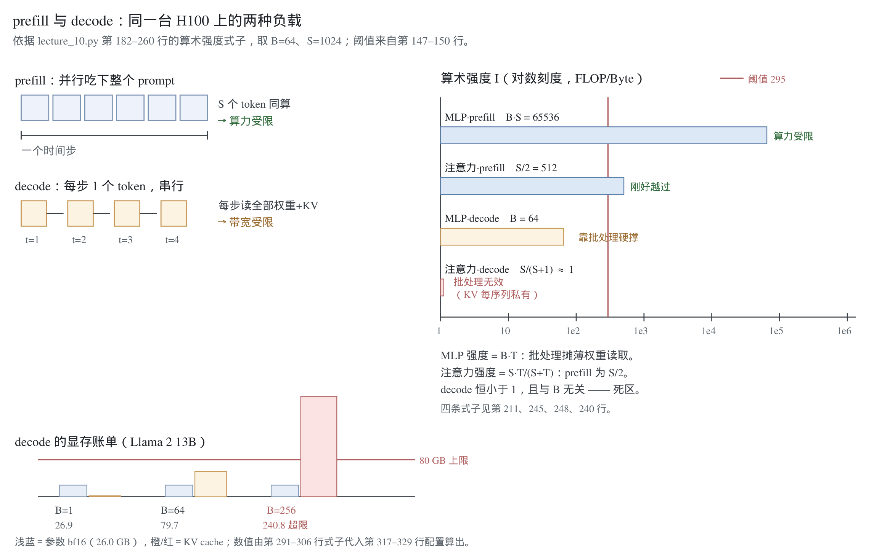

*图 10-1　左：prefill 一次前向并行处理整个 prompt，decode 每步只产出 1 个 token；右：四个代表性算子的算术强度（对数刻度）与 H100 阈值 295 的关系。阈值按 H100 峰值算力与显存带宽之比估算。*

## KV cache：显存直接就是延迟

### 三个式子

不做 cache 的话，生成 $T$ 个 token 要把历史反复灌进模型：

把每层每个头的 $K,V$ 存进 HBM 就把这部分重复计算省掉了：

我们将它写成一个可算的式子：

$$
\text{KV}_{\text{seq}}=S\cdot(KH)\cdot L\cdot 2\cdot 2\ \text{bytes},
$$

两个 2 分别是"key 与 value 各一份"和"bf16 两字节"。总显存是参数加 KV：

$$
M=\underbrace{B\cdot\text{KV}_{\text{seq}}}_{\text{KV cache}}+\underbrace{2\cdot N_{\text{params}}}_{\text{参数（bf16）}} .
$$

而延迟被建模成"把 $M$ 全部读一遍"：

$$
\text{latency}=\frac{M}{\text{memory\_bandwidth}},\qquad
\text{throughput}=\frac{B}{\text{latency}} .
$$

这两行是整章的定量骨架：**因为推理是 memory-bound，所以显存占用直接等于每步时间**。谁能把 $M$ 压下去，谁就快。

### 量级：把 Llama 2 13B 代进去

给出完整配置：$S=1024$，$D=5120$，$F=13824$，$N=40$，$K=40$，$H=128$，$L=40$，$V=32000$，`memory_bandwidth = 3.35e12`。

把配置代入上面三个式子，得到的数如下（只给符号式与"装不下"的断言，以下数值是本书按式子代入配置算出的，可复核）：

| 量 | 计算 | 结果 |
| --- | --- | --- |
| 参数量 | $2VD+3DFL+(2DNH+2DKH)L$ | $1.30\times10^{10}$（13.0 B） |
| 参数显存 | $2\times N_{\text{params}}$ | 26.0 GB |
| 单序列 KV（$S=1024$） | $1024\times5120\times40\times4$ | 0.84 GB |
| $B=1$ 总显存 | $26.0+0.84$ | 26.9 GB |
| $B=64$ 总显存 | $26.0+53.7$ | 79.7 GB |
| $B=256$ 总显存 | $26.0+214.7$ | 240.8 GB |

代码用断言检查 $B=256$ 时的显存需求：`h100_memory = 80e9`，随后 `assert b256.memory > h100_memory`。上表的 240.8 GB 正是这个断言的内容——**两张 H100 都放不下**。

代进延迟式子，同时得到延迟与吞吐：

| batch | 总显存 | 每 token 时间 | 吞吐 |
| --- | --- | --- | --- |
| $B=1$ | 26.9 GB | 8.0 ms | 125 tok/s |
| $B=64$ | 79.7 GB | 23.8 ms | 2689 tok/s |
| $B=256$ | 240.8 GB | 71.9 ms | 3562 tok/s（放不下） |

这张表把"批处理"的真实交换关系摊开了：从 $B=1$ 到 $B=64$，吞吐涨了 21.5 倍，但单条延迟从 8.0 ms 恶化到 23.8 ms——**每一次提速都是从用户等待里借来的**。而 $B=64\to256$ 吞吐只再涨 32%，因为参数那 26 GB 早已被摊薄，剩下的全是 KV：KV 项随 $B$ 线性增长，收益自然递减。

两个方向要分清（依据仍是前面的三个式子）。$M$ 对 $B$ 是线性的，所以加 batch 的边际收益递减但不会变负；$M$ 对 $S$ 也是线性的，但 $S$ 是**用户给的**，服务方改不了——这就是长上下文请求天然更贵、且会挤占同批其他请求的原因。工程上常见的做法是给 $S$ 设上限、或按上下文长度分池，把长请求隔离开。

### 排队论的三个量

前面对 $B$ 的讨论隐含了一个不现实的假设：batch 是"配"出来的。真实系统里 batch 是**等**出来的——请求随机到达，调度器决定等多久凑批（等待凑批会增加先到请求的延迟）。

三个量足以描述这件事。设到达率 $\lambda$（请求/秒）、单请求平均服务时间 $W$、系统内平均并发请求数 $N$，Little 定律给出

$$
N=\lambda W .
$$

把 $W$ 拆成排队等待 $W_q$ 与执行 $W_s$ 两部分。若调度器愿意等 $\tau$ 秒来凑批，则 batch 大小约为 $\lambda\tau$，而这 $\tau$ 秒直接加到**每个**请求的 TTFT 上。于是有了本章最重要的一条工程不等式：提高吞吐所需的等待时间，与降低 TTFT 的目标直接冲突，二者只能靠"分阶段用不同 batch"来调和——这条约束可以定量表示为：也正因为它无法两全，现代推理栈才把 prefill 与 decode 拆到不同池子里调度。

## 批处理：把延迟换成吞吐

给出一个廉价但有效的横向扩展手段：直接开 $M$ 份模型副本，"latency is the same, throughput increases by M"。这是因为副本之间不共享任何状态，$M$ 份副本等价于 $M$ 个独立服务。代价是 $M$ 份参数显存——注意这和第 7、8 章的模型并行不是一回事：副本不切分模型，只复制。

更有价值的做法是**分阶段用不同的 batch**：

这条建议来自两阶段的强度差异：prefill 本来就是算力受限（$I=B\cdot S$ 或 $S/2$），加大 batch 对强度帮助有限，却会拉长每个请求的排队时间；decode 是带宽受限（$I=B$），加大 batch 几乎是唯一能提高强度的手段。

### 动态负载：连续批处理与选择性批处理

真实流量并不是规整的张量，主要有三类难点：请求在不同时刻到达（等凑批会惩罚早到的请求）、序列有共享前缀（system prompt、同 prompt 多采样）、长度各不相同（padding 很浪费）。训练拿到的是一个整齐的 $B\times S$ 块，推理拿到的是参差不齐的数组。

解法是迭代级调度（iteration-level scheduling）：一次 decode 一步，新请求随时加入批。这会带出第二个问题——批内序列长度不同，没法直接按 $B\times S$ 算。一种做法是**选择性批处理**：

注意力必须逐序列算（因为 $K,V$ 是私有的，且长度不同），而非注意力部分（MLP、LayerNorm）与序列边界无关，可以把 3 条、9 条、5 条长度拼成一个 17 行的大矩阵一起算。这正好呼应前面的结论：**能共享权重的部分可以拼，不能共享状态的部分不能拼**。

第三个问题是分页。老做法是按最大长度预留一整块 KV，要注意这会产生内部碎片（生成得比预留短）与外部碎片（块之间空隙）。PagedAttention 借操作系统的分页思想，把一条序列的 KV 切成**非连续的块**，于是可以做到块级共享与前缀复制写（copy-on-write）：

这一条对 agent 场景特别重要：一个固定 system prompt 被上千个请求复用，只留一份 KV 就省下上千份重复显存。

。KV cache 随 $S$ 线性增长。选择性批处理的代价是注意力部分无法共享一次权重读取，因此 decode 的注意力强度仍是 $S/(S+1)<1$；分页的代价是块表查表与访存不连续，需要用融合 kernel 把"读块 + 算注意力"合成一个 kernel 才能吃回收益——实现中还需注意这一点（"Kernel to fuse block read and attention (reduce kernel launch overhead)"、FlashAttention/FlashDecoding、CUDA graphs）。

## 有损路线：把 KV 压小

既然 latency 等于 $M$ 除以带宽，压缩 $M$ 就是最直接的加速。按"压什么"分了三条路线，并反复强调同一件事：**每次压缩都要复核精度**。

### 改注意力结构

分组查询注意力（GQA）[10] 的思路是让多个 query 头共享一份 KV：

收益可以直接从式子里读出来：

用同一个 Llama 2 13B 配置做了三档对照：$K=40,B=64$ 的原版；改成 $K=8,B=64$（KV 缩到 1/5）；再借省下的显存把 $B$ 提到 256。结论是"worse latency, but better throughput (and still fits in memory!)"。用上表的算法复算（依据同前）：$K=8$ 时单序列 KV 从 0.84 GB 降到 0.17 GB，$B=256$ 总显存 69.0 GB，正好塞进 80 GB。

还可以进一步计算：$K=8,B=256$ 的每 token 时间是 20.6 ms、吞吐 12432 tok/s；对比原版 $K=40,B=64$ 的 23.8 ms 与 2689 tok/s——**在更低的延迟下拿到 4.6 倍吞吐**。这就是"压 KV"比"加 batch"划算的地方：它同时改善了延迟和吞吐这两条曲线。

同一族的手段还有：多头潜在注意力（MLA）把 KV 存成低维压缩向量 $c=W_ch$ 再投影回 $K,V$，DeepSeek v2 把 $NH=16384$ 压到 $C=512$，因为与 RoPE 不兼容还要额外加 64 维 RoPE 维度，共 576；跨层注意力（CLA）把 KV 在**层**之间共享，正如 GQA 在头之间共享；局部（滑窗）注意力只留最近窗口，给出两个关键性质："Effective context scales linearly with the number of layers"和"KV cache is independent of sequence length!"，代价是伤精度，所以要与全局注意力交替成混合层。此外， DeepSeek v4 的三段式压缩（CSA 每 $m$ 个 token 压成 1、DSA 选 top-$k$、HCA 压得更狠）与 1M 上下文 [28]。

滑窗注意力的思想最早在 Longformer [29] 与 Sparse Transformer [30] 里成形，Mistral 7B [31] 是把它推到开源模型的代表。

### 量化

量化直接减少每个数的字节数，从而线性缩小 $M$。已报告的机制是 scale 加 zero-point 的仿射量化：

$$
x_q=\operatorname{round}\!\left(\frac{x}{s}\right)+z,\qquad
\hat{x}=(x_q-z)\,s .
$$

常见数值格式及其存储开销如下：fp32 4 字节（训练时的参数与优化器状态）、bf16 2 字节（推理默认）、fp8 1 字节（e4m3 在 H100 上取值范围约 $[-240,240]$）、int8 1 字节（$[-128,127]$）、int4 0.5 字节（$[-8,7]$）。精度越低越便宜也越不准。路线分两条：量化感知训练（QAT，前向时假装量化以模拟误差，贵）与训练后量化（PTQ，用样本数据定每层/每张量的 scale 与 zero point，便宜；GPTQ 用 Hessian 信息补偿误差）。AWQ 的观察是"有些激活通道特别大，打到这些通道的权重更重要"，于是只把 0.1%–1% 的权重留在高精度，已报告的数字是 fp16 转 int3 后显存降 4 倍、加速 3.2 倍。

### 剪枝加蒸馏

第三条路线最粗暴：把贵模型的一部分拆掉，再把它修回来。

注意第 3 步不是可选项：直接剪完的模型会明显掉点，蒸馏（用原模型当老师）负责把能力补回来。我们将这条路线和"从零设计更快架构"对照，给了两份配方：从零路线是"定义更快架构 → 训练"；蒸馏路线是"定义更快架构 → 用原模型初始化 → 蒸馏修复"。

## 无损路线：投机采样

前面的手段都在改模型，因此都有精度风险。投机采样（speculative sampling）不一样：它同时用两个模型，但采样分布**严格等于**目标模型。

思路来自一个不对称性：

既然"一次检查 $k$ 个 token"和"生成 1 个 token"的代价接近，那就让小模型先猜 $k$ 个，再让大模型一次并行验一遍。

为什么这样采样仍然是精确的？用一个两词表的例子证明，这里完整展开（只给结论与两行算式，下面补齐每一步的依据）。

设词表只有 $\{A,B\}$，目标分布 $q$、草稿分布 $p$，且 $p(A)>q(A)$（草稿模型过度采样 $A$）。因为两个分布各自归一，必有 $p(B)<q(B)$。算法是：先按 $p$ 采一个 token；以概率 $\min(1,q(x)/p(x))$ 接受它；若拒绝，则从残差分布

$$
r(x)=\frac{\max\big(q(x)-p(x),\,0\big)}{\sum_{x'}\max\big(q(x')-p(x'),\,0\big)}
$$

重新采一个。两词表下残差为 $[0,1]$，即拒绝后一定采 $B$。于是

$$
P[\text{采到 }A]=p(A)\cdot\frac{q(A)}{p(A)}+p(B)\cdot 1\cdot 0=q(A),
$$

$$
P[\text{采到 }B]=p(B)\cdot 1+p(A)\cdot\left(1-\frac{q(A)}{p(A)}\right)\cdot 1=q(B).
$$

两项都等于目标分布，所以输出是**精确样本**。相关报告将其概括为：

那个"修改"很关键：纯拒绝采样可能一直拒绝下去（没有下界），而这里强制至少产出一个候选，保证每步都有进展——这正是它能当加速器用的原因。

实践上草稿模型要尽量接近目标模型（已报告的搭配包括 70B 配 8B、8B 配 1B），因为接受率决定加速比。后续工作把草稿端做得更强：Medusa 让草稿模型并行产出多个 token，EAGLE 让草稿模型吃目标模型的高层特征。

接受率为什么是全部？设草稿步长 $k$、平均接受长度 $\alpha$（一次验证平均被接受多少个 token）。每轮代价约等于"一次目标模型前向"，产出 $\alpha$ 个 token，于是加速比近似

$$
\text{speedup}\approx\frac{\alpha}{1}\quad(\text{相对逐 token 生成}),
$$

（这是把"一轮验证 = 一次前向"与"逐 token = 每步一次前向"相比得到的量级式，忽略了草稿模型自身的开销。）它说明两件事：$\alpha$ 必须显著大于 1 才划算；草稿模型越准、$k$ 适度越小，$\alpha$ 越高。反过来，如果草稿模型与目标模型分布差得远，$\alpha\to1$，加速比归零而草稿开销照付。这也解释了为什么将草稿模型做得尽量接近目标模型——那不是工程偏好，是这条式子的直接推论。

## 推理优化的分析顺序

按改动幅度和风险，可以将这些技术排成一份实践顺序表：

| 顺序 | 手段 | 改什么 | 精度风险 | 主要收益 |
| --- | --- | --- | --- | --- |
| 1 | 分页 + 连续批处理 | 调度与显存管理 | 无 | 显存利用率、吞吐 |
| 2 | prefill/decode 分开配 batch | 调度策略 | 无 | TTFT 与吞吐同时改善 |
| 3 | 投机采样 | 加一个草稿模型 | 无（精确采样） | 单条延迟 |
| 4 | GQA/MLA/滑窗 | 注意力结构 | 有，需复核 | 显存与吞吐同时下降 |
| 5 | 量化 | 数值精度 | 有，需复核 | 显存线性下降 |
| 6 | 剪枝 + 蒸馏 | 模型规模 | 有，且要重训 | 全面下降 |
| 7 | 换更快架构并从零训练 | 架构 + 训练 | 需重训 | 上限最高、代价最大 |

顺序的道理很简单：前三条不动模型，风险为零，应该先做满；中间三条动模型但可验证，做完必须回到第 12 章的评测流程确认没掉点；最后一条要重训，是"再做一个模型"级别的投入。我们将这条分界线直接写进了小标题：lossy 的手段归在"### Taking shortcuts (lossy)"之下，无损的投机采样单独归在"### Use shortcuts but double check (lossless)"之下，并在给出总纲"reduce inference complexity without hurting accuracy"。

## 本章回顾与练习

Prefill 并行处理提示词，decode 则逐 token 读取权重和 KV cache。系统优化要在首 token 延迟、后续 token 延迟、吞吐与显存占用间权衡。

**练习**

1. 估算 $L=32,T=8192,d=4096$、bf16 下单序列的 MHA KV 缓存大小。
2. 说明增大 batch 为什么能摊薄 MLP 权重读取，却未必消除注意力带宽瓶颈。
3. 比较投机采样与 KV 量化对输出分布和数值精度的影响。

# 第 11 章　Scaling Laws II：工程应用与外推边界

## 本章导读

缩放律提供经验关系，工程配方把它转成模型宽度、深度、学习率与 batch 的选择。配方依赖实验条件，使用前应先检查假设和适用范围。

学完本章后，你应能：

- 说明 muP 和超参数缩放的基本用途；
- 识别配方对数据、优化器和预算的依赖；
- 规划一个成本可控的小规模拟合实验。

## 缩放律在工程决策中的应用

第 9 章给出的是**关系**：损失随参数、数据、算力按幂律下降。第 11 章换了个问题：给定预算，**怎么定超参**。

MiniCPM（1–2.5B）与 DeepSeek（7B/67B）的公开配方，因为它们把"怎么定超参"写成了可复现的流程，而不是一句"我们调出来的"。

## 配方一：muP + 固定宽高比

两个关键词：

- **muP（Maximal Update Parametrization）**：一套让超参随宽度缩放的参数化方式，使小模型上调好的学习率可以直接用于大模型 [27]。
- **固定宽高比（aspect ratio）**：不单独调 $d$ 与 $L$，而是按固定比例一起放大。

"最大的试验模型与最终模型差 5 倍"这句是重点：**配方允许你在小 5 倍的范围里拟合，然后外推**——这正是缩放律的经济价值，也是它最大的风险来源。

## 配方二：学习率与 batch 的缩放

做法是把 (batch, 数据量) 扫一遍，读出每个点上的损失，再找等损失线。工程上关心的两个式子（形式来自公开的缩放研究）：

$$
B_{\text{opt}}\propto D^{\,\alpha_B},\qquad
\eta_{\text{opt}}\propto N^{\,-\alpha_\eta},
$$

即最优 batch 随数据量增长，最优学习率随模型变大而下降。两个指数一般落在 $0.2\sim0.6$ 区间，具体值由拟合给出，**不是普适常数**；原始缩放律见 [24]、[25]。

还需注意一个限制：

也就是说，这类拟合的置信区间很宽，换优化器、换数据分布，指数就会变。

## 缩放律拟合的成本

训练到一半的学习率退火（decay）会让"中间损失"不能代表"最终损失"，所以每个数据点都要**从头训完**。若扫 $n$ 个配置，总成本是 $n$ 倍的完整训练——这就是"拟合缩放律比训练一个模型贵得多"的原因。

已报告的一个省法是把退火schedule做成**分段线性**，并对齐不同规模的数据预算：

## 三种主流做法

| 做法 | 关键操作 | 代价 | 代表 |
| --- | --- | --- | --- |
| Chinchilla 法一 | 固定模型，扫数据量 | 需要从头训完每条曲线 | 第 9 章 |
| Chinchilla 法二（IsoFLOP） | 固定算力，扫模型/数据分配 | 每个算力档都要一组训练 | 第 9 章、LLaMA 3 |
| 纯经验网格 | 直接对 (LR, batch) 网格搜索 | 最贵，但最接近真实最优 | DeepSeek、StepFun |

### 一个真实的成本对照

以 4 个规模、每个规模 3 个数据点为例：若最小模型单次训练 20 分钟、单机 8 卡，规模每翻 4 倍算力约乘 4，则总成本大致是

$$
T\approx 12\times 20\ \text{min}\times\frac{1+4+16+64}{4}\ \text{(归一化)}
\approx 8.5\ \text{小时}.
$$

看上去不贵，但这是"最小规模才 20 分钟"的前提。真实项目里最小模型往往已经是数小时，于是"拟合缩放律"本身的成本可以和"训练一个中等模型"相当——这就是为什么很多团队直接引用别家配方，而不是自己拟合。

## 配方失效的三种情形

**其一，换优化器，超参缩放关系就不成立。**

**其二，muP 对强权重衰减不鲁棒。**

**其三，外推区间问题。** 所有配方都是"在某个宽度/数据区间内拟合，再外推 5 倍"。一旦越界（例如从 1B 直接推到 70B），幂律的指数是否仍成立，没有任何保证——第 9 章讲的数据不足、评测方式变化都会让曲线弯掉。

## 公开训练配置的阅读方法

拿到任何一份"我们的缩放律"时，按这五问核对（读法而非公式）：

1. 拟合区间是什么？（最小/最大模型、数据量、算力）
2. 用的是哪种方法？（法一/法二/网格搜索）
3. 超参怎么随规模缩放？（muP、固定宽高比、还是各自拟合）
4. 外推了多少倍？（$5\times$ 属正常，$50\times$ 要警惕）
5. 结论是"损失"还是"下游能力"？两者的曲线经常不一致。

## 自己做一次小规模拟合：五步流程

如果只有几十张卡，仍然可以做一次有用的拟合（流程与公开配方一致）：

1. **定宽高比**：选 3～4 个规模，$d$ 与 $L$ 按固定比例缩放（如 $d\in\{512,768,1024,1536\}$）。
2. **小规模扫超参**：在最小模型上扫学习率与 batch，取损失最低的 1/4 区间。
3. **用 muP 外推**：把最小模型的最优学习率按 muP 规则推到较大模型，减少重复搜索 [27]。
4. **每条曲线训到底**：每个配置都要完整退火，否则损失不可比（这正是"成本从 $n$ 变 $n^{2}$"的来源）。
5. **拟合与自查**：用 $\log L$ 对 $\log N,\log D$ 做线性回归，报告拟合区间与残差；**不要报单个指数**，要报"在该区间内，$N$ 每翻 10 倍损失降 $x$"。

成本估算：4 个规模 × 3 个数据量 = 12 条曲线；若最小规模一次训练 2 GPU·小时，规模每翻 4 倍算力 ×4，总成本约 $2\times(4^{0}+4^{1}+4^{2}+4^{3})\times3\approx 510$ GPU·小时——单机一周内可完成。

### 一个必须写进报告的数字：外推倍数

任何拟合结论都应附带"外推倍数 = 目标规模 / 最大拟合规模"。公开配方的经验值是 ≤5 倍；超过这个范围，幂律指数是否成立没有保证（第 9 章已给出数据不足、评测变化两条失效路径）。

## 四份公开配方的对照

公开配方可以按超参数的选择方式来比较：

| 配方 | 关键做法 | 拟合区间思路 |
| --- | --- | --- |
| MiniCPM | muP 初始化 + 固定宽高比 + WSD 学习率（末段约 10% 衰减） | 小模型上调好，外推约 5 倍 |
| DeepSeek | 假设多数超参与规模无关；对 batch/LR 做缩放分析；IsoFLOP 定模型规模；分段线性 schedule 降低拟合成本 | 先小规模网格，再 IsoFLOP |
| LLaMA 3 | IsoFLOP 式（39:1 的 token/参数比），并观察"算力→下游能力"的缩放 | 直接按算力档位扫 |
| Qwen 2.5 / 3 | batch 与超参各自拟合，LR/batch 的缩放关系分开做 | 分项拟合 |

四个配方共享一个骨架：**先在能承受的规模上扫超参，再用某种参数化（muP 或显式拟合）把结论推到目标规模**。差别只在"推的方式"和"扫的粒度"。

token/参数比也不能视为固定常数。第 9 章的 Chinchilla 给的是"约 20 token/参数"，LLaMA 3 用 39:1，DeepSeek 又不同——这说明**这个比例不是常数，而是与数据质量、训练目标、推理成本预算共同决定的工程选择**。把它当成硬规律，是最常见的误读。

## 本章回顾与练习

工程配方把缩放关系落实为可执行超参数，但换了模型、数据或预算之后，配方可能不再适用。小规模实验用于验证外推，而不是替代验证。

**练习**

1. 解释 muP 希望在宽度变化时保持哪些量的可比性。
2. 制定一次学习率与 batch 缩放实验，写明固定量、变化量和观测指标。
3. 读一份公开训练配方，指出其中哪些信息不足以复现。

# 第 12 章　评测

## 本章导读

评测指标只是目标能力的代理。一个分数能回答什么，取决于任务、抽样、判分方式和真实使用场景之间的距离。

学完本章后，你应能：

- 区分交叉熵、困惑度、准确率和偏好分数；
- 识别抽样误差、污染、泄漏与记忆的差别；
- 为一个模型比较设计合适的指标和配对检验。

## 评测指标与模型设计

看起来评测只有三步：写一批 prompt、发给模型、算准确率。实际评测远不止这三步：

最后那句话是本章的纲。"智能""有用""安全"都是**抽象构念**，没法直接测量；我们必须把它换成一个**具体指标**（MMLU 准确率、Arena 的 ELO、SWE-Bench 的通过率）。这一步替换一旦做出，指标就会反过来塑造研究方向——大家优化什么，模型就长成什么。所以评测设计的第一个问题不是"用哪个 benchmark"，而是"我要测的那个构念，被这个指标代理得有多好"。

用四种"什么叫好"把这个分歧摊开：在 benchmark 上得分高、得分高且便宜（Artificial Analysis 的成本-性能图）、人类更愿意选它（Chatbot Arena）、人们真的愿意为它付钱（OpenRouter 排行）。四个答案都对，但它们衡量的不是同一个东西。因此，选择指标前应先明确要回答的问题。

## 困惑度的含义与适用范围

语言模型是 token 序列上的概率分布 $p(x)$，困惑度衡量它给某个数据集 $D$ 分配的概率有多高：

$$
\operatorname{PPL}(D)=\left(\frac{1}{p(D)}\right)^{1/|D|}
=\exp\!\left(-\frac{1}{|D|}\sum_{i=1}^{|D|}\log p(x_i\mid x_{<i})\right).
$$

右边那个等号把困惑度和交叉熵接上了：困惑度就是"每 token 平均负对数似然"取指数。所以最小化训练损失和最小化困惑度是同一件事。这条线索可以追到 Shannon 用 n-gram 模型估计印刷英文熵的工作 [32]——语言建模从第一天起就是用"预测得多准"来定义的，困惑度只是这个定义的现代写法。

传统做法是同分布评测：在某个数据集的训练集上训练、测试集上算困惑度，标准数据集是 Penn Treebank、WikiText-103、One Billion Word Benchmark。GPT-2 [33] 换了玩法：在 WebText 上训练，然后**零样本**跑到这些标准集上，也就是分布外评测。要注意结果很有意思——在小数据集（PTB）上迁移有帮助，在更大的数据集（1BW）上反而没有。

### 困惑度不能代表所有语言能力

我们将这条路线的信仰写得毫不客气（"more faith than science"）：设真实分布为 $t$、模型为 $p$，最优困惑度是 $H(t)$，当且仅当 $p=t$ 时取到；而若 $p=t$，那么任何任务的条件概率 $p(\text{solution}\mid\text{problem})$ 都可解，于是"压低困惑度终将抵达 AGI"。

这个论证的漏洞在于前提：交叉熵满足 $H(t,p)\ge H(t)$，且仅当 $p=t$ 时取等号。$p=t$ 要求模型精确学会真实分布，而真实分布的定义域是整个可能文本空间——包括那些从未出现在训练集里的长尾。我们能压低的只是**在评测集这个子集上**的交叉熵，它下界的不是 $H(t)$ 而是 $H(t)$ 在该子集上的投影。所以"困惑度下降"与"能力提升"之间没有逻辑蕴含，只有经验相关。

给出两个更实际的批评。第一，困惑度惩罚**所有** token：

第二，如果真开一个困惑度排行榜，你必须相信提交者给的 `log_prob` 是合法概率分布——它是自报的，无法验证是否归一。这是所有"自报指标"的共同弱点：

$$
\sum_{x} p(x)=1
$$

这条约束无法从提交的 `log_prob` 数组上验证，因为词表外的质量完全没有被报告。

## 一条谱系：从考试到 agent

按"测什么"把 benchmark 排成一条线（的调用顺序就是这条线）：困惑度 → 考试 → 对话 → agent → 纯推理 → 安全。每一代都是为了补上一代的缺口。

| 代际 | 代表 | 规模（已报告的数字） | 补上了什么 | 仍缺什么 |
| --- | --- | --- | --- | --- |
| 考试 | MMLU [34] | 57 个学科、选择题 | 有唯一正确答案、易判分 | 只测知识，不测"语言理解" |
| 考试（加固） | MMLU-Pro | 4 选项扩到 10 选项 | 去掉噪声题、用 CoT 评估 | 准确率掉 16%–33%，仍未饱和 |
| 考试（加固） | GPQA | 61 位 PhD 出题 | 谷歌也搜不到答案 | 专家 65%、非专家 34%、GPT-4 39% |
| 考试（加固） | HLE | 2500 题 | 多模态、多学科、混合题型 | 需 50 万美元奖池激励出题 |
| 对话 | Chatbot Arena | 真实用户两两对比 | 真实 prompt、开放式回答 | 评分者是谁？偏差？刷分？ |
| 对话 | AlpacaEval / WildBench | 805 条指令 / 1024 例 | 低成本、与 Arena 高相关 | LLM 判分器的系统性偏好 |
| agent | SWE-Bench | 2294 任务、12 个 Python 仓库 | 用单元测试判分，客观 | 任务构造质量、测试覆盖不足 |
| agent | TerminalBench | 229 任务、93 位贡献者（2.0 版 89 题） | 终端环境简单通用 | 题量小，方差大 |
| 纯推理 | ARC-AGI（1/2/3） | 每题唯一，记忆无用 | 把推理从知识里剥出来 | 被约束在"人类式"推理 |
| 安全 | HarmBench / AIR-Bench | 510 种有害行为 / 314 类风险、5694 prompt | 有明确的风险分类 | "安全"本身高度依赖语境 |

几条值得记住的细节。

**MMLU 的名字在骗人。** 需要明确的是：

**Arena 用的是 Bradley-Terry 形式。** 已报告的胜率模型是：

$$
P(A\text{ 胜}B)=\frac{1}{1+10^{(\mathrm{ELO}_B-\mathrm{ELO}_A)/400}},
$$

然后对全部两两比较做最大似然拟合，得到 ELO 分数。注意它只给出**相对**次序，而且默认"胜负关系可以传递"——循环克制（A 胜 B、B 胜 C、C 胜 A）会被压成一个平均。这种评分方式有四个局限：这些人是谁、有没有刷分的、二元偏好把"风格"和"正确性"混在一起、人类自己判断得对吗（"Prone to sycophancy?"）。

**agent 评测 = 评模型 + 评脚手架。** 可以将 agent 定义为：agent = 语言模型 + agent scaffold（决定怎么用模型的逻辑）。于是 SWE-Bench 上的分数既反映模型，也反映脚手架的规划、分层委派、持久记忆等设计。**把 agent 分数当作模型能力，是这一代评测最常见的误读。**

**开放式任务难在判分。** AlpacaEval [35] 用 GPT-4 当裁判，AlpacaEval 曾出现长度偏差：LLM 裁判偏好更长的回答，于是排行榜被更长的回答推高，2.0 版不得不用回归把长度偏差扣掉。WildBench 的改法是给裁判一张清单（checklist），逐个检查要点，而不是给一个总体印象分。

**为什么两两比较比打分更可靠。** 我们将这条写成了对话类评测的核心方法论：

道理和后面要讲的配对检验同源：两个回答同时摆在眼前时，"哪个更好"这个问题把评分者的**绝对尺度**消掉了，只剩下相对的比较；而绝对打分（1–10 分）需要评分者在脑子里维持一个稳定的标尺，人和 LLM 都做不到。这也是 Arena 只收"选哪个"、不收"打几分"的原因。

## 评测误差的来源

到这里都是"用哪个指标"。但只要指标是**在有限样本上算出来的一个比例**，它自己就带着不确定性。这是本章最容易被跳过、也最容易导致错误结论的一步。

### 抽样误差：一个比例的置信区间

设 benchmark 有 $n$ 道题、模型答对 $k$ 道，准确率 $\hat p=k/n$。把每题看成独立伯努利试验，则

$$
\operatorname{SE}(\hat p)=\sqrt{\frac{\hat p(1-\hat p)}{n}},
\qquad
\text{95\% CI}=\hat p\pm 1.96\,\operatorname{SE}(\hat p).
$$

（这是二项比例的 Wald 区间，没有给这个式子；它的依据是中心极限定理，$\hat p$ 近似正态。）当 $\hat p=0.5$ 时 $\operatorname{SE}$ 取最大值 $\tfrac{1}{2\sqrt n}$，所以我们只需要题量就能给出一个悲观估计。将几个 benchmark 的题量代入：

| benchmark | 题量 $n$ | $p=0.5$ 时的 SE | 95% CI 半宽 | 一道题值多少 |
| --- | --- | --- | --- | --- |
| Terminal-Bench 2.0 | 89 | 5.30 pp | ±10.39 pp | 1.12 pp |
| TerminalBench（全量） | 229 | 3.30 pp | ±6.48 pp | 0.44 pp |
| HarmBench | 510 | 2.21 pp | ±4.34 pp | 0.20 pp |
| HLE | 2500 | 1.00 pp | ±1.96 pp | 0.04 pp |
| AIR-Bench | 5694 | 0.66 pp | ±1.30 pp | 0.02 pp |

这张表能直接读出两件事。第一，**89 道题的 benchmark 的 95% 区间宽达 ±10 个百分点**——两个模型在这上面差 8 分，完全可能是噪声。第二，**换个随机种子重跑也未必能复现**：$n=89$ 时一道题就值 1.12 个百分点，任何"我们比基线高 1.5 分"的结论都极其脆弱。

但题量不是唯一的问题。即使题量不小，两个模型的区间仍然可能大幅重叠：

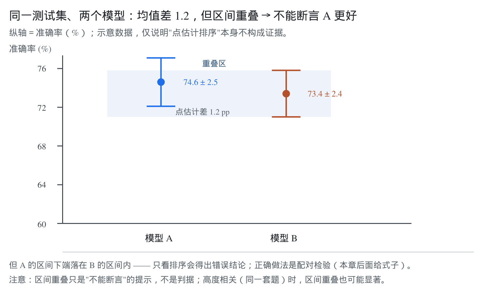

*图 12-1　两个模型在同一测试集上的点估计与 95% 置信区间：均值差 1.2 个百分点，但区间大幅重叠，因此不能仅凭"均值更高"断言 A 更好。图为示意数据；是否真的不同要走本节的配对检验，而不是比较两个区间的重叠程度。*

这里要提醒一个常见的误用：**"两个区间重叠"与"差异不显著"不是等价的判据**。重叠只是充分条件之一——两个 95% 区间完全不重叠时差异一定显著，但重叠时差异仍可能显著（尤其当两组高度相关，也就是同一套题时）。正确做法是下面要讲的配对检验，区间比较只能当作快速筛查。

### 系统误差：判分器与题目本身

抽样误差可以用加题量解决，系统误差不行。

判分器偏向是第一种：LLM 裁判偏好长答案、偏好与自己风格相近的答案；人类评分者则会被排版、语气、谄媚影响。一种改进办法是"清单/评分细则能提高可靠性，无论裁判是人还是 LLM"。

题目质量是第二种，而且更隐蔽。例如，SWE-Bench 修完变成 SWE-Bench Verified；各 benchmark 出"Platinum"精修版；agentic benchmark 的通病是"测试用例不足、一个平凡的 agent 就能过"。这说明 benchmark 必须排除过于简单的通关路径：如果普通策略就能通过测试，分数便不能说明模型具备目标能力。

## 污染、泄漏、记忆：三个必须分开的词

这三个词经常被混着用，但它们是三个不同层面的东西，混用会导致错误的补救措施。


### 三个定义

**泄漏（leakage）**是数据层面的关系：测试集的样本（或它的近似副本）出现在训练语料里。它是客观的、可验证的（只要有训练数据清单），而且与模型无关——换任何模型，这批数据都还是漏的。

**污染（contamination）**是结果层面的关系：模型在泄漏样本上的表现，被训练过程**抬高**了。注意"抬高"两个字：泄漏是污染的必要条件，不是充分条件。一条测试样本进了训练集，但如果它只出现过一次、被去重掉了、或者模型根本没学到，分数可能一点没变。

**记忆（memorization）**是行为层面的性质：模型能逐字复现某段训练数据。它可以被直接测量（给定前缀看能否续出原文），但**它与污染不是同一件事**，两个方向都可能脱钩：

| 现象 | 记忆 | 分数被抬高 | 说明 |
| --- | --- | --- | --- |
| 逐字背下且答对 | 是 | 是 | 最典型的污染 |
| 逐字背下但答错 | 是 | 否 | 记住了，但没记住"答案"（例如记住了题干却记错选项） |
| 没背下但答对 | 否 | 是 | 训练分布被拉偏，模型学到了同类题的模式 |
| 没背下也没答对 | 否 | 否 | 干净的题 |

（）它解释了为什么"我们没有记忆某测试集"这种辩护不足以证明"没有污染"：第三行那种情况完全不需要逐字记忆。

### 四条应对路线

下表列出四类常用应对方式及其局限。它们不能简单按可靠性排序，因为适用条件和可验证程度不同：

| 路线 | 做法 | 强度 | 局限 |
| --- | --- | --- | --- |
| 推断 | 利用数据点的可交换性，从模型行为反推是否见过 | 弱 | 只能给统计信号，不能证明 |
| 规范 | 要求模型方报告 train-test 重叠与置信区间 | 中 | 依赖自报，无法验证 |
| 新鲜评测 | LiveCodeBench、UncheatableEval：抓新网页 | 中 | 时间戳不可靠 |
| 私有评测 | 用公司内部代码库、个人写作 | 强 | 不可复现、不可比较 |

也就是说，"这道题是 2025 年 6 月才发布的，模型 2025 年 1 月就训完了"这个论证，前提是**没人提前抄过**。网页互相转载、数据集被镜像、论文预印本提前流出，都会让时间戳失效。

## 配对检验的适用条件

前面说两个准确率之差本身不是证据。但"加题量"不是唯一出路——如果两个模型跑的是**同一套题**，那么题目难度这部分方差可以被消掉。

设模型 A、B 在同 $n$ 道题上的结果，记 $b$ 为"A 对 B 错"的题数、$c$ 为"A 错 B 对"的题数。则

$$
\hat p_A-\hat p_B=\frac{b-c}{n},
\qquad
\operatorname{SE}_{\text{paired}}=\sqrt{\frac{(b+c)/n-\big((b-c)/n\big)^2}{n}} .
$$

（这是对配对差值 $d_i=A_i-B_i$ 取样本均值后的标准误；$d_i$ 的方差为 $(b+c)/n-\big((b-c)/n\big)^2$，除以 $n$ 再开方。）与之对照，若把两组当成独立样本，标准误是

$$
\operatorname{SE}_{\text{indep}}=\sqrt{\frac{\hat p_A(1-\hat p_A)}{n}+\frac{\hat p_B(1-\hat p_B)}{n}} .
$$

$n=1000$、$\hat p_A=0.6$、$\hat p_B=0.5$ 时，$\operatorname{SE}_{\text{indep}}\approx2.21$ pp，95% 区间约 ±4.34 pp。而配对版本要看 $b,c$ 的构成。下表给出同一套题上准确率差均为 2 个百分点的三组配对结果：

| $b$ | $c$ | $b-c$ | 差值 | 配对 SE | 95% CI | McNemar $\chi^2$ | 结论 |
| --- | --- | --- | --- | --- | --- | --- | --- |
| 100 | 80 | 20 | 2.0 pp | 1.34 pp | ±2.63 pp | 2.22 | 不显著 |
| 60 | 40 | 20 | 2.0 pp | 1.00 pp | ±1.96 pp | 4.00 | 显著（$>3.84$） |
| 120 | 100 | 20 | 2.0 pp | 1.48 pp | ±2.90 pp | 1.82 | 不显著 |

这三组的准确率差均为 2 个百分点，但配对检验结果不同。差异取决于两模型在同题上的分歧数量及方向：$b+c$ 越小，说明两个模型的分歧集中（少数题上互有胜负），差值的噪声也越小。

比较同一批样本上的两个模型时，可以使用 McNemar 检验：

$$
\chi^2=\frac{(b-c)^2}{b+c}\ \sim\ \chi^2_1,
$$

临界值 3.84（$\alpha=0.05$，单自由度）。第三行里 $b=120,c=100$，$\chi^2=1.82$ 远小于 3.84——尽管原始差值一样是 2 个百分点。

### 三条实操含义

1. **报差值必须报 $b,c$**。只报告两个准确率不足以判断配对差异的显著性；在二元配对检验中，$b,c$ 汇总了不一致样本的方向和数量。
2. **同一个 benchmark 换版本不能配对**。配对的前提是"同题"，题目一改，$b,c$ 就没有意义了，只能退回独立样本的宽区间。
3. **别在小 benchmark 上做多位小数比较**。$n=89$ 时一道题值 1.12 pp，报"72.4% vs 71.1%"是把噪声当成了信号。

## 平均分之外：泛化、公平与鲁棒性

整体准确率是各组准确率按样本占比加权后的平均：$A=\sum_g p_g A_g$。如果某一组样本很少，即使该组表现明显偏低，总分仍可能很好看。报告结果时可同时列出各组样本数与指标；最大组间差 $\max_g A_g-\min_g A_g$ 是一个简单的诊断量，但不能单独代表公平性。分组依据应与任务相关，也要说明数据量和不确定性。

鲁棒性要问模型在输入轻微变化后是否仍能完成同一任务。可以比较原始问题与语义不变的改写、格式变化或常见噪声下的结果；若变换改变了题意，就不能把分数下降简单解释为模型不鲁棒。泛化评测则应留出不同来源、时间段或领域的数据，避免随机切分后训练集与测试集仍高度相似。

## 安全评测的操作化定义

其他 benchmark 至少共享一个隐含前提：我们知道"答对"长什么样。安全评测没有这个前提。

给出两个把"安全"操作化的尝试。HarmBench 从**行为**入手，列出 510 种违反法律或规范的有害行为，逐条测模型是否拒绝；AIR-Bench 从**规范**入手，把监管框架与公司政策拆成 314 个风险类别、5694 条 prompt。两条路的差别很重要：前者假设"有害"有共识，后者假设"有害"由条文定义——而条文是按国家、按时间变的。

攻击面则是另一回事。模型被训练成拒绝有害指令，但拒绝是可以被绕过的：

部分攻击提示可能从开源模型迁移到其他模型，但迁移效果受模型、提示构造和防护方式影响。安全评测应报告所用攻击方法及测试范围。这意味着**安全评测不能只测"正常提问下会不会拒绝"，还必须测"被优化过的提问下会不会拒绝"**，而攻击提示的空间很大，有限测试无法穷尽所有输入；评测结论应限定于测试策略和覆盖范围。

此外，提醒两件事：安全高度依赖语境（政治、法律、社会规范逐国不同），风险种类又极其分散（幻觉、谄媚、助长犯罪、不平等、削弱批判性思维）；以及 **dual-use**——一个能力强的网络安全 agent，既能用来入侵系统，也能用来做渗透测试。同一个能力，评测上无法自动区分善恶。

因此，报告安全评测结果时，应同时说明风险类别、测试输入分布和是否包含攻击性测试。**看到"安全得分 95%"时，先问它测的是哪一类风险、在什么提问分布下测的、有没有做过攻击性测试。** 三个问题有一个答不上来，这个数就不能用。

## 生态效度与真实使用场景

抽样误差和污染都在问"这个数准不准"。生态效度提出了另一个问题：**这个数有意义吗**。这类问题通常称为 ecological validity。

两头都不理想：考试题干净但假，真实流量真但不可控。可以从三个方向改进：GDPVal 按美国 GDP 取 9 个 sector、44 个职业，任务由平均约 14 年经验的专业人士提供；MedHELM 丢掉标准考试，改用 29 位临床医生提供的 121 个临床任务；Clio 则反过来，用语言模型去分析真实用户数据，只公布"人们在问什么"的聚合模式。

这里还要区分两类评测对象：

越真实的评测越接近真实用户数据，也就越难公开。

## 评的是方法还是模型

评测对象可以分成两类。基础模型之前，评测的是**方法**：固定的 train-test 划分下，谁的算法更好。今天评测的（大多）是**模型/系统**：prompt 怎么写、脚手架怎么搭、采样几次取最好的，全都算进去。一个例外是 nanogpt speedrun：固定数据与算力预算，比谁先到某个验证损失——这仍是"评方法"的干净设计。

这个区分决定了你的结论能推广到哪。评方法的结论可以指导研究；评系统的结论只能指导选型。混着报，就会得到"某模型比某方法强"这种没有意义的话。

## 本章回顾与练习

评测分数只有在代理目标与真实问题相符时才有解释力。困惑度衡量 token 预测，配对比较衡量同题相对表现，安全和公平性则需要单独定义判据。

**练习**

1. 给定平均交叉熵 1.2 nats/token，计算对应困惑度并解释含义。
2. 比较数据污染、测试泄漏和训练记忆，分别设计一个检查方法。
3. 两个模型在同一组题目上逐题结果已知，说明何时采用配对检验比比较独立均值合适。

# 第 13 章　数据来源与数据集

## 本章导读

训练语料来自有时间边界的快照和多个数据源。来源、许可和采样方式会共同影响语料内容，也决定研究者能否复核数据处理过程。

学完本章后，你应能：

- 说明网页快照与实时互联网数据的区别；
- 区分访问、复制和训练使用等许可问题；
- 设计可追溯的数据记录字段。

## 数据来源与数据集设计

前面的章节讨论了给定数据后如何训练模型：架构、算力、并行、缩放律。接下来要回答另一个问题：**训练数据从哪里来**。

训练数据的来源会影响模型能力、版权责任和研究的可复现性。

这个判断有一个很好用的证据：开放权重模型（如 Llama 3 [36]）会把架构、训练流程、超参几乎全部公开，唯独数据基本不给。给出两条保密动机：**竞争**（数据是差异化的来源）与**版权责任**（清单本身就是证据）。换句话说，数据是唯一一个"说了就可能惹麻烦"的部分。

### 与前基础模型时代的分工差别

两个时代的数据工作形态有所不同：前基础模型时代，数据工作的主体是**标注**（为监督学习造标签）；现在标注少了，但**清洗与策展**的工作量极大。而且：

这句话解释了这一章为什么读起来不像系统章节那样有干净的公式：架构和系统可以靠一个更好的算法一次性收益，数据只能靠一条条规则、一个个域名地磨。它的边际收益随人力线性增长，没有"顿悟"。

### 三个阶段与两类模型

我们将训练分成三段：预训练（原始文本，如网页文档）、中训练（更多高质量数据以增强能力）、后训练（对话记录或强化学习）。真实工程里界线模糊、阶段可能更多，但趋势是清楚的——**从大量低质量数据，走向少量高质量数据**。

对应的两类产物是：base model（预训练 + 中训练之后）与 instruct/chat model（后训练之后）。近年还有一个趋势：base model 越来越少发布，很多模型一出来就是 instruct 版本。

AI2 的 OLMo 2 [37] 是把这三段全部公开的代表，这也是本章后面反复引用它的原因——**能核对的例子比结论更值钱**。

## 从活服务器到一段快照

### 一个常被说错的句子

这一处理分两步完成，每一步都去掉一类内容。第一步过滤掉不公开的部分（登录后的内容、内网、付费墙）。第二步则处理另一个问题：

网页是**活的**，训练用的是**死的快照**。中间的转换器就是爬虫：从一个种子集合出发发现网页、下载已发现的网页，把新发现的链接放回队列。这一个事实决定了后面所有关于"偏差"和"可追溯性"的讨论——你拿到的不是"互联网"，而是"某次爬取在某组种子下、按某套策略截下来的一张照片"。

### Common Crawl：大规模网页存档

给出它的规模：2007 年成立的非营利组织；大约每月跑一次爬取，每次新增 30–50 亿网页；至今累计约 3000 亿页；2026 年 4 月那一次是 21.9 亿页、372.2 TB。作为对照，Google 的搜索索引至少 100 PB——公共爬取和商业索引之间差着两三个数量级。

技术上它用 Apache Nutch，三种策略决定了"照片"的形状：**选择策略**（下哪些页）、**礼貌策略**（遵守 `robots.txt`、别压垮服务器）、**重访策略**（多久回来看看变了没）。此外，点了一个工程难题："URLs are dynamic, many URLs lead to basically same content"——同一个内容有无数个 URL，这直接导致后面必须做去重。

两种落盘格式要分清：WARC 是原始 HTTP 响应（含 HTML），WET 是已经转成纯文本的版本。**WET 是有损的**，而损失发生在哪一步、用什么工具，会一路影响到模型的下游精度：

DCLM 的对照实验提供了一个例子 [38]。这也是本章一个反直觉的结论：**抽取器（HTML→文本）的选择，比很多模型侧的改动更能影响最终精度**。

### 数据可访问性与覆盖范围

我们将障碍分成四类，这个分类很值得背下来。

| 类别 | 具体形式 | 例子 |
| --- | --- | --- |
| 动态内容 | 站点是应用，URL 不变，要点按钮、提交表单才有内容 | Discord、wandb |
| 认证 | 需要账号（通常还要付费） | Facebook、X、LinkedIn、NYTimes |
| 技术限制 | `robots.txt`（自愿遵守）、Cloudflare 拦机器人、按 IP/国家封锁、限速 | 各类站点 |
| 法律限制 | 服务条款禁止机器人下载；可能根本没有复制许可 | 见下节 |

`robots.txt` 只是**自愿**约定，不遵守不会自动违法，但它是爬虫伦理的事实标准。而限制正在变多：

这条结论的实践含义是：**同一个数据集在不同年份重建，能拿到的内容不一样**。所以"我们用 C4 训练的"这句话，如果不写清版本和抓取时间，是不可复现的。

以下两个案例展示了数据获取中的不同问题。网络爬取可能涉及网站服务条款、`robots.txt`、服务器负载和复制许可；影子图书馆案例则涉及作品来源、访问限制和版权争议。相关研究报告了 LibGen 与 Sci-Hub 在特定年份的规模。对具体内容是否构成侵权，需结合适用法域、作品来源和使用行为判断。

## 数据使用中的许可与权利问题

这里讨论数据处理与工程选择。具体数据能否使用，还需结合许可条款、法域和实际用途判断。

### 美国版权法中的保护范围与期限

以美国版权法为例，版权通常保护固定在有形媒介上的原创表达，保护一般不以登记为成立条件；但在美国作品的侵权诉讼中，登记通常是起诉的程序前提。保护期限取决于作品类型、创作和发表时间等因素，不能用单一年限概括。事实、思想和方法与具体表达的法律地位不同；实际判断还需结合适用法域和案件事实。[64]

使用受版权保护的作品时，可能涉及权利人许可、公有领域作品或法定限制与例外等不同依据。适用规则因法域和具体事实而异。

### 许可的范围与条件

知识共享（Creative Commons, CC）提供一组标准化许可，权利人可据此声明他人使用作品时须遵守的条件，例如署名、非商业使用或相同方式共享。不同 CC 许可的授权范围不同，使用者需要核对具体版本及作品页面所列条件。CC 许可不会自动授予作品所涉的全部其他权利。

另一条路是商业授权，例如：Google 与 Reddit、OpenAI 与 Shutterstock、OpenAI 与 StackExchange。

### 合理使用的四要素

美国版权法第 107 条列出合理使用分析的四项非穷尽因素。法院会结合具体事实综合判断；商业或教育用途、使用比例等单一因素都不能独立决定结论。[64]

1. **使用的目的与性质**：包括商业性质、非营利教育用途，以及使用是否具有转换性；教育用途本身并不自动构成合理使用。
2. **原作的性质**：作品偏事实性还是创造性、是否已发表等，均可能影响判断。
3. **使用部分的数量与实质**：需结合使用数量及其在原作中的重要性判断，没有适用于所有作品的固定比例。
4. **对原作现有或潜在市场及价值的影响**。

已报告的三个合理使用例子：相关判例包括评论作品、对代码进行不同用途的使用，以及 Google Books 图书索引案；这些案件的结论都依赖各自的事实和适用法律。

版权分析不只涉及逐字复制；在特定条件下，非逐字使用也可能涉及受保护表达。思想、事实与表达之间的界限，以及戏仿是否构成合理使用，都需结合适用法律和具体事实判断。

分析语言模型训练涉及的版权问题时，应分别考察数据获取与复制行为、训练用途及其转换性、模型输出与受保护表达的关系，以及对现有或潜在市场的影响。各因素的权重和结论由适用法域的法律规则及个案事实决定；不能仅凭训练目的、模型是否逐字记忆或市场影响中的某一项预设结论。[64]

### 服务条款是第四层

网站服务条款可能对访问或下载方式另设条件。条款的效力、适用范围及其与内容许可的关系需结合具体条款和适用法律判断；内容许可与平台服务条款涉及不同权利关系。

### 已发生的诉讼

三个案件都涉及一个关键区分："训练"与"取得副本"：

| 案件 | 争点 | 进展 |
| --- | --- | --- |
| NYT v. OpenAI（2023） | 训练与再现 NYT 文章 | 指控阶段 |
| Bartz 等诉 Anthropic（N.D. Cal., No. 3:24-cv-05417） | 数据集包含从盗版渠道取得的书籍副本 | 2025 年法院区分了训练用途与下载盗版副本、建立中央图书馆的行为；相关集体诉讼于 2026 年获法院最终批准和解；和解金额为 15 亿美元。该程序性结果解决的是该案特定争议，不构成对所有模型训练行为的普遍裁决 |
| Kadrey 等 v. Meta | 使用原告书籍训练 Llama（据案件披露） | 2025 简易判决：训练（在该情形下）属合理使用；torrenting 指控仍待决 |

判决结论必须放回具体事实中理解：

注意第一行的限定语：**"for specific instances"**。已经判过的案子只对当时的事实有效，不能推成通则。具体数据能否使用，需要结合许可条款、法域和实际用途判断。

## 采样偏差：数据不是中性的样本

这是本章的第二个重点。核心命题很简单：**任何一条数据流水线都在做选择，每次选择都会让分布偏离"互联网"这个虚构的整体。**

### 选择发生在哪

数据处理流程可以看成一条链，每一环都可能引入偏差：

| 环节 | 已报告的例子 | 偏差方向 |
| --- | --- | --- |
| 种子集 | Common Crawl 起步于数亿个种子 URL | 被链接得多的站点被过度代表 |
| 链接图 | WebText 取 Reddit 帖子里 karma ≥ 3 的外链 [33] | 代表"Reddit 用户觉得有价值"的内容 |
| 语种判定 | CCNet 用 fastText 只留目标语言；FineWeb 要 $p(\text{en})>0.65$ | 低资源语言被系统性丢弃 |
| 规则过滤 | C4 移除含 `{` 的页面，等于排除代码 | 技术类内容被削 |
| 模型过滤 | DCLM 用 GPT-4 生成的指令数据当正例 | 向"像指令数据"的文本收敛 |
| 去重 | SlimPajama 用 MinHashLSH、Dolma 用 Bloom filter | 少数派表达被当作重复删掉 |
| 时间 | 单次爬取快照（C4 只使用 2019 年 4 月的一个快照） | 与快照时刻绑定 |

几个环节值得展开。

**WebText 的 karma 门槛是"质量代理"，它代理的是特定人群的偏好。** 40 GB、800 万页这个规模背后，是"Reddit 上被点赞三次以上的外链"这个筛选条件。用它训出来的模型会继承这套偏好——这不是缺陷，而是必须被记录下来的设计选择。OpenWebText [39] 复现时也沿用了同一套 URL 来源，所以偏差被继承而不是被修正。

**规则过滤会连带砍掉整个领域。** C4 的规则看起来都很合理（保留以标点结尾且至少 5 个词的行、删除少于 3 句的页、删掉含"bad words"、含 `{`、含"lorem ipsum"、含"terms of use"的页、用 langdetect 只留英文概率 ≥ 0.99 的文本）。但这些规则叠加起来，会让最终语料的**领域分布**与原始网页差很远——对 C4 的领域分析也显示了这一点。一条看似中性的"删掉含 `{` 的页面"，直接决定了模型有没有见过代码。

**模型过滤会自我强化。** DCLM 的做法是用 20 万条正例（OpenHermes-2.5 的 GPT-4 生成指令数据、ELI5 的问答）与 20 万条负例训一个 fastText 分类器，再拿它给整个 240 万亿 token 的池子打分。效果确实好，但代价是：**"好数据"的定义被锚定在"像 GPT-4 生成的指令数据"上**。一轮轮迭代下去，语料会向这个锚点收敛。

**覆盖不完整是另一类偏差。** 给出一个漂亮的证据：用 OpenWebText 的链接去 Common Crawl 里找，用了 12 个 dump 才凑到 17 GB，而 WebText 本身是 40 GB——"suggesting CommonCrawl is incomplete"。也就是说，公共爬取并没有覆盖它声称覆盖的那部分网页。

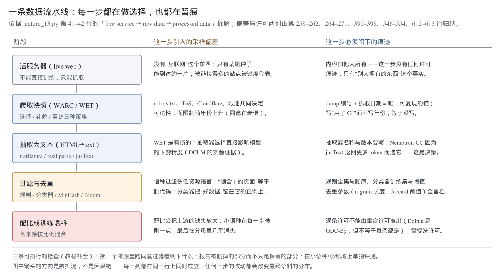

*图 13-1　将数据从在线服务到原始语料、再到处理后语料的流程拆成五步，并标出各步的采样偏差与应记录的信息。底部列出三项检查。*

### 把偏差算成数

偏差不只是修辞，它可以直接从已报告的数字算出来。下面五个量都是标准定义（给出原始数字，没给这些比值；每个式子的代入值都注明出处行号）。

**删除率。** 一条流水线保留了原语料的多少：

$$
\rho=\frac{N_{\text{keep}}}{N_{\text{raw}}} .
$$

代入 C4 的起点与终点（从 1.4 万亿 token 降至 1560 亿 token）：

$$
\rho=\frac{156\times10^{9}}{1.4\times10^{12}}\approx 0.111,
$$

也就是**删掉了 88.9%**。这个数比"用了哪些规则"更能说明流水线的性格。

**去重率。** The Stack 抓了 1.37 亿个仓库、510 亿个文件，其中只有 50 亿是唯一的：

$$
u=\frac{N_{\text{unique}}}{N_{\text{total}}}=\frac{5\times10^{9}}{51\times10^{9}}\approx 0.098 .
$$

近九成的文件是重复的。所以去重不是"优化"，而是让语料可用与否的前置条件。

**覆盖率。** WebText 是 40 GB，但用它的链接去 Common Crawl 里只能找回 17 GB：

$$
c=\frac{17}{40}=0.425 .
$$

公共爬取只覆盖了它声称覆盖的那部分网页的四成多。

**分布偏移。** 设网页总体中第 $i$ 个领域的占比为 $q_i$、过滤后语料中为 $p_i$，两个分布之间的距离可用全变差度量：

$$
\delta=\frac{1}{2}\sum_i|p_i-q_i|\in[0,1],
$$

$\delta=0$ 表示过滤没有改变领域构成，$\delta=1$ 表示完全换了一批。工程上比单个 $\delta$ 更有用的是列出 $p_i/q_i$ 偏离最大的那几个 $i$——那才是被规则误伤的领域。

**保留率与 token 预算。** 若原始快照有 $B$ 字节、平均每 token 占 $r$ 字节、保留率 $\rho$，则可训 token 数为

$$
N=\frac{\rho B}{r}.
$$

Nemotron-CC 抱怨 DCLM "remove 90% of data"，本质就是在说 $\rho$ 太小、$N$ 不够；而 $N$ 直接决定训练能不能继续（Llama 3 与 Qwen3 报告的 token 数分别为 15 万亿和 36 万亿）。这也解释了为什么"过滤更强"与"数据更多"会成为一对长期矛盾：$\rho$ 与质量正相关，$N$ 与 $\rho$ 正相关。

### 三条可执行的检查

（以下三条是把上面的偏差源翻译成可操作的检查项，没有给这份清单。）

1. **换一个来源重跑同一套过滤，看剩下什么。** 如果两个独立 crawl 快照经过同样过滤后领域分布差很多，说明过滤规则对来源过度敏感。
2. **报告被删掉的部分，而不只是保留的部分。** 每个过滤步骤记录"删了多少、按什么规则删、抽样看几条"。C4 从 1.4 万亿 token 压到 1560 亿——这个 89% 的删除率本身就是最重要的元数据，但通常没人报。
3. **在小语种/小领域上单独评测。** 全局指标会掩盖局部塌陷；语种过滤与去重对长尾的伤害远大于对头部。

## 可追溯性：让数据能被复核

### 数据可追溯性的作用

三件事都依赖它。第一，第 12 章的污染判定：如果不知道训练语料里有没有某个测试集，就无法判断分数是否被抬高。第二，许可审计：商用时要能说清每一批数据的来源与许可依据。第三，可复现：别人要能重建出你的语料，或至少重建出它的分布。

核心问题是：

中间那条箭头（live service → raw → processed）里的每一步，都是需要被记录的状态变化。

### 可追溯性所需记录

一份可复核的数据记录至少包含七项：

1. **快照标识**：哪几次 crawl、什么日期、多少个 dump（FineWeb 使用了 95 个 dump）。
2. **种子与发现策略**：从哪出发、遵守什么 `robots.txt` 策略。
3. **抽取器与版本**：WARC 还是 WET、用 trafilatura 还是 jusText。Nemotron-CC 就明确说因为 jusText 返回的 token 更多而选了它——这是一个会影响结果的工程决策，必须写下来。
4. **过滤规则全集**：包括规则顺序，因为顺序会影响结果。
5. **分类器**：训练数据、正负例来源、阈值。
6. **去重算法与阈值**：MinHash 的 n-gram 长度与 Jaccard 阈值、Bloom filter 的参数（RefinedWeb 使用 5-gram MinHash）。
7. **许可判定方法**：怎么判的、判错率多少。The Stack 用 `go-license-detector` 只留 MIT/Apache 一类宽松许可，这个"怎么判"的细节决定了它的可信度。

### 许可的三个陷阱

CommonPile 的数据构造还需留意三个问题：

第一条是**洗许可**：把受版权保护的作品重新以宽松许可发布，很难检测。第二条是**集合许可不向下延伸**：Dolma 整体是 ODC-By，但这不意味着其中每一条数据都是 ODC-By 的。第三条是**合成数据的许可链断了**：用一个在未授权数据上训出来的模型生成数据，这批新数据的许可状态无从判定。

CommonPile 的目的就是回答一个很硬的问题：**只用宽松许可的数据，能不能训出好模型？** 它收集了 8 TB。因此，谨慎的：可以做得不错，但没有更多 token 就很难竞争。

## 一条流水线的十七年

我们将 2019–2024 年的主要数据集按时间排了一遍（的调用顺序就是这条线）。这张表值得完整看一次，因为它是"数据工程如何进化"的最短叙事。

| 年份 | 数据集 | 规模（已报告的数字） | 关键做法 |
| --- | --- | --- | --- |
| 2019 | BERT [40] | Wikipedia + BooksCorpus（7000 本、9.85 亿词） | 用文档而非句子；BooksCorpus 因违反 Smashwords 条款被下架 |
| 2019 | WebText [33] | 800 万页、40 GB | Reddit karma ≥ 3 作为质量代理 |
| 2019 | OpenWebText [39] | 复现 WebText | fastText 去非英文 + 近重复删除 |
| 2019 | CCNet | Common Crawl 过滤版 | 段落级去重 + 语种识别 + KenLM 5-gram 质量过滤 |
| 2019 | C4 [15] | 1.4 万亿 → 1560 亿 token（806 GB） | 纯手工规则，无分类器 |
| 2020 | GPT-3 [41] | 570 GB、4000 亿 token | 训分类器区分高质量来源 + 模糊去重（含 benchmark） |
| 2021 | The Pile [42] | 22 个域、825 GB、约 2750 亿 token | 社群共建；用 WARC+juSText 而非 WET |
| 2021 | MassiveText [43] | 10.5 TB（只用了 3000 亿 token，12%） | 手工规则 + Google SafeSearch 判毒性 |
| 2022 | LLaMA [44] | 1.2 万亿 token | CCNet + C4 + GitHub + 书籍 + arXiv + StackExchange |
| 2023 | RefinedWeb | 5 万亿中放出 6000 亿 | trafilatura + Gopher 规则，刻意不用 ML 过滤以避免偏差 |
| 2024 | Dolma [45] | 3 万亿 token | Bloom filter 去重；避免模型过滤 |
| 2024 | DCLM [38] | 池 240 万亿 → 基线 3.8 万亿 | 质量分类器（fastText） |
| 2024 | Nemotron-CC [46] | 6.3 万亿（高质量子集 1.1 万亿） | 分类器集成 + 合成数据改写 |
| 2022– | The Stack | 1.37 亿仓库、510 亿文件（50 亿去重后）、3.1 TB | 只留宽松许可 + MinHash 近重复删除 |
| — | CommonPile | 8 TB | 只用宽松许可数据 |

两条趋势从表里直接读得出来。

**第一，过滤强度与 token 量在互相拉扯。** Nemotron-CC 的出发点就是对这条张力的直接回应：相关报告指出 FineWebEdu 与 DCLM "filter too aggressively (remove 90% of data)"，而需求是"moar tokens (but preserve quality)"。它的解法有两条：分类器集成（让 Nemotron-340B-instruct 给 FineWeb 文档按教育价值打分，蒸馏到更快的模型）与合成数据改写（低质量数据用 LM 重写，高质量数据用 LM 生成任务）。作为参照，给出两个数：Llama 3 训了 15 万亿 token，Qwen3 训了 36 万亿。**在数据受限的时代，"要更多 token"本身就是一条技术路线。**

**第二，许可从"事后问题"变成"设计约束"。** 2019 年的数据集几乎不讨论许可（BooksCorpus 曾被下架，Books3 也从 Hugging Face 撤下）。2022 年之后，The Stack 以"只留宽松许可"为第一性设计，CommonPile 干脆把"全宽松许可"当成唯一目标。这不是道德进步，而是**风险定价变了**：诉讼出现之后，"能不能用"从研究问题变成了产品问题。

## 本章回顾与练习

数据来源要连同采集时间、许可和处理记录一起管理。追溯信息能帮助复核数据如何进入训练集，也让偏差分析有据可查。

**练习**

1. 为一个网页语料设计最少的来源追溯字段。
2. 解释网页快照与实时网页抓取在可复现性上的差异。
3. 某数据集允许浏览但许可不清；列出在决定训练使用前应核查的问题。

# 第 14 章　数据处理与混合

## 本章导读

原始文档需要经过抽取、过滤、去重和配比，才能成为训练语料。每个步骤都有自己的误差来源，也会改变模型看到的数据分布。

学完本章后，你应能：

- 描述从原始文件到训练样本的处理流程；
- 比较规则过滤、模型打分和去重方法；
- 解释数据配比如何改变有效 token 数与训练分布。

## 数据处理的主要阶段

上一章回答「数据从哪来」：抓取、许可、语料构成。这一章回答「到手之后怎么改」。

这件事之所以不能省，是因为**原始数据和训练样本之间差着四次变形**，而每一次变形都不是中性的：转写丢信息，过滤带偏分布，去重改变重复度，配比改变各源的权重。四步合起来决定了模型实际看到的是什么分布——这比模型结构更能解释两个同规模模型的能力差距。

我们将四步和后训练数据并列讲，是因为它们的失效模式不同，但共用同一套「定义目标 → 用打分函数逼近 → 按分数取舍」的骨架。下表是本章的地图。

| 步骤 | 要修的失效模式 | 核心机制 | 主要代价 |
| --- | --- | --- | --- |
| 转写（transformation） | 原始数据不是文本：HTML、PDF、代码目录 | 规则抽取 + OCR + 线性化 | 有损；版面与表格信息丢失 |
| 过滤（filtering） | 语料里混着低质、错语言、有毒内容 | 训练一个 target 分类器，按分数取舍 | 需要极快（跑在全量原始数据上） |
| 去重（deduplication） | 镜像站、fork、模板文、复制粘贴 | 哈希 + Jaccard + LSH | 两两比较的复杂度；内存 |
| 配比（mixing） | 多源的采样权重拍脑袋 | 小规模回归 + epoch 上限 | 小规模到大规模的迁移假设 |

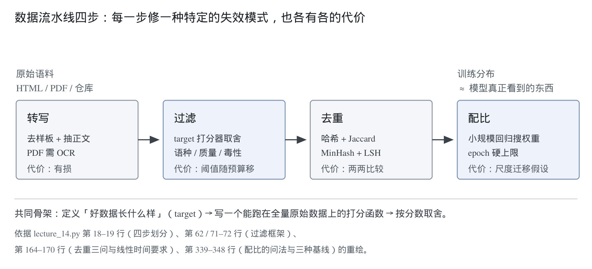

四步的共同骨架是同一句话：**先定义「好数据长什么样」（target），再写一个能跑在全部原始数据上的打分函数，最后按分数取舍。**差别只在「打分函数」的形态——转写用的是规则，过滤用的是分类器，去重用的是哈希碰撞，配比用的是回归模型。看清这一点，四步就不需要分别记忆。

## 第一步：转写——原始数据不是文本

网页的主干工作是去掉样板（导航、广告）并抽出正文。网页抽取还要处理三个问题：图片与表格怎么办、这一步**本质上是有损的**（必须把二维版面线性化成一维 token 序列）、以及工具都是规则式的。

「Accuracy matters」这一判断来自 DCLM 对抽取器的对照实验。PDF 更麻烦：FinePDFs 的流程要重抓被截断的大 PDF、用 VLM（RolmOCR）或 Docling 做 OCR、再大量清理与过滤，相关报告也指出「a lot of layout information is missing」——公式的上下标、表格的行列关系在纯文本里没有位置可放。

转写误差为什么会被放大，可以用一个简单估计说明。设抽取器把正文 token 的 $p_{\text{keep}}$ 保留下来、把样板 token 的 $p_{\text{leak}}$ 混进正文，则训练分布中垃圾占比约为

$$
\pi_{\text{junk}} = \frac{p_{\text{leak}}\, N_{\text{boiler}}}{p_{\text{keep}}\, N_{\text{body}} + p_{\text{leak}}\, N_{\text{boiler}}},
$$

其中 $N$ 是各自的 token 数。网页上样板与正文的量级常常相当（$N_{\text{boiler}} \approx N_{\text{body}}$），于是 $p_{\text{leak}}$ 从 2% 涨到 20% 就足以让 $\pi_{\text{junk}}$ 从 2% 涨到 17%：**抽取器的精度直接改写了训练分布的熵**。这不是已报告的结论，但它是 DCLM 愿意花整节篇幅做抽取器消融的原因 [38]。

## 第二步：过滤与质量评分

### 统一框架

去重的目标可以概括为：

语言识别、质量过滤、毒性过滤都是这一句话的特例。对算法只有两条硬要求：

第一条容易被忽略：target 集是「好数据的样子」，如果算法只会原样挑回 target，它就没有泛化，只是在做数据泄漏。第二条决定了方法选择——分类器必须是线性的或极小的，因为要跑在 TB 级原始语料上。

打分函数只有两类，给出它们的公式：

即保留规则是

$$
\text{keep}(x) \;\Longleftrightarrow\; s(x) \ge t,
\qquad s(x) \in \{\,p_T(x),\; p(T\mid x)\,\}.
$$

生成式打分（KenLM 的 n-gram 困惑度）回答「这句话像不像 target 语料」，判别式打分（fastText）回答「这句话属于 target 的概率」。前者便宜、不需要负例；后者更锐利，但需要构造负例。

两者的单位成本几乎差一个数量级，这决定了它们各自的位置。$n$-gram KenLM 打分是 $|x|$ 次查表 + 加法，复杂度 $O(n\lvert x\rvert)$，常数极小，纯 CPU、无向量运算；fastText 打分是一次「词袋平均 + 线性层」，复杂度 $O(\lvert x\rvert d + d\lvert C\rvert)$，其中 $d$ 是词向量维度、$\lvert C\rvert$ 是类别数。取 $\lvert x\rvert\approx5\times10^{2}$、$d=10^{2}$，后者约 $5\times10^{4}$ 次乘加，而前者是 $10^{3}$ 量级的查表——所以在 $10^{12}$ token 规模上，KenLM 是「几乎免费」，fastText 是「要排进预算」。这也解释了为什么 OpenMathText 先用规则和 KenLM 把语料砍一大刀（困惑度 < 15000），最后才用 fastText 做精筛。

此外，给了一张路线表，说明这不是纯技术选择而是流派选择：

### 三个应用

| 应用 | target 是什么 | 打分器 | 采用的具体参数 |
| --- | --- | --- | --- |
| 语言识别 | 目标语言（如英文） | fastText 现成模型，支持 176 种语言 | Dolma 保留 $p(\text{English}) \ge 0.5$ [45] |
| 质量过滤 | 高质量文本 | 线性分类器 / fastText / 随机森林 | GPT-3 用 Pareto 随机保留；phi-1 用随机森林 |
| 毒性过滤 | 无毒评论 | 在 Jigsaw 有毒评论集上训练 | Dolma 直接复用该数据集 [45] |

GPT-3 的做法值得单独看，因为它的保留规则是**随机**的而不是硬阈值 [41]：

采用的实现是一行采样：

```python
def keep_document(score: float) -> bool:
    return np.random.pareto(9) > 1 - score
```

`np.random.pareto(a)` 采样的是 Lomax 分布，$P(X > y) = (1+y)^{-a}$。令 $y = 1-s$、$a=9$，保留概率为

$$
P[\text{keep}\mid s] = (2-s)^{-9},
$$

它在 $s=1$ 时等于 1，$s=0$ 时等于 $2^{-9}\approx 0.2\%$。所以这不是「阈值 + 硬切」，而是一条**单调但处处非零**的接受曲线：低分文档仍有极小概率进入训练集，高分文档也不会因为差 0.01 分被整批丢掉。这种设计保留了分布的尾部，代价是过滤不再可复现（除非固定随机种子）。

phi-1 走的是另一条路：先让 GPT-4 按「对学习基础编程的学生有多少教育价值」给 10 万条样本打标，再在这个小 target 集上训练随机森林，特征用预训练 codegen 模型的输出 embedding，最后在全量 Python 子集上打分 [47]。已报告的对照是唯一的硬数字：

同样的 1.3B 模型，过滤后**用的步数只有 37.5%（36K/96K），HumanEval 却从 12.19% 提到 17.68%**。这是全章最干净的一条证据：数据选择能把「算力效率」放大到接近 3 倍。

### 阈值随训练长度移动

这一步容易出错，需特别检查：

直觉是这样的：过滤是在「提高单位 token 的质量」和「减少可用 token 总量」之间做交换。如果训练预算小（只训 1 个 epoch 的一小部分），你几乎必然要用最高质的子集；如果预算大到要在同一份数据上重复很多遍，那么把低质但**新颖**的 token 丢掉就是净损失——重复高质数据带来的过拟合，比多看点低质数据的收益更糟。所以阈值必须和「训练 token 数 / 可用 token 数」一起调，不能单独调。

## 第三步：去重与线性时间复杂度

### 两种重复，两种危害

近似重复的常见来源是服务条款与许可证、模板化写作、以及复制粘贴造成的格式差异。已报告的极端例子是 C4 里同一段商品描述出现了 **61,036 次**——这已经不是「数据里有点噪声」，而是一个 token 序列被赋予了 6 万倍的权重。

去重有两项直接收益：

第一条是算力账：重复 token 对梯度的贡献近似冗余，删掉它等于免费提高有效学习率。第二条是合规账：模型逐字复现训练文本的能力与重复度强相关，去重是缓解版权与隐私风险最便宜的手段。

### 去重算法的设计选择

我们将去重拆成三个必须分别回答的问题：

这三个问号决定了后面所有算法的形态。粒度越细，误删越多；匹配越严格，漏删越多；「全删」比「留一个」更彻底，但也更容易删掉唯一一份正确版本。

而真正的难点不在这三个问号里，而在复杂度上：

朴素两两比较是 $O(N^2)$；$N=10^{9}$ 篇文档时这个数字没有任何工程意义。所以全章的方法都在做同一件事：**把「比较」换成「碰撞」**。

### 精确去重：一次排序就是一次 MapReduce

精确去重可以用三行代码实现：

```python
hash_items = itertools.groupby(sorted(items, key=mmh3.hash), key=mmh3.hash)
deduped_items = [next(group) for h, group in hash_items]
```

要点在最后一句：`sorted(key=hash)` + `groupby` 正是 shuffle 的两步，换成任意 MapReduce 引擎都能跑，内存只需一个哈希值而不是原文。代价是哈希碰撞会误删——所以这里必须用抗碰撞的哈希（或用足够长的摘要），而**不能**用下面 LSH 里那种「故意容易碰撞」的哈希。

C4 的选择展示了粒度的取舍：item 取 3 句 span，精确匹配，留一个 [15]。

这是细粒度去重的固有副作用：删掉一段会让上下文断裂，模型于是学到「句子之间可以无因果跳转」。粗粒度（整篇）去重没有这个问题，但会把「一篇好文章里有一段是抄的」整篇丢掉。

### Jaccard 与 MinHash

近似重复需要一个相似度定义。常用集合的 Jaccard 系数衡量相似度：

$$
J(A,B) = \frac{|A \cap B|}{|A \cup B|},
$$

并把「近似重复」定义为 $J(A,B) \ge \tau$（$\tau$ 由使用方设定）。$A$、$B$ 通常是文档的 shingle 集合（连续 $k$ 个 token 的集合）。

问题仍然是 $O(N^2)$。MinHash 的作用是给每个集合一个**固定长度的签名**，使签名的碰撞概率等于 Jaccard：

用特征矩阵 + 随机置换给出证明思路：对集合 $S$，定义 $h(S)=\min_{x\in S} h(x)$。随机置换下每个元素成为最小值的概率相同，因此

$$
\Pr\big[h(A)=h(B)\big]
= \Pr\big[\text{首个最小元素同属 } A \text{ 与 } B\big]
= \frac{|A\cap B|}{|A\cup B|}
= J(A,B).
$$

实现只有一行 `min(mmh3.hash(x, seed) for x in S)`，并用 100 个随机种子验证估计误差小于 0.01——也就是说签名长度 $n$ 越大，$\hat J$ 的二项标准差 $\sqrt{J(1-J)/n}$ 越小。

但单次碰撞什么也判不了：

### LSH：把阈值压成一条 S 曲线

解决方案是把 $n$ 个 MinHash 分成 $b$ 个 band、每个 band $r$ 个（$n=br$），**任一 band 内全部相同**就判定为候选对：

采用的碰撞概率就是「或（band 间）之与（band 内）」：

$$
P_{\text{collide}}(s) = 1-\bigl(1-s^{r}\bigr)^{b},
\qquad s = J(A,B).
$$

这条曲线就是图 14-2。它有 S 形：$s$ 很小时概率趋 0，$s$ 很大时趋 1，中间有一段陡峭的过渡。参数的作用这意味着得很清楚：

阈值（相变点）的定义是「一个固定 band 期望匹配数等于 1」的那一点，即 $s^{r}=1/b$，于是

$$
s^{\ast} = \left(\frac{1}{b}\right)^{1/r},
\qquad
P_{\text{collide}}(s^{\ast}) = 1-\left(1-\frac{1}{b}\right)^{b} \approx 1-\frac{1}{e} \approx 0.632 .
$$

用的验收例子是 $n=9000,\; b=20,\; r=450$，代入得 $s^{\ast} = 20^{-1/450} \approx 0.9934$——也就是说，只有 **Jaccard 约 99.3% 以上**才被判为近似重复。这个数字看起来很高，但它正是「近似重复」在代码语料里的实际尺度：改一个变量名、加一行注释，Jaccard 仍然在 0.99 量级。

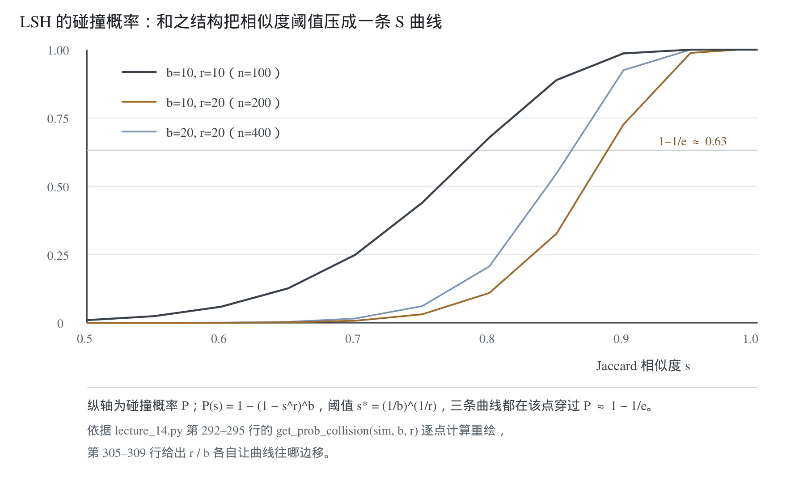

图 14-2 有两点值得单独记住。第一，三条曲线在 $s^{\ast}$ 处都穿过同一条水平线 $1-1/e$——这不是巧合，而是阈值的定义方式决定的：一个固定 band 的匹配概率被设计成 $1/b$，于是期望匹配 band 数恰好是 1，至少一个匹配的概率就是 $1-(1-1/b)^b$。第二，S 曲线的陡峭程度由 $r$ 决定：期望匹配 band 数的对数斜率约为 $b\cdot r$ 量级（由 $s^r$ 的导数可得），所以「判定要多干脆」和「哈希要做多少次」是同义词。

### $n=9000$ 时的计算成本

LSH 的收益是「不用两两比较」，代价是每个文档要做 $n \times |S|$ 次哈希。取文档 shingle 数 $|S| = 10^{3}$、单核 mmh3 吞吐 $10^{7}$ 次/秒：

$$
\frac{9000 \times 10^{3}}{10^{7}} \approx 0.9\ \text{核·秒/文档}.
$$

$10^{9}$ 篇文档就需要 $9\times10^{8}$ 核·秒，约 **28.5 核·年**；摊到 1000 核上是十天量级。这就是产业界必须在三个参数上做取舍的原因：

| 方法 | 每文档计算量 | 全局结构 | 可否 MapReduce | 适合的重复类型 |
| --- | --- | --- | --- | --- |
| 精确哈希 | $O(1)$ 次哈希 | 排序或哈希表，$O(N)$ | 可以 | 镜像站、fork、逐字复制 |
| 细粒度精确（C4） | $O(|D|/3)$ 次哈希 | 同上 | 可以 | 段落级复制 |
| MinHash + LSH | $O(n\lvert S\rvert)$ 次哈希 | band 桶，桶内再两两 | 可以（先分桶） | 近似重复、模板文 |

一眼能看出的结论是：想提高召回（更低的 $s^{\ast}$）就要么增大 $b$ 要么减小 $r$；但减小 $r$ 会让曲线变平，判定变得随机。**LSH 的分辨率本质上由 $n=br$ 买来**，所以「阈值定得多准」和「算力花多少」是同一个旋钮。

## 第四步：配比——质量、多样性与 epoch 的三方谈判

### 三种基线

模型同时在多个源上训练（网页、代码、论文、百科），于是必须回答：

三种基线的性质差别很大：均匀采样等于给「小而精」的源极高权重；按比例采样等于让「大而杂」的网页主导一切；凭感觉设定则常见于工业界，且往往有效——但无法归因。

有两点说明为什么不能「一味给高质量源加权」的理由：

### 稀缺源的 50 遍

第二条是最容易算错的地方，具体计算如下。设低质源有 $10^{12}$ token、高质源只有 $10^{10}$ token，配比取 $p=(0.5,0.5)$，总训练量 $10^{12}$ token，则各源的 epoch 数是

$$
e_s = \frac{p_s \, N_{\text{train}}}{N_s},
\qquad
e_{\text{low}} = \frac{0.5\times10^{12}}{10^{12}} = 0.5,
\qquad
e_{\text{high}} = \frac{0.5\times10^{12}}{10^{10}} = 50 .
$$

这个算式说明：**配比问题实际上是一个带约束的优化问题**，约束来自每个源的有限性。忽略它，你得到的不是「更高质量的混合」，而是「在一个小语料上训 50 个 epoch 的记忆化模型」。

### UniMax：给 epoch 数设硬上限

UniMax（原用于多语言配比）：在均匀采样之上加一个硬上限。

形式化为

$$
\begin{aligned}
\text{maximize}\quad & \textstyle\sum_s w_s \log p_s \\
\text{subject to}\quad & \textstyle\sum_s p_s = 1,\quad
p_s N_{\text{train}} \le C\,N_s \ \ \forall s,
\end{aligned}
$$

其中第一行是「尽量接近想要的权重 $w$」，第二行是可行性约束（$C$ 通常取 4–10）。当某个源触顶时，它的份额被压到 $C N_s / N_{\text{train}}$，剩下的质量按比例分给其他源。这比手调阈值的好处是**约束是显式的**：你能立刻看出哪个源被 epoch 上限卡住了。

### 回归式配比与模拟 epoching

更系统的做法是把配比当成一个小型回归问题（RegMix 一类）[48]：

即在单纯形上采样若干配比 $p^{(1)},\dots,p^{(m)}$，各训一个小模型，得到下游分数 $y^{(i)}$，拟合 $\hat f(p)\approx y$，再在单纯形上求 $\arg\max_p \hat f(p)$。这种方法依赖两个前提：

第一个希望很脆弱：回归模型在采样点附近准，不代表在极值点准，而我们恰恰只用极值点。第二个希望已经被已有结果也表明——配比**确实**有尺度依赖：

模拟 epoching（simulated epoching）是针对这个矛盾的补丁：让**小规模实验看起来像大规模训练**。做法是把所有源按同一比例降采样：

$$
r = \frac{N_{\text{small}}}{N_{\text{large}}},
\qquad
N_s' = r\,N_s .
$$

算一下就知道它为什么有效：$N_{\text{small}}=10^{10}$、$N_{\text{large}}=10^{12}$ 时 $r=0.01$，高质源从 $10^{10}$ 降到 $10^{8}$ token。此时任何「在高质量源上反复 epoch」的配比都会立刻在小规模上暴露为过拟合，于是搜出来的最优点自动向均衡移动——已报告的例子从 $p_{\text{high}}=0.9$ 调到 $0.3$。（正文该处代码注释写作「More mass on high quality data」而数值方向相反，本书按数值理解：高质源权重被下调。）

这条思路值得记成一句方法论：**小规模实验的价值取决于它是否复现了大规模训练的约束**。前面第 9、11 章的 scaling law 是这样，数据配比也是这样。

## 后训练数据与合成数据

我们将后训练数据放在数据章，是因为它和预训练数据共享同一套骨架，但配方反过来：预训练是「从海量里筛出想要的」，后训练是「为了想要的去造出来」。

OpenThoughts 是这个配方的公开实例：1.2M 条样本，教师是 QwQ-32B，问题来自 27 个人类与合成源。这组数据呈现出四条与直觉相反的观察 [49]：

第二条尤其重要：**教师的能力不等于教师的价值**。一个更强的模型可能输出风格过于多样、推理链过长，反而不如一个「稳定、格式规整」的中等模型适合做蒸馏源。第三条则说明「答案正确性过滤」在这个尺度上不是瓶颈——瓶颈在题目分布。

这些评测集的构造方式各异：SWE-smith 向 128 个仓库注入 bug，生成 5 万个任务；SWE-Zero 根据 15 万个 GitHub PR 构造 30 万条无执行反馈的轨迹，并删除未来提交；SWE-rebench 用 Qwen 2.5-72B-Instruct 安装依赖、评估 PR，生成 2.1 万个可交互任务。任务数量不等于数据质量。

## 本章回顾与练习

抽取、过滤、去重和配比会逐步改变训练语料。需要把质量定义写成规则，并检查每一步误删、重复和分布漂移。

**练习**

1. 为一批 PDF 设计从抽取到训练样本的处理流程，并标明三种可能的抽取错误。
2. 比较 MinHash 去重与精确哈希，分别说明适用场景。
3. 如果高质量来源被重复采样 4 次，说明唯一 token 数和有效训练曝光次数的区别。

# 第 15 章　Mid / Post-training

## 本章导读

预训练目标让模型预测下一个 token；后训练则改变模型如何响应指令和偏好。本章从监督微调数据出发，再讨论偏好优化的目标与约束。

学完本章后，你应能：

- 区分预训练、SFT 与 mid-training；
- 解释偏好数据如何构造奖励或比较目标；
- 辨认 PPO 与 DPO 在优化对象上的差别。

## 预训练模型与对话助手的能力差异

前文分别讨论了数据、架构和训练规模。到此为止你得到的是一个**会续写的模型**：给它一段文本，它按训练分布的统计规律往下写。这不是助手。

差距在于**控制**：模型还需要学会按指令组织回答，并根据偏好调整输出。

后训练领域的经验结论需要谨慎看待：

**后训练的经验知识比预训练稀疏得多**。预训练有 scaling law 这种可复现的定量关系；后训练大量结论来自少数几篇论文与工业实践，很多细节不公开。因此，已有结果有时只给出趋势而没有具体系数，反映的是该领域公开证据仍然有限。

已报告的标准路线是两段式：

常见流程分为两段：先做 SFT（supervised fine-tuning，监督微调），再进行偏好优化，例如 PPO 或 DPO。

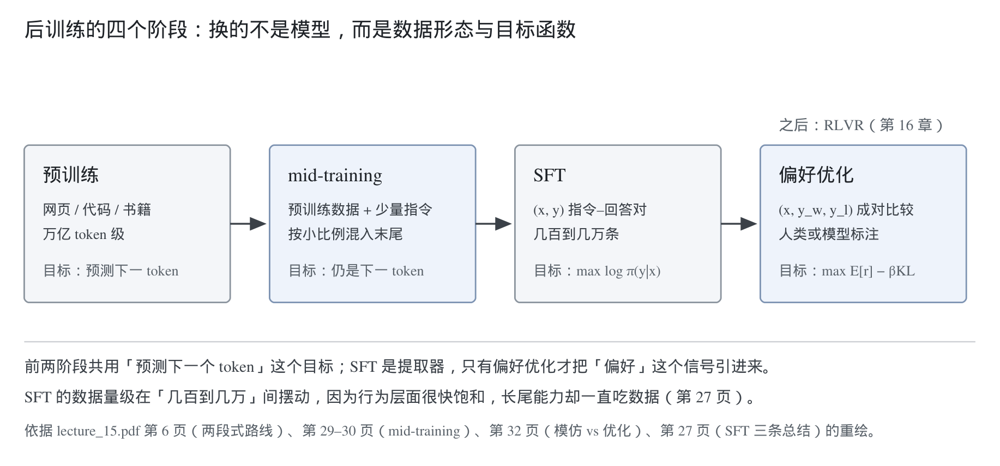

## SFT：只有两个成分

方法简单到几乎不需要讲——就是在指令-回答对上做梯度下降。所以这一节的重心全在数据上。我们将「数据集里到底有什么」和「什么决定高性能」拆成两个问题，并用一串真实数据集作答。

### 从 FLAN 到 agent 轨迹

几类常见的指令数据各有特点：FLAN 是**把 NLP 基准改写成指令**（分类、摘要、data-to-text），回答短、格式规整；Alpaca 是开放式指令加代码，属于 Self-instruct 这一支——让强模型按种子指令批量生成「指令-回答」对，再人工抽检 [35]；OpenAssistant 是长回答、带文献引用；Nemotron-SFT-OpenCode 直接是带 `tool_calls` 的 agent 轨迹（读取仓库文件并调用开发工具）。

这三条差别解释了为什么「SFT 数据量」这个数字几乎没有意义：同样 10 万条，FLAN 式的短问答与 OpenAssistant 式的长论述训练出的模型，行为完全不同。两类差异分别体现在样本表面形式和训练目标上：

| 显性差异（一眼看得出） | 隐性差异（更要命） |
| --- | --- |
| 回答长度、是否用 bullet | 数据规模（scale） |
| 是否带引用、是否带复杂知识 | 安全（safety） |

### 风格会被误当成能力

一个实际问题是：

解释这一结果时，还需考虑评测条件：

这些结果表明：**长度、bullet、语气这类风格因素会强烈影响「偏好式」评测，却基本不影响「有标准答案」的基准**。这意味着两件事。第一，用偏好胜率当能力指标是错的——你测到的一大半是风格。第二，反过来说，如果目标是让模型「讨人喜欢」，那么风格就是产品的一部分，不该被当成噪声消除。第 12 章讲评测设计时强调「先问测什么」，这里就是最典型的案例。

### 微调不能注入事实

OpenAssistant 中一条讨论 monopsony 并带有文献引用的回答引出了一个值得分析的问题：这条样本到底在教模型什么？


为什么「加入事实正确的数据」也可能有害？SFT 的损失只最大化 $\log\pi_\theta(y\mid x)$，它奖励的是「在被问到 $x$ 时输出 $y$ 这个字符串」，而不是「$y$ 为真」。若模型参数里没有关于该事实的可靠表征，最小化损失的最省力路径是学会「被问到这类问题时给出一个语气确定的断言」——也就是幻觉的**行为面**。我们将它标为 folklore（民间经验）而不是定论，是因为缺少受控实验；但至少从目标函数的形式看，这个机制是自洽的。

### 安全：500 条就能改变行为

安全数据的公开细节最少，目前公开信息显示：

主要做法是**从真实用户场景里抽安全案例**，再做少量高质量标注。效果量级是这一节唯一给出的数字：

500 条能改变行为，说明安全**不是一个需要海量数据的能力，而是一个需要精确触发的行为**。

### SFT 能改变行为，但不等于注入新知识

SFT 可以把预训练中已经形成的续写、翻译或推理能力接到「指令 → 回答」的接口上，但不能保证模型因此获得可靠的新事实。LIMA 等工作的观察是，少量高质量样本也能显著改变回答行为 [50]。这不意味着所有目标都能用少量数据达到：格式和响应习惯可能较快趋于稳定，长尾能力的覆盖则可能随着样本增加继续改善；所需规模取决于任务和数据质量。

## Mid-training：把指令微调折进预训练

如果 SFT 只是「提取」，那它为什么不能做得更大？因为数据量一大就会灾难性遗忘。一种做法是调整训练顺序：

公开相关研究通常没有给出统一配比，因此这里不指定一个数值。机制很直接：把指令数据按一个小比例（例如百分之几）混进预训练的末尾阶段，模型就在「预测下一个 token」这个它熟悉的 objective 下见过对话格式；随后那一轮短 SFT 只负责把格式对齐，不需要再承担「让模型见过这种数据分布」的任务，于是既放大了指令数据的使用量，又避免了在纯指令数据上反复训练导致的遗忘。第 14 章讲的配比与 epoch 上限，在这里同样适用。

## 监督微调与偏好优化

用两行公式把两种范式分开，这是本章最重要的一处对照：

写成公式，SFT 是最大似然：

$$
\mathcal{L}_{\text{SFT}}(\theta)
= -\,\mathbb{E}_{(x,y)\sim\mathcal{D}}
\Big[\sum_{t=1}^{|y|}\log \pi_\theta\big(y_t \mid x, y_{<t}\big)\Big],
$$

而偏好优化是带 KL 约束的奖励最大化：

$$
\max_{\pi}\ \;
\mathbb{E}_{x\sim\mathcal{D},\,y\sim\pi(\cdot\mid x)}\big[r(x,y)\big]
\;-\;\beta\,
\mathbb{E}_{x}\Big[\mathrm{KL}\big(\pi(\cdot\mid x)\,\big\|\,\pi_{\text{ref}}(\cdot\mid x)\big)\Big],
$$

其中

$$
\mathrm{KL}\big(\pi\,\|\,\pi_{\text{ref}}\big)
=\mathbb{E}_{y\sim\pi}\Big[\log\frac{\pi(y\mid x)}{\pi_{\text{ref}}(y\mid x)}\Big].
$$

两者的差别不是「有没有标签」，而是**优化对象**：SFT 让模型去逼近一个分布，RLHF 让模型去最大化一个可测量的量。常用的表述是——「LMs are policies, not a model of some distribution」：一旦进入优化视角，模型就是一个策略 $\pi_\theta(y\mid x)$，我们关心的是它采样出来的东西有多好，而不是它对数据分布拟合得多准。

那为什么不直接 SFT 到底？已报告的答案是 G-V gap：

**人们写下的（generation）不是他们偏好的（valuation）**。标注者写摘要时会写自己习惯的风格，但在两个候选之间二选一时，他会选另一个。只要目标行为与「人类写出来的文本」有系统偏差，纯模仿就有一个不可消除的误差地板——这就是需要偏好数据的原因。

| 维度 | SFT（模仿） | 偏好优化（RLHF / DPO） |
| --- | --- | --- |
| 数据形态 | $(x,y)$ 指令-回答对 | $(x,y_w,y_l)$ 成对比较 |
| 目标 | 最大似然 $\log\pi_\theta(y\mid x)$ | 最大化 $r$ 并受 KL 约束 |
| 优化对象 | 一个分布 | 一个策略 |
| 天花板 | 人类书写的分布 | 人类偏好的分布 |
| 典型失败 | 学到风格，没学到偏好 | 过优化、熵坍缩 |

## 偏好数据：从人到模型

偏好数据的收集本身就很困难。标准设置是成对反馈：给同一个 prompt 两个回答，标注者选更好的那个。InstructGPT 的标注指南是少数公开的详细材料[51]。

有价值的不是「成对」这个形式，还要考虑三类混杂因素。第一，**标注者是谁会改变模型**：

第二，**众包本身不可靠**：难以拿到真正高质量、可验证的标注者，难以让他们真的去核对正确性，还要提防标注者用 AI 代写；大规模收集还有伦理问题。第三，**模型可以替代人做标注**：

到这一步，基于 AI 反馈的训练方法逐渐得到应用：Ultrafeedback 这类纯模型标注的数据被用于 Zephyr、Olmo、Tulu3，Constitutional AI 则让模型按一套原则给自己的输出打分[47]。但这种做法也会带来副作用：**长度效应在 RLHF 后非常显著**。原因不难推：如果标注者（或模型评委）系统性地偏好更长的回答，偏好优化就会把「变长」当成提高奖励的捷径。这类现象可能来自奖励信号自身的偏差，具体机制需要通过受控实验检验。

## PPO：三行公式，一条难调的路

有了成对数据，怎么把它变成梯度？按历史顺序给了三步。第一步是策略梯度：

$$
\nabla_\theta\,\mathbb{E}_{p_\theta}\big[R(z)\big]
= \mathbb{E}_{p_\theta}\big[R(z)\,\nabla_\theta \log p_\theta(z)\big],
$$

它无偏但**方差极大**——已有分析指出其方差过高。

$R(z)$ 是整条序列的一个标量，而 $\log p_\theta(z)=\sum_t \log\pi_\theta(y_t\mid s_t)$，于是梯度估计的方差随序列长度 $T$ 增长；同一个 prompt 下不同采样的奖励差异又很大，导致要几百上千条 rollout 才能把梯度噪声压下来。这正是 PPO 必须配 value baseline 与优势估计的原因，具体做法留给第 16 章。

第二步 TRPO 在当前策略附近做线性化，限制每次更新的步长；第三步 PPO 把「限制步长」换成更便宜的裁剪 [52]：

$$
\mathcal{L}^{\text{CLIP}}(\theta)
=\mathbb{E}\Big[\min\big(\rho_t A_t,\ \mathrm{clip}(\rho_t,\,1-\epsilon,\,1+\epsilon)\,A_t\big)\Big],
\qquad
\rho_t=\frac{\pi_\theta(y_t\mid s_t)}{\pi_{\theta_{\text{old}}}(y_t\mid s_t)} .
$$

$\rho_t$ 是新旧策略在同一个 token 上的概率比；把它裁到 $[1-\epsilon,1+\epsilon]$，等价于声明「一次更新不允许把某个 token 的概率改动太多」。我们将 PPO 排在 TRPO 之后讲，是因为两者目的相同（别一步走太远），而 clip 只需要一次乘法加一次比较——这正是 PPO 能在语言模型这种巨大动作空间上跑起来的原因。$A_t$ 是优势估计，它决定了「这个 token 该被鼓励还是抑制」；没有它，$\rho_t$ 的裁剪就不知道该往哪个方向裁。

PPO 的实现成本也需要考虑：

「看起来无害」是说：目标函数只有一行，但它背后需要一个奖励模型、一个价值网络、一个在线采样循环、一个 KL 控制器，任何一处不稳都会让训练崩掉。这也是后面 DPO 出场的动机。在引入 DPO 前，可以先看四种「能不能不要 PPO」的想法——加 `[GOOD]` / `[BAD]` 控制 token 做 SFT、只在偏好回答上训练、训奖励模型后取偏好者、训奖励模型后采 1024 个取最好——它们共同的弱点是：要么丢掉了负样本的信息，要么仍然要单独训奖励模型。DPO 的思路是把这两件事一次解决。

## DPO：把奖励模型消掉

推导分四步，每一步都值得写清楚，因为它解释了「为什么可以不训奖励模型」。

**第一步：非参数假设下的闭式最优。** 固定 $x$，把上面那个 KL 约束目标对分布 $\pi(\cdot\mid x)$ 求极值。这是一个标准的变分问题：目标里既有 $\pi$ 的线性项（奖励），又有 $\pi\log(\pi/\pi_{\text{ref}})$ 形式的项，用拉格朗日乘子可解。我们将它写成「Assume that the policy $\pi$ is the set of all policies (nonparametric assumption). The maximizer is then,」，结果是

$$
\pi^{\star}(y\mid x)
=\frac{1}{Z(x)}\,\pi_{\text{ref}}(y\mid x)\,
\exp\!\Big(\frac{r(x,y)}{\beta}\Big),
\qquad
Z(x)=\sum_{y}\pi_{\text{ref}}(y\mid x)\exp\!\Big(\frac{r(x,y)}{\beta}\Big).
$$

把约束 $\sum_y\pi(y\mid x)=1$ 用乘子 $\lambda(x)$ 加进目标，对每个 $y$ 求偏导并令其为零，得 $\log\frac{\pi(y\mid x)}{\pi_{\text{ref}}(y\mid x)}=\frac{r(x,y)}{\beta}+\text{const}$，整理即得上式。依据是采用的结论与该目标是标准 KL 正则问题的形式；完整推导亦见 DPO 原论文 [53]。

**第二步：反解隐式奖励。** 把上式取对数并移项：

$$
r(x,y)=\beta\log\frac{\pi^{\star}(y\mid x)}{\pi_{\text{ref}}(y\mid x)}+\beta\log Z(x).
$$

这一步是全篇的关键：**最优策略与奖励之间存在一一对应**，所以奖励可以被策略「表示」出来。后来的推理模型工作也使用了这一等价关系。

**第三步：代入 Bradley–Terry。** 成对偏好的标准模型是

$$
P(y_w \succ y_l \mid x)=\sigma\big(r(x,y_w)-r(x,y_l)\big),
\qquad \sigma(z)=\frac{1}{1+e^{-z}} .
$$

把第二步的 $r$ 代进去，$\beta\log Z(x)$ 在相减时**抵消**——这正是 DPO 不需要奖励模型、也不需要估计配分函数的原因。

**第四步：得到损失。** 对数据集做负对数似然：

$$
\mathcal{L}_{\text{DPO}}(\theta)
=-\mathbb{E}_{(x,y_w,y_l)}\Big[\log\sigma\Big(
\beta\log\frac{\pi_\theta(y_w\mid x)}{\pi_{\text{ref}}(y_w\mid x)}
-\beta\log\frac{\pi_\theta(y_l\mid x)}{\pi_{\text{ref}}(y_l\mid x)}
\Big)\Big].
$$

有一种概括将其称为「Conceptually.. This is MLE on the pairwise rewards, under nonparametric assumption + alternative parametrization」——它不是新的学习范式，而是**换了一种参数化**的成对奖励最大似然。图 15-2 把这四步画成一条链。

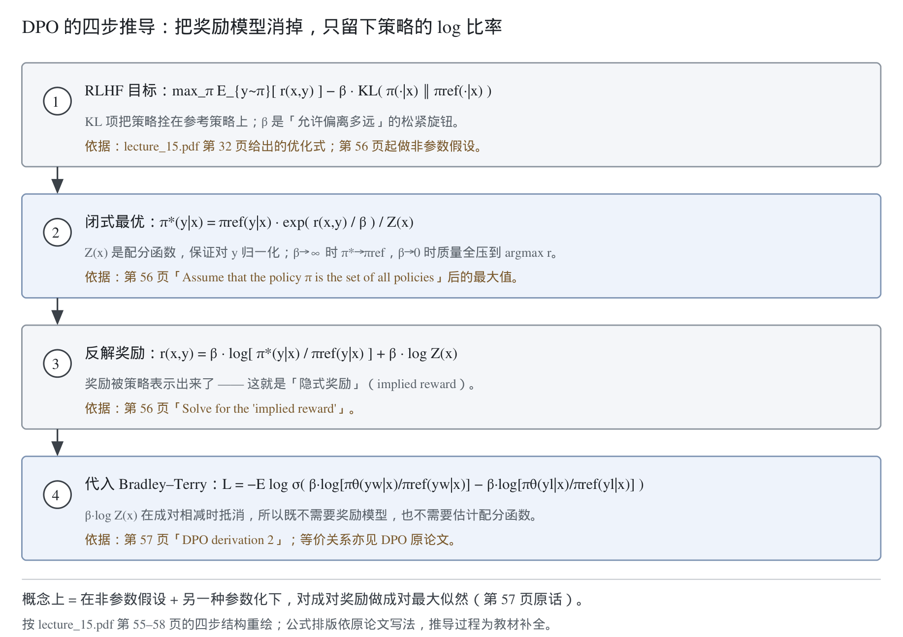

### 偏好目标的梯度形式

对 $\mathcal{L}_{\text{DPO}}$ 求导，报告显示一个很好记的形状：

$$
\nabla_\theta \mathcal{L}_{\text{DPO}}
=-\,\beta\,
\mathbb{E}\Big[
w_\theta(x,y_w,y_l)\Big(
\nabla_\theta\log\pi_\theta(y_w\mid x)
-\nabla_\theta\log\pi_\theta(y_l\mid x)
\Big)\Big],
$$

$$
w_\theta(x,y_w,y_l)=\sigma\big(\hat r_\theta(x,y_l)-\hat r_\theta(x,y_w)\big),
\qquad
\hat r_\theta(x,y)=\beta\log\frac{\pi_\theta(y\mid x)}{\pi_{\text{ref}}(y\mid x)} .
$$

可以这样理解：「pos gradient on good, neg gradient on bad (Scaled by 'prediction error' of the implied reward model)」：

- 括号里是「抬高 $y_w$ 的似然、压低 $y_l$ 的似然」；
- 权重 $w_\theta$ 是**隐式奖励模型判错的程度**：若模型已经认为 $y_w$ 远好于 $y_l$（$\hat r_w \gg \hat r_l$），则 $\sigma(\hat r_l-\hat r_w)\to 0$，这条样本几乎不产生梯度；若模型判反了，权重接近 1，梯度最大。

这个「按错误程度加权」的结构，正是它能在离线数据上稳定工作的原因——已经在训练集上「学会」的样本自动降权，不会像纯 SFT 那样被大量简单样本淹没。

### β 与参考策略的约束作用

这是本章最容易被略过、但最该讲清的一点。看第一步的闭式解 $\pi^{\star}\propto\pi_{\text{ref}}\exp(r/\beta)$ 就能读出全部行为：

| $\beta$ | $\pi^{\star}$ 的行为 | 后果 |
| --- | --- | --- |
| $\beta\to\infty$ | $\exp(r/\beta)\to 1$，$\pi^{\star}\to\pi_{\text{ref}}$ | 完全不学习偏好，安全但无用 |
| $\beta$ 适中 | 在参考策略附近按奖励大小重新分配概率质量 | 常规工作区间 |
| $\beta\to 0$ | 概率质量全部压到 $\arg\max_y r(x,y)$ | 策略确定性化、熵趋 0，即 mode collapse |

所以 $\beta$ 不是「学习率」意义上的超参，而是**允许策略离参考策略多远的旋钮**。$\pi_{\text{ref}}$ 的作用也不是「防止过拟合」这么含糊：它是唯一提供绝对锚点的东西。没有它，损失只约束两个 log 概率的**差**——把 $\pi_\theta(y_l)$ 压向 0 与把 $\pi_\theta(y_w)$ 抬向 1 在损失上等价，模型可以靠前者「作弊」，代价是整体分布塌缩。有了 $\pi_{\text{ref}}$ 作分母，$\hat r_\theta$ 才有绝对含义，梯度才会同时约束两侧。

这也解释了两个副作用为什么和 $\beta$ 有关：

过优化说的是：把奖励推得越远，代理奖励与真实偏好的相关性越早开始下降——这条观察对人类偏好与**有噪**的 LM 偏好成立，但对**无噪**的 LM 偏好不成立，说明它很大程度上是「奖励模型有误差」的后果，而不是优化的必然命运。mode collapse则直接对应 $\beta$ 太小：策略退化成近似确定性的映射，输出分布的校准性随之消失。

## 变体与经验教训

两个变体针对的正是上面两个痛点。**SimPO** 去掉参考策略，改用长度归一化的隐式奖励：

$$
\hat r_{\text{SimPO}}(x,y)=\frac{\beta}{|y|}\log\pi_\theta(y\mid x),
$$

好处是不用同时持有两个模型（省一半显存）、长度归一化顺手压掉「越长越好」的偏差；代价是失去了 $\pi_{\text{ref}}$ 这个绝对锚点，稳定性更依赖其他正则。**Length-normalized DPO** 则在保留参考策略的前提下，把 log 比率按长度归一化，目的同样是削弱长度效应。

做实验时还要注意：

DPO 更简单≠更好。很多「A 比 B 好」的结论依赖于奖励模型、数据量、评测方式的具体选择，换一套设置就可能翻转。比较后训练方法时，应同时核对这些实验条件。

## 本章回顾与练习

SFT 用示范回答拟合条件输出；偏好优化再利用成对比较或奖励模型调整策略。方法名称不同，训练信号和优化约束也不同。

**练习**

1. 为一个客服任务写出一条输入、目标回答和损失 mask 的设计。
2. 画出 PPO 的策略、奖励模型、价值模型之间的数据流。
3. 解释 DPO 如何用偏好对更新策略，并列出它依赖的参考模型或数据条件。

# 第 16 章　RLVR：用可验证奖励做强化学习

## 本章导读

当任务答案可以程序化验证时，模型可以根据可验证结果获得强化信号。这种奖励适用于一部分任务，可靠性取决于答案、判定程序和采样方式。

学完本章后，你应能：

- 说明 RLVR 的适用前提及其边界；
- 从策略梯度读懂 PPO 与 GRPO 的主要量；
- 分析采样、奖励整形和训练不稳定的关系。

## RLHF 之后的强化学习方法

第 15 章介绍了通过 SFT 和基于奖励模型的强化学习调整模型输出的流程 [51]。第 16 章转向可验证奖励，讨论在答案可以由程序判定的任务中，如何利用结果反馈进行策略优化。

相关报告分别介绍了通用偏好对齐与面向推理任务的强化学习。OpenAI o1 与 DeepSeek-R1 的训练描述中包含强化学习和结果反馈；其能力差异还可能来自初始化模型、训练数据、计算预算、优化算法和系统实现，不能归结为奖励形式这一项。

奖励优化直接作用于奖励模型给出的分数，该分数是目标偏好的代理。当策略输出偏离奖励模型训练分布时，代理分数与目标偏好之间的关系可能减弱。这类现象通常称为奖励过优化（overoptimization）。设真实目标是 $J^{\star}$，奖励模型为 $\hat R_\phi$，可将真实目标与代理误差分开表示：

$$
J^{\star}(\theta)=\underbrace{\mathbb{E}_{\pi_\theta}[\hat R_\phi]}_{\text{RL 真正在优化的量}}+\underbrace{\mathbb{E}_{\pi_\theta}[\hat R_\phi-R^{\star}]}_{\text{代理误差}} .
$$

优化代理奖励可能提高第一项，同时也可能增大第二项所表示的代理误差。因此，增加 RL 更新步数未必持续提高真实目标。可验证奖励在一部分任务中由外部判定程序提供，其适用范围仍受任务和验证器能力限制。

## 可验证奖励：定义与三个前提

定义可以写得很窄。给一个问题 $q$、一条完整回答 $o$、一个标准答案 $a$，可验证奖励是

$$
r(q,o)=V(q,o;a),\qquad V(q,\cdot\,;a)\ \text{由确定性程序计算},
$$

其中 $V$ 的输出通常就是 $\{0,1\}$，或有限个离散档。注意 $V$ 只依赖 $(q,o,a)$，不依赖任何学出来的参数——这是它与奖励模型的唯一分界，也是全部力量的来源：代理误差为零，$J^{\star}$ 与可优化量合并成同一个东西。

用 R1 的受控实验说明奖励可以拆成两层：

| 奖励 | 判定方式 | 来源 | 失效形态 |
| --- | --- | --- | --- |
| 准确性 | 答案与标准答案比对（字符串规范化、等价性判定、跑测试） |  | 判定器过严→几乎全错；过松→奖励黑客 |
| 格式 | 是否出现指定标记（如思考标签） |  | 只学格式不学推理 |
| 长度预算 | 组内长度相对排名 | （Kimi） | 压得太早会伤准确率 |

"可验证"其实有三个前提，缺一个就会退回 RLHF 的老问题。

1. **有标准答案**。数学题、可跑测试的代码题满足；"写一篇好散文"不满足。
2. **判定可自动化**。这一步比看上去宽松，也比看上去危险——Kimi 的做法是：代码题"取有标准解的问题，生成新的测试用例"，数学题则"用 80 万条样本训一个 CoT 奖励模型做答案等价性检查"。也就是说，链条末端仍可能挂着一个模型判定器，只是它判定的是**等价性**这种比"好不好"窄得多的关系。
3. **判定方向与想要的能力同向**。若判定器偏爱某种表面模式，RL 会精确地学会那个模式。

这解释了一件容易被忽略的事：RLVR 不是"不要奖励模型"，而是**把模型判定器推到链条末端，只让它回答一个是非问题**。

还有一个常被忽略的经济学约束：验证器必须比生成便宜得多，否则整条流水线不划算。设一次 rollout 生成 $|o|$ 个 token、成本 $c_{\text{gen}}\cdot|o|$，验证一次成本 $c_{\text{ver}}$，则验证开销占比约为

$$
\frac{c_{\text{ver}}}{c_{\text{gen}}\cdot|o|+c_{\text{ver}}} .
$$

跑单元测试（毫秒级、CPU）几乎免费；用一个大模型判等价性就要重新算账，因为它在每个样本上都是一次前向。这就是为什么"可验证"在实践中往往收缩到**代码跑测试、数学比答案**这两类：不是因为别的域不重要，而是因为别的域的验证器太贵，或者判定本身不可靠。

这也是 DPO [53] 不适用于这类任务的原因，主要有两点：

## 从策略梯度到 PPO

用三行把 PPO 的来路讲完，这三行用于说明后面的 GRPO 是"保留第三步、换掉第二步"：

第一步是最朴素的策略梯度：

$$
\nabla_\theta \mathbb{E}_{p_\theta}[R(z)]=\mathbb{E}_{p_\theta}\big[R(z)\,\nabla_\theta \log p_\theta(z)\big],
$$

其中 $z$ 是一整条采样轨迹（对语言模型就是一条完整回答），$R(z)$ 是它的标量回报。这个估计是无偏的，但方差极大：整条序列只拿到一个标量，所有 token 共享同一份噪声。方差为什么大，可以看一个上界。若 $R$ 的标准差为 $\sigma_R$、$\nabla_\theta\log p_\theta$ 的范数为 $g$，则单样本梯度的标准差约 $\sigma_R g$；而真正有用的信号是 $\mathbb{E}[R]$ 乘以 $g$ 量级。序列级 RL 里 $\sigma_R$ 往往与 $\mathbb{E}[R]$ 同阶（对错各半时尤其如此），所以信噪比是 $O(1)$，必须靠大 batch 或 baseline 把方差压下来。这一估计说明了 Sutton 与 Barto 讨论方差问题的动机：

减去一个只依赖状态（对语言模型即"当前上下文"）的项不改变期望，只降方差。PPO 的做法是用一个学出来的价值网络 $V_\phi(s_t)$ 充当这个 baseline：

$$
A_t=\sum_{k=t}^{T}\gamma^{k-t}r_k-V_\phi(s_t),
$$

对语言模型而言，这个设定退化成一个 bandit 问题：

取 $\gamma=\lambda=1$，优势就变成"整条序列的回报减去价值预测"，与 token 位置无关。有了优势，PPO 的替代目标是对重要性比率做裁剪：

$$
L^{\text{PPO}}(\theta)=\mathbb{E}\Big[\min\big(\rho_t(\theta)A_t,\ \mathrm{clip}(\rho_t(\theta),1-\epsilon,1+\epsilon)A_t\big)\Big],
\qquad
\rho_t(\theta)=\frac{\pi_\theta(o_t\mid q,o_{<t})}{\pi_{\theta_{\text{old}}}(o_t\mid q,o_{<t})}.
$$

采用的实操值只有一个数：

## 奖励整形的具体形态

语言模型 RL 与经典 RL 的差别集中在"奖励怎么铺到 token 上"。我们将这个做法直接写成两行：

写成式子，第 $t$ 个 token 的即时回报是

$$
r_t=\mathbb{1}[t=T]\cdot R(q,o)\;-\;\beta\log\frac{\pi_\theta(o_t\mid q,o_{<t})}{\pi_{\text{ref}}(o_t\mid q,o_{<t})},
$$

也就是"终局给一次全序列奖励 + 每个 token 扣一笔 KL 通行费"。$T$ 是回答的最后一个 token，$\pi_{\text{ref}}$ 是参考策略（通常是 SFT 后的模型）。

这个式子里有两个工程细节值得单独说，因为它们是训练不稳定的第一来源。

**其一，KL 项必须裁剪。** $\beta\log(\pi_\theta/\pi_{\text{ref}})$ 在 $\pi_\theta$ 把某个 token 的概率压到接近 0 时会趋于无穷，一个坏 batch 就能让整步梯度爆炸。所说的"clip KL for sequences where new policy logp < reference logp"，就是只在这种"新策略比参考更不自信"的方向上截断。

**其二，KL 估计器要不小于零。**实务里常用的 $k_3$ 估计器取 $u=\pi_{\text{ref}}/\pi_\theta$，用

$$
\widehat{D}_{\mathrm{KL}}=u-\log u-1\ \ge 0
$$

做逐 token 估计：它恒非负、期望等于 KL，且比 $\log(\pi_\theta/\pi_{\text{ref}})$ 的单样本估计方差小得多。写成"负奖励"就是 $-\beta\widehat{D}_{\mathrm{KL}}$。这里采用逐 token KL 惩罚，并通过裁剪限制更新幅度；"per-token KL penalty"这个说法和裁剪这个动作。

把上面所有零件串起来，RLVR 的一步就是图 16-1 的样子。图中三个数字分别对应：验证器输出 $\{0,1\}$、组内 $z$-score 的 $10^{-4}$、裁剪的 $\epsilon=0.2$（PPO 实现）。它们不是超参数的随意选择，而是三个"防止单步更新过猛"的阀门。

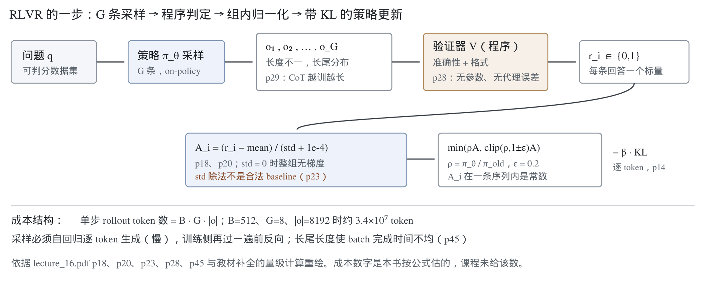

## 组内相对优势与 GRPO

先看引入 RLVR 的动因。不要 PPO 的理由是工程性的：

不要价值网络，就得有别的东西提供 baseline。GRPO 的答案是：**同一个问题采一组回答，用组内统计量当 baseline**。

对一个问题 $q$ 采 $G$ 条回答 $o_1,\dots,o_G$，奖励 $r_i=r(q,o_i)$，组内相对优势是

$$
A_i=\frac{r_i-\mathrm{mean}(r_1,\dots,r_G)}{\mathrm{std}(r_1,\dots,r_G)+10^{-4}} .
$$

最后一个常数的取值依据是：

分母加 $10^{-4}$ 是为了在组内奖励全同（$\mathrm{std}=0$）时不除零。此时分子也为 0，因此按该定义有 $A_i=0$，这组样本不会通过优势项产生策略梯度。若奖励经常在组内相同，采样预算的利用率会受到影响；具体频率取决于任务难度与奖励分布。

### 两者不能写成同一个公式

PPO 与 GRPO 的目标函数包含相似的裁剪项，但优势估计的来源和粒度不同。PPO 与 GRPO 共享的是"裁剪的重要性比率"这一层骨架，差别全在 $A$ 上：

| 维度 | PPO | GRPO |
| --- | --- | --- |
| 优势记号 | $A_t$，逐 token | $A_i$，逐序列 |
| 优势来源 | 学出来的价值网络 $V_\phi$ + GAE | 同 prompt 的 $G$ 条样本的组内均值/标准差 |
| 额外参数 | 有（价值头，与策略同规模量级） | 无 |
| 采样结构 | 一条轨迹算一次回报 | 必须成组采（$G$ 条共享一个 prompt） |
| 组内方差为 0 时 | 仍有 baseline，梯度不必然为 0 | $A_i=0$，整组无梯度 |
| 损失骨架 | 裁剪比率 $\times$ 优势 | 裁剪比率 $\times$ 优势 |

所以正确的写法是**两个式子**，共享 $\min(\rho A,\mathrm{clip}(\rho,1-\epsilon,1+\epsilon)A)$ 这一项，但 $A$ 的维度不同。把它压缩成 $L(\theta)=\mathbb{E}[\min(\rho A,\dots)]$ 一个式子并宣称"二者等价"，等于抹掉了"$A$ 是标量还是向量、来自学习还是统计"这个真正的分界；更糟的是它会让读者以为 GRPO 也有价值网络，从而完全误判显存与调参成本。

GRPO 的完整目标把上面所有零件拼起来：

$$
J_{\text{GRPO}}(\theta)=\mathbb{E}_{q,\ \{o_i\}}\left[\frac{1}{G}\sum_{i=1}^{G}\frac{1}{|o_i|}\sum_{t=1}^{|o_i|}\min\Big(\rho_{i,t}A_i,\ \mathrm{clip}(\rho_{i,t},1-\epsilon,1+\epsilon)A_i\Big)-\beta\,\widehat{D}_{\mathrm{KL}}\right].
$$

形状上要看清三点：$A_i$ 在外层求和里是常数（对一条序列的所有 token 相同）；$\rho_{i,t}$ 在内层逐 token 变；长度归一化 $1/|o_i|$ 让长回答的每条 token 权重更小。

### 在线更新时，裁剪项去哪了

还要留意：

这句话不是修辞，是一个可以推出来的等价。若每条样本只被用一次，那么做梯度时 $\pi_\theta$ 还没变过，$\rho_{i,t}=\pi_\theta/\pi_{\theta_{\text{old}}}=1$；而 $\mathrm{clip}(1,1-\epsilon,1+\epsilon)=1$，于是 $\min$ 的两支相等，目标退化为

$$
J_{\text{on}}(\theta)=\mathbb{E}\Big[\frac{1}{G}\sum_{i=1}^{G}\frac{1}{|o_i|}\sum_{t=1}^{|o_i|}A_i\,\log\pi_\theta(o_{i,t}\mid q,o_{i,<t})\Big],
$$

这正是"用组归一化奖励当权重的 REINFORCE"。裁剪项只有在同一批 rollout 上做多步更新（内层循环）时才真正起作用：那时 $\rho_{i,t}\ne 1$，比率开始偏离 1，$\mathrm{clip}$ 才把过大的更新截住。所以 PPO/GRPO 里的"内层 epoch"是用算力换样本效率的旋钮，而裁剪是它的安全阀——两者必须一起理解，单独看任何一个都说不通为什么要有 $\epsilon$。

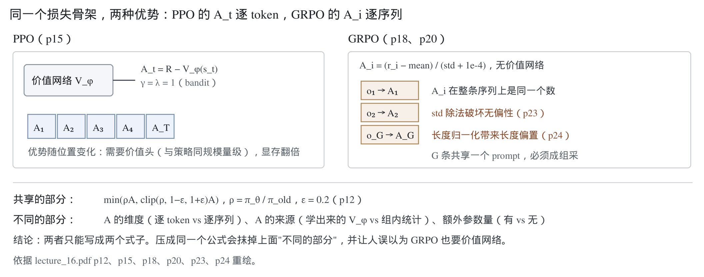

### 这个目标有已知缺陷

GRPO 仍有需要分析的统计问题：

以及机制可以这样读。baseline 的合法性要求它不依赖被采样的动作，只依赖状态；$\mathrm{mean}(r)$ 满足，$\mathrm{std}(r)$ 却不满足——它是同一组样本的函数，与 $r_i$ 相关，所以除以它会让梯度期望产生偏移，所说的 unbiasness 破坏就在这里。至于"upweights too easy or hard questions"：除以 $\mathrm{std}$ 等价于给低方差组更大的增益，而低方差组恰好是几乎全对或几乎全错的题。长度归一化 $1/|o_i|$ 又引入反向偏置：同样答对，短回答的每条 token 拿到更大权重，于是策略有动力变短或变长——两种方向都出现过，R1 一节也将它列为待解释现象（"Length due to biased objective?"）。

## 采样策略：RLVR 的算力花在哪

RLVR 是 on-policy 的：每一步的梯度只对刚采出来的样本有效。于是采样成了主要成本。RL Infra 的主要瓶颈包括采样成本：算一笔量级账。设每步 $B=512$ 个 prompt、每题采 $G=8$ 条、平均回答长度 $|o|=8192$ token，则单步仅 rollout 就要

$$
B\cdot G\cdot|o|=512\times 8\times 8192\approx 3.4\times 10^{7}\ \text{token},
$$

而训练侧同样要过一遍这些 token 做前反向。这一流程会增加强化学习的采样与训练开销。与 SFT 的成本差异取决于生成长度、每个 prompt 的采样数、更新轮数和系统吞吐，不能概括为固定的数量级。长度分布还是长尾的——少数几万 token 的 CoT 会把一个 batch 的完成时间拖到最后一条，GPU 利用率因此掉下来，回答长度差异较大时，批次完成时间可能受最长样本影响，并降低设备利用率；实际影响取决于批处理和调度策略。

采样策略上有三个可调项，三个案例分别采用了不同做法：

- **难度筛选**。Kimi "select only examples that models fail on best-of-8"；Qwen3 也按 best-of-$n$ 筛，并额外"去掉模型不用 CoT 就能做对的题"和"与验证集太相似的题"。
- **难度调度**。Kimi 给数据打难度标签，从易到难，并按 $(1-\text{成功率})$ 采样以避免反复做已解决的题。
- **长度控制**。Kimi 在训练后段加一个长度奖励，系数 $\lambda\in[0.5,-0.5]$，组内更长的序列拿负值。

难度筛选为什么必要，回到 $A_i$ 的定义就清楚了：组内全对或全错时 $\mathrm{std}=0$，整组梯度为零，采样成本白花。所以"筛掉太易与太难的题"不是数据洁癖，而是让每一步的 token 预算都产生非零梯度。

组大小 $G$ 本身是个纯权衡，没有公开具体取值；三个案例中只有 Qwen3 报告了样本数 3995。两头都有限制：$G$ 太小，$\mathrm{mean}$ 与 $\mathrm{std}$ 的估计噪声大，$A_i$ 的信号被估计误差淹没，而且碰上一次全对就整组作废；$G$ 太大，rollout 成本按 $G$ 线性增长，在独立同分布等简化假设下，均值估计的标准误通常按 $1/\sqrt{G}$ 缩小；实际有效信息还取决于样本相关性、奖励分布和优势估计方法。所以常见的做法是取一个"够估计均值方差"的小 $G$，把省下的算力用在更多不同的 prompt 上——多样性（不同 $q$）比重复（同一个 $q$ 更多次）更值钱，因为梯度是按 prompt 求和的。

## 训练不稳定的具体形态

给出期望曲线的对照，这其实是最好用的诊断工具：

也就是说，正常情况下应当看到三条曲线都"讲道理"：可验证奖励上升、奖励模型的打分同步上升（而不是背离）、KL 项保持负值（策略没有跑离参考模型）。任何一条偏离，都对应下面某一种具体故障。

| 故障形态 | 机制 | 处置 |
| --- | --- | --- |
| KL 发散 | 单个坏 batch 把某 token 概率压向 0，$\log$ 项爆炸 | 逐 token KL 惩罚 + 单边裁剪；调 $\beta$ |
| 长度膨胀 | 长度归一化与 std 项共同引入长度偏置；也可能是"更长=更多思考"的伪相关 | 长度奖励（Kimi）、去掉长度归一化（Dr. GRPO 路线） |
| 语言混杂 | RL 只约束答案与格式，不约束语言 | 加语言一致性奖励 |
| 格式刷分 | 格式奖励是稀疏可判的，模型先学会它 | 格式奖励权重压低、与准确性同时看曲线 |
| 组内零梯度 | $\mathrm{std}=0\Rightarrow A_i=0$ | 难度筛选、提高采样温度 |
| 能力回退 | 通用 RLHF 阶段会挤掉一部分数学/STEM 能力 | 分阶段训练，先推理 RL 再通用对齐 |

第三条（语言混杂）值得单独引一句，因为它是"RL 会精确优化你给的东西"一个例子：

R1 的处理是加一个语言一致性奖励。这一案例说明：**未纳入奖励或约束的输出属性可能不会按预期得到优化**。

最后一条（能力回退）是跨章的，Qwen3 报告指出 "math/stem abilities go down (a bit) with general purpose RLHF"。它说明 RLVR 学到的能力不是免费叠加的，后置的通用对齐会覆盖一部分推理行为——这也是第 17 章要处理的对齐冲突。

### 出问题时的检查顺序先看 KL：如果 KL 项由负变正或量级失控，后面所有曲线都不可信，先调 $\beta$ 与裁剪。再看奖励曲线的"两条线是否背离"——可验证奖励在涨、独立留出的验证集不涨，说明判定器被刷；奖励模型的打分在涨、人类抽检不涨，说明在 overoptimize 代理。第三看长度分布：均值上升同时准确率不升，基本就是长度偏置而不是"思考变多"。最后看组内方差：如果大量 prompt 的 $\mathrm{std}$ 长期为 0，问题不在优化而在数据难度，回去改采样。

这个顺序的价值在于它把"loss 不降"这种模糊抱怨拆成四个可观测的量，而每个量都有对应的来源与处置动作。

## 三个案例的共同配方

用三个开放模型做案例：DeepSeek R1 [49]、Kimi K1.5 [54]、Qwen3 [55]。它们的方法细节不同，但骨架惊人地一致：都以一个已经会写长 CoT 的模型为起点，都在可验证域里做 on-policy RL，都花了大量精力在数据难度筛选与长度治理上。

| 项目 | RL 算法 | 初始化 | 数据筛选 | 长度治理 | 独特处 |
| --- | --- | --- | --- | --- | --- |
| DeepSeek R1 | GRPO | R1-zero 直接对基座做 RL；R1 先做长 CoT 的 SFT | 未公开 | 观察到 CoT 变长，未显式控制 | 语言一致性奖励；阶段 2 引入非可验证奖励 |
| Kimi K1.5 | 自研策略梯度（DPO 型推导、平方损失代理与带 baseline 的正则化策略梯度） | 长 CoT 的 SFT | best-of-8 必须失败 | 显式长度奖励，$\lambda\in[0.5,-0.5]$ | 难度分层；按成功率采样 |
| Qwen3 | GRPO | SFT + 推理 RL | best-of-$n$ 筛难度、去无 CoT 可解、去与验证集相似 | thinking mode fusion 控制长度 | 只用 3995 条样本 |

R1 这一节最值得对照的是两个版本的差别。R1-zero 是"纯 RL"：直接在 DeepSeek-V3 [13] 基座上用 GRPO，奖励只有准确性与格式两项。R1 则在前面加了一步长 CoT 的 SFT，并在 RL 中加语言一致性奖励、在第二阶段引入非可验证奖励。我们将差别列成三点：

这个对照的工程含义是：**RLVR 需要一个"已经会按格式思考"的起点**。基座模型如果几乎从不产生可判分的答案，验证器给出的全是 0，组内方差为零，梯度为零——RL 在原地空转。少量长 CoT 的 SFT 就是把这个起点垫起来的手段，相关报告称，claimed benefit 是可解释性，但数据来源并不完全清楚。

Kimi 的 RL 目标值得多看一眼，因为公开描述明确指出它"不是 GRPO"：

该方法从带参考策略的闭式最优解出发，构造隐式奖励及其平方损失代理，再得到带 baseline 和正则项的策略梯度形式。它与 GRPO 都不依赖单独训练的价值网络，但两者使用的优势构造不同，目标函数不能直接互换。

R1 的另一个贡献在数据侧：它证明了**少量高质量长 CoT 的 SFT 就能把推理"点着"**。相关报告称，R1 先使用来自 Gemini / r1 的 1k 道数学与科学问题及长 CoT，再进行 RL。而 R1 之后的蒸馏（用 R1 生成 80 万条 CoT 教 Qwen 2.5）说明 RL 的产出还可以被"缓存"成监督数据——RL 探索一次，蒸馏复用多次。

GRPO 并非终点，而是一个简单、成本较低的起点。后续的 Dr. GRPO 等方法针对它的缺陷作了改进。

## 本章回顾与练习

RLVR 用可执行判定产生奖励，适用于答案或过程能够被可靠验证的任务。判分程序是训练目标的一部分，错误判分会被优化放大。

**练习**

1. 给出两个适合自动验证和两个不适合直接用规则验证的任务。
2. 区分 PPO 与 GRPO 中优势估计所用的基线。
3. 设计一道可验证数学题，列出判分器需要处理的等价答案与异常输入。

# 第 17 章　对齐与多模态：输入输出表示与训练

## 本章导读

多模态模型需要把图像、音频和视频转成可与语言模型交互的表示。编码方式会影响信息保留、序列长度和生成路径。

学完本章后，你应能：

- 描述视觉编码器、连接器与语言模型的分工；
- 比较离散 token 与连续表示；
- 说明图像、音频和视频任务对位置与时间信息的要求。

## 多模态模型的表示与架构

多模态模型首先要回答一个问题：图像、音频和视频如何转成模型能够处理的序列？


第 1 章说过，BPE 分词是**可逆**的：encode 再 decode 必须还原原字符串。这条性质在多模态里立刻失效——图像不可能被无损地切成几百个 token，任何编码都是**有损压缩 + 语义选择**。所以"再加一个编码器"这个说法漏掉了真正的难点：编码器决定模型能看到什么，它看不到的东西，后面的 LLM 再大也补不回来。

分析多模态模型时，可以从两个问题入手：

本章按这两个问题组织：先看输入怎么编码（CLIP、SigLIP），再看编码怎么注入 LLM（LLaVA 到 Qwen3-VL），然后看输出为什么必须换一套机制（Chameleon 的离散路线与 diffusion 的连续路线），最后讨论训练与评测上的差异——这是本章关注多模态表示、输入输出架构与训练评测之间的关系。

多模态能力正逐渐成为模型设计的一部分：

GPT-4 的技术报告描述了图像输入能力 [47]；Llama 4 的技术报告也介绍了多模态架构 [56]。本章据此讨论图像、音频和视频如何编码，以及这些表示如何接入语言模型。

| 模态 | 表示 | 可逆性 | 一个 token 的含义 |
| --- | --- | --- | --- |
| 文本 | BPE 离散 id | 可逆（无损） | 子词片段 |
| 图像（理解） | 连续向量（ViT 特征） | 不可逆 | 一块 patch 的语义 |
| 图像（生成） | 离散码本 id（VQ-VAE） | 有损重建 | 一个码本条目 |
| 视频 | 帧序列 + 时间戳 | 不可逆 | 一帧的一块 patch |
同一个"图像"，在理解链路里是连续向量，在生成链路里是离散 id。两种表示服务于不同任务：理解更重视语义，生成则需要能够逐 token 采样的离散表示。

## 对齐目标的共性：把一个 batch 变成分类问题

CLIP 的出发点很朴素：视觉模型一直在标注好的图像上训练，而互联网上有海量"图 + 说明文字"的弱标注对。

方法是把一个 batch 变成分类问题：

写成式子就是 batch 内的对称 InfoNCE。设图像向量 $u_i$、文本向量 $v_j$，相似度取余弦，则图到文的损失是

$$
\mathcal{L}_{i\rightarrow t}=-\frac{1}{N}\sum_{i=1}^{N}\log
\frac{\exp(s_{ii}/\tau)}{\sum_{j=1}^{N}\exp(s_{ij}/\tau)},
\qquad
s_{ij}=\frac{u_i^{\top}v_j}{\lVert u_i\rVert\,\lVert v_j\rVert},
$$

文到图再对称地算一遍，两项平均。形状上要看清：$U\in\mathbb{R}^{N\times d}$、$V\in\mathbb{R}^{N\times d}$、$S\in\mathbb{R}^{N\times N}$，分母对**整行**做归一化。这一步的形状决定了一切工程后果——每一行都耦合了同 batch 的全部文本，所以 softmax 必须在全 batch 上算，我们将它列进 CLIP 的技术要求：

batch 越大，每一行的负样本越多，任务越难、表征越好，但通信与显存也越贵（第 7 章的 all-gather 在这里重新出现）。

SigLIP 换掉的就是这一步：

于是损失从"行内 softmax"变成"逐元素 sigmoid + 标签"：

$$
\mathcal{L}_{\text{SigLIP}}=-\frac{1}{N}\sum_{i=1}^{N}\sum_{j=1}^{N}\log\sigma\big(z_{ij}\,s_{ij}\big),
\qquad
z_{ij}=\begin{cases}+1,& i=j\\ -1,& i\ne j\end{cases}
$$

差别不是换个损失函数那么小。softmax 版本里每个样本的梯度依赖整行（要用到全部 $N$ 个负样本的归一化项），sigmoid 版本里每一项 $(i,j)$ 都是独立的二分类，归一化被拆掉了。采用的直接结论是：

此外，给了一组效率对照：CLIP 用 256 块 TPUv3 训 10 天，SigLIP 用 32 块 TPUv4 训 5 天。该对比同时改变了加速器代际和训练配置，不能视为控制变量一致的性能基准。它可以说明不同损失设计与并行策略会影响训练资源需求，但不能单独归因于某一项技术的性能收益。

| 维度 | CLIP（ 57–60、95） | SigLIP（101–121） |
| --- | --- | --- |
| 任务形式 | 行内多分类（1 正 $N-1$ 负） | 逐对二分类（对齐/不对齐） |
| 归一化范围 | 整行（跨样本耦合） | 无（每对独立） |
| 对 batch 的依赖 | 必须大 batch 才有足够负样本 | 可与 batch 解耦，小 batch 也可用 |
| 已报告的效率数字 | 10 天 / 256 TPUv3 | 5 天 / 32 TPUv4 |
| 一句话总结 | 强，但贵 | 便宜，且够好 |

两者共享的"对齐目标"可以一句话概括：**在表示空间里让配对样本相似度上升、非配对下降**。这是所有模态对齐的共同骨架——CLIP 与 SigLIP 的差别只在"非配对怎么算"，而这个差别完全由损失形状决定。

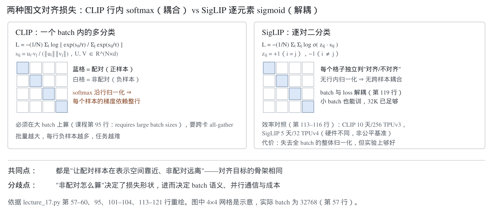

## 注入：连接器就是信息瓶颈

有了图像向量，下一步是把它塞进语言模型。LLaVA 的做法简单到近乎粗暴：

也就是

$$
E_{\text{img}}=f_{\text{ViT}}(I)\in\mathbb{R}^{n\times d_v},
\qquad
X_{\text{vis}}=E_{\text{img}}W\in\mathbb{R}^{n\times d},
\qquad
X_{\text{in}}=\big[\,X_{\text{vis}};\ X_{\text{txt}}\,\big],
$$

其中 $W\in\mathbb{R}^{d_v\times d}$ 是唯一可训练的新参数，$[\cdot;\cdot]$ 表示沿序列维拼接。文本 token 与视觉 token 从此在同一个序列里，走同一个 attention——这就是"多模态"在实现层面的全部含义。

每张图产生多少个 token，是个必须先算的量。CLIP 的最佳配置是 ViT-L/14@336px，即 14×14 的 patch、输入 336×336，于是

$$
n=\left(\frac{336}{14}\right)^{2}=24^{2}=576 .
$$

576 个 token 只换一张图，而一段 500 字的文本大约 700 个 token——图像的信息密度与文本完全不在一个量级上。这就是后面所有"压缩"动作的动机：Qwen-VL 用一层 cross-attention adaptor 把任意分辨率压到**固定 256 个 token**，Qwen2-VL 则先用 ViT/14 切 224×224，再把 2×2 邻域合并：

$$
n=\left(\frac{224}{14}\right)^{2}\Big/\,2^{2}=256/4=64\ \text{（相关研究记为 }66\text{）},
$$

【疑点】按该式计算得到 64，与文中标注的 66 相差 2。差值是否来自边界或特殊 token，需要核对模型定义；现有信息不足以确定。

分辨率的处理是另一条主线。CLIP 的预处理是"短边缩到 336 再中心裁剪"，这意味着长图的两端会被切掉。LLaVA-OneVision 用 AnyRes 解决：

AnyRes 的本质是"用 token 数换分辨率"：块数 $a\times b$ 越多，细节保留越多，序列越长。于是 token 预算成了唯一的设计货币，OneVision 对三类输入的处理也体现了这一点：

在部分多图或视频系统中，预处理器会根据输入规模调整分辨率或采样帧数，以控制视觉 token 数和显存开销。具体策略因模型而异；全注意力中的两两交互成本会随总序列长度近似按平方增长。

| 模型 | 视觉编码器 | 连接器 | 每图 token |
| --- | --- | --- | --- |
| LLaVA | CLIP ViT-L/14 | 单层线性投影 | 576（$24\times24$） |
| LLaVA-OneVision | SigLIP（末层前后 grid 特征） | 2 层 MLP | 随 AnyRes 的 $a\times b$ 变 |
| Qwen-VL | OpenCLIP ViT-bigC/14 | 单层 cross-attention + 2D 位置编码 | 固定 256 |
| Qwen2-VL | 675M ViT | 2×2 邻域合并 | 66（动态分辨率） |
| Qwen3-VL | SigLIP-2 | DeepStack 跨层融合 | 随分辨率与帧数变 |

连接器的"深度"是一个容易被忽视的设计维度。LLaVA 只用一层线性投影，Qwen-VL 用一层 cross-attention，OneVision 用两层 MLP，Qwen3-VL 用 DeepStack 往多个层里注入。这四种做法的差别可以这样理解：线性投影只改变基，不改变 token 数与容量；cross-attention 能把任意长度的视觉特征压到固定 256 个 token，是"压缩器 + 对齐器"二合一；MLP 比线性多一层非线性，能拟合更复杂的映射；DeepStack 则是把视觉信息同时送进低层与中层——因为若只在第一层注入，后面几十层只能通过自注意力的间接路径反复搬运视觉信息，深层注入等于给模型一条更短的梯度通路。视觉语言模型可以看作由 vision encoder、projector 和语言模型组成；在总体模板相同的情况下，连接器结构与视觉信息的注入位置决定了模型能利用多少视觉信息。

模板之外的另一个变量是"换多大的语言模型"。OneVision 直接把解码器换成 Qwen-2 72B [57]，而 Qwen3-VL 建立在 Qwen3 上（含 dense 与 MoE 两条线，最大到 235B-A22B）[55]。这说明视觉侧与语言侧的规模是**解耦**的：视觉编码器通常停在几百 M 到一两 B（Qwen2-VL 的 ViT 为 675M），而语言侧可以继续放大。多模态的"扩容"主要发生在语言侧，视觉侧靠分辨率与 token 数扩容——这也是为什么 token 预算值得单独讨论。

Qwen3-VL 的两处改动都涉及"位置信息怎么编码"这个更深的问题。其一是交错 MRoPE：我们将时间、宽、高三个轴交替分配到低高频段，写成 `[t w h t w h ...]` 而不是 `[t t t t w w w w h h h h]`。其二是把视频时间戳做成**显式 token** 而不是编码进位置——位置编码表达的是"相对远近"，而时间戳表达的是"第几秒"，后者是绝对量，塞进位置编码会被 RoPE 的相对性抹掉。（RoPE 编码相对位移。）

这一整套"编码器 + 连接器 + LM"的模板在图 17-2 里画成了一条流水线。图中三个数字（576、256、66）分别对应 LLaVA 的算术结果、Qwen-VL 的固定长度、Qwen2-VL 的合并结果——它们是同一张图在不同设计下被允许占用的 token 数，并决定了信息保留、序列长度与计算开销之间的取舍。

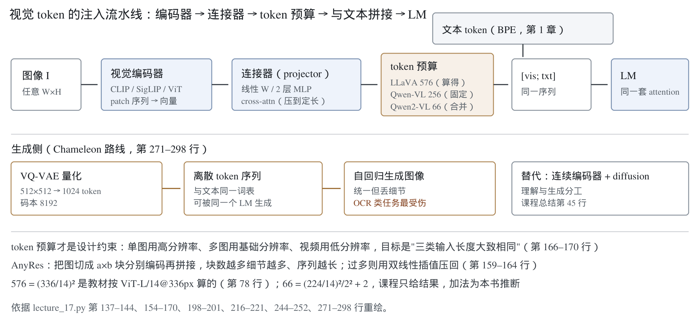

## 对齐目标的分歧：语义对齐与重建对齐

前面两节用了两次"对齐"，但指的是两件不同的事，必须分开。

CLIP/SigLIP 学的是**语义对齐**：让图像表示靠近它的说明文字。监督信号来自 caption，而我们将这层监督的性质说得很清楚：

这句话里有两个限定词值得划重点：**noisy**（网上的说明文字常常写错、常常只描述了图的一部分）与 **not very fine-grained**（取舍是按图像分类这类粗粒度任务做的，不是按 OCR 这类细粒度任务做的）。所以 CLIP 特征天生擅长"草地上有一只猫"，天生不擅长"第三行第二个字是 7"。

VQ-VAE 学的是**重建对齐**：让解码后的图像逼近原图。它的目标是标准的重建误差：

$$
\mathcal{L}_{\text{VQ}}=\big\lVert I-D\big(z_{q}(E(I))\big)\big\rVert_{2}^{2},
$$

其中 $E$ 是编码器、$z_q$ 是量化到码本、$D$ 是解码器。原报告只写了 "minimize reconstruction loss"，这个式子是它的标准写法。注意它**完全没有文本参与**：VQ-VAE 不知道"猫"是什么，只知道哪些像素该是什么颜色。

| 维度 | 语义对齐（CLIP / SigLIP） | 重建对齐（VQ-VAE） |
| --- | --- | --- |
| 监督信号 | (图, 说明文字) 对，含噪声 | 像素本身，无噪声 |
| 学到什么 | 类别级、场景级语义 | 低层纹理与边缘 |
| 丢失什么 | 细粒度细节、文字笔画 | 语义（不知"这是什么"） |
| 输出 | 连续向量（不可解码回图） | 离散码（可解码回图） |
| 依据 |  |  |
| 典型用途 | 理解 | 生成 |

这张表解释了为什么"一个编码器通吃"行不通：两个目标的梯度指向不同方向，语义对齐会把细节压掉（细节对"图文匹配"这个任务没用），重建对齐会把语义丢掉（语义对"像素误差"没有贡献）。Chameleon 的"统一离散"本质上是在两者之间做折中：用 VQ token 让模型能生成，代价是理解侧要忍受离散化损失——这就是这意味着它 "not as performant" 却仍称其 "elegant"的原因。

所以更常见的工程答案是**分工**：理解走连续编码器（CLIP/SigLIP），生成走 diffusion。这条路线牺牲了"一个模型统一所有模态"的美感，换来每一项指标都不妥协。

## 输出非文本：连续解码还是离散自回归

前面所有模型都有一个共同缺陷：只能读，不能画。

Chameleon 的路线是"一切皆 token"，因此必须有一个**能输出离散 token 的图像编码器**：算一下这条路的压缩率，就能看出它为什么必然丢信息。一张 512×512 的 RGB 图原始是 $512\times512\times3=786{,}432$ 字节；VQ-VAE 把它变成 1024 个、每个 13 bit 的码本索引，共

$$
1024\times\log_2 8192=1024\times13=13{,}312\ \text{bit}\approx1.66\ \text{KB},
$$

压缩比约

$$
\frac{786{,}432\times8}{13{,}312}\approx473 .
$$

473 倍的压缩不可能无损，损失的正是高频细节——用一句话点破了后果：

离散化对 OCR 最致命，因为文字识别靠的恰恰是高频笔画细节；而语义类问答对此不敏感。这就把第 1 章"分词"的直觉推到了极限：文本的 token 化可以做到无损，图像的 token 化做不到——**损失多少、损失在哪里，是编码器的设计选择，而不是实现细节**。

代价还体现在训练稳定性上，这是 Chameleon 一节最有价值的部分：机制可以这样读：文本下一个 token 的分布很尖（低熵），图像下一个 token 的分布很平（高熵，8192 个码本条目里挑一个）。若两类 token 共享同一套输出层与残差流，图像的损失会持续把 logit 的尺度往上推，于是残差范数增长、softmax 的 logit 漂移——这是"两种熵混在一个模型里"的直接后果。已报告的两个修法都是压尺度：QK norm 把 attention 的 $QK^{\top}$ 归一化，z-loss 惩罚配分函数的对数：

$$
\mathcal{L}_{z}=\lambda\,\big(\log Z\big)^{2},
\qquad
Z=\sum_{v=1}^{V}\exp(o_v),
$$

其中 $o_v$ 是输出 logit。（依据是只给了 "z-loss" 这个名字；$(\log Z)^2$ 这一形式来自把 softmax 配分函数钉在 0 附近的标准做法。）

两条路线各有适用场景：

理解侧继续用连续编码器（CLIP/SigLIP 之类），生成侧交给 diffusion；Chameleon 的"统一离散"路线优雅但有代价。这两类路线分别侧重语义表示和细节重建，适用目标不同。

## 训练与评测的差异

多模态章节与前面所有章节最大的不同，是**同一个模型在不同训练阶段会冻结不同的部分**。训练阶段冻结或更新哪些模块，应与表示对齐和联合优化的训练目标相匹配。

| 模型 | 阶段 1 | 阶段 2 | 阶段 3 |
| --- | --- | --- | --- |
| LLaVA | 冻结视觉编码器与 LM，只训 $W$ | 冻视觉编码器，训 $W$ + LM | — |
| Qwen-VL | 大规模低质数据；冻 LM，训编码器 + adaptor | 高质量任务数据、提分辨率；全参训练 | 指令数据；冻视觉，训 adaptor + LM |
| Qwen2-VL | 只训视觉编码器 | 全参训练 | 指令跟随数据上训 LM |
| Qwen3-VL | 预训练四阶段：adaptor → 8K → 32K → 256K 长度 | （同左，逐段放开） | 后训练：SFT 长 CoT + 蒸馏 + RL |  |这张表有两条可读的规律。第一，**第一阶段几乎总是"只训连接器"**：LLaVA 只训 $W$、Qwen-VL 只训编码器与 adaptor。此时梯度只经过新参数，最大的风险是把已经训好的语言能力冲掉，所以冻结是对的。第二，**训练顺序跟随上下文长度**：Qwen3-VL 先处理较短序列再扩展到 32K 和 256K，可以控制随 $T^{2}$ 增长的 attention 开销，先用短序列把表示对齐、再用长序列扩展，比一上来就 256K 便宜得多。

数据侧的共同经验只有一句，但分量很重：

LLaVA 的 158K 样本是拿 MS COCO 的标注喂给 GPT-4 生成问答再配回原图；OneVision 明确说"quality over quantity"。这与第 13、14 章的数据工程结论一致：多模态的瓶颈不在模型结构，而在"图 + 指令 + 正确答案"这种三元组的供给。

评测上的差异更隐蔽，也是本章必须点明的地方。文本评测里，同一道题喂给模型就是同一串 token；多模态评测里，**同一张图经过不同预处理会变成不同长度的 token 序列**——短边缩到 336 再中心裁剪会丢掉长图两端，AnyRes 切块会把同一张图变成 $a\times b$ 倍的 token；视频还要设定采样率，例如每秒 2 帧，并限制总 token 数。输入的信息预算变了，分数就不可比。

| 能力 | 依赖的输入预算 | 依据 | 预算不足时的失效方式 |
| --- | --- | --- | --- |
| 图像分类 / 场景理解 | 低（一张 336×336 就够） |  | 几乎不受影响 |
| OCR / 文档理解 | 高（分辨率即信息） |  | 小字糊成一块，答案凭空猜 |
| 图表 / 多图关系 | 中高（要保留图间结构） |  | 张冠李戴，指代错图 |
| 视频时序 | 采样率决定时间分辨率 |  | 漏掉短事件，或时间戳对不上 |
| 视觉定位 | 高（要空间坐标） | （`<box>`、2D 位置编码） | 框位置系统性偏移 |

所以读多模态论文时要先问一句：它的 token 预算给了多少？两个模型在"OCR 分数"上的差距，可能只是其中一个把图切得更细。因此，没有给统一口径的 benchmark 数字，不宜据此编造一个。

另一个需要考虑的差异是：**训练用教师强制，评测用自由解码**。训练时每个位置喂的是真实前缀，模型只需在已知上下文上预测下一个 token；评测时模型吃的是自己上一步的输出，一旦前面错一个 token，后面就在错误的上下文里继续。文本任务里这个差距通常被 SFT 抹平，多模态任务里它被放大——因为视觉 token 的错误不是"选错词"而是"看错位置"，而位置错误会改变整段视觉上下文的含义。（依据是自回归训练的 teacher forcing 与推理时的自由运行这一对设定；）

### 训练不稳定的两个来源

第一个来源是前面说的熵差：文本低熵、图像高熵，混在一个输出层里会让 logit 尺度失稳。修法是 QK norm 与 z-loss。

第二个来源是**样本长度极不均匀**。视频样本动辄上万 token，文本样本几百 token，若按 token 平均，一个 batch 的损失会被视频主导。Qwen3-VL 的修法写得很具体：写成式子，设模态 $m$ 有 $n_m$ 个 token、逐 token 损失 $\ell_t$，则

$$
\mathcal{L}=\sum_{m}\frac{1}{\sqrt{n_{m}}}\sum_{t\in m}\ell_{t},
$$

与"按 token 平均"（$1/n_m$）相比，$\sqrt{n_m}$ 只是部分抵消长度：长样本仍然贡献更多，但不再是线性主导。选 $\sqrt{\cdot}$ 而不是别的幂次，本质是在"完全平均（每个样本等权）"与"完全按 token（每个 token 等权）"之间取一个折中——给出这个做法，没给推导，所以该权重介于按样本平均和按 token 平均之间；本节采用它，但没有推导指数为何恰好取 $1/2$。

## 本章回顾与练习

多模态系统要在输入表示、跨模态对齐和输出解码之间作选择。表示越紧凑，计算可能越省，但丢失的信息也可能无法由后续模块恢复。

**练习**

1. 画出视觉编码器、连接器和语言模型的数据流，并标出张量形状。
2. 比较离散图像 token 和连续 patch embedding 在生成与重建上的差别。
3. 视频输入中分别用位置编码和显式时间戳表达什么信息？

## 术语表

| 术语 | 含义 |
| --- | --- |
| Token（词元） | 分词器切分出的离散单元；它可以是字节、字符、词或子词。 |
| Tokenizer（分词器） | 把文本编码为 token id，并在需要时把 token 序列解码回文本的程序。 |
| Vocabulary（词表） | token 与整数 id 的对应表；词表大小记为 $V$。 |
| Embedding（嵌入） | 把离散 id 映射到可学习连续向量的查表层。 |
| Position encoding（位置编码） | 向模型提供序列位置或相对距离信息的表示方法。 |
| Self-attention（自注意力） | 令同一序列各位置生成 Q、K、V，并依据 Q 与 K 的分数对 V 加权汇集信息的运算。 |
| Softmax | 把一组实数映射成非负且和为 1 的概率权重；在注意力中，它归一化分数，不单独定义一种注意力机制。 |
| Residual connection（残差连接） | 将子层输入绕过变换后与子层输出相加的结构。 |
| LayerNorm | 沿单个样本的特征维计算均值和方差，再做可学习的缩放与平移。 |
| RMSNorm | 依据特征均方根缩放向量，不先减去均值。 |
| Logits | Softmax 之前的未归一化分数。 |
| Cross-entropy（交叉熵） | 衡量真实分布与模型预测分布之间差异的损失；分类语言模型中等价于真实类别的平均负对数概率。 |
| Perplexity（困惑度） | 交叉熵取指数后的量；在给定 tokenization 和评测数据上衡量模型预测的不确定程度。 |
| FLOP | 一次浮点加法或乘法等基本浮点运算的计数单位；FLOPs 可指运算总数，FLOP/s 指每秒运算数。 |
| Arithmetic intensity（算术强度） | 完成的浮点运算数除以读写的数据字节数，常用于判断算子是否受带宽限制。 |
| Data parallelism（数据并行） | 不同设备处理不同数据副本或微批，并同步模型梯度或参数更新。 |
| Tensor parallelism（张量并行） | 把单层中的权重或中间张量切到多设备上协同计算。 |
| Pipeline parallelism（流水线并行） | 把模型的不同层分配到不同设备，分批传递中间激活。 |
| AdamW | 使用一阶和二阶梯度矩估计更新参数，并将权重衰减与梯度矩更新解耦的优化器。 |
| Warmup（学习率预热） | 训练初期逐渐提高学习率的一段调度过程。 |

## 参考文献
[1] Rico Sennrich, Barry Haddow, Alexandra Birch Neural Machine Translation of Rare Words with Subword Units. 2015. https://arxiv.org/abs/1508.07909
[2] Artidoro Pagnoni, Ram Pasunuru, Pedro Rodriguez, John Nguyen 等 Byte Latent Transformer: Patches Scale Better Than Tokens. 2024. https://arxiv.org/abs/2412.09871
[3] Diederik P. Kingma, Jimmy Ba Adam: A Method for Stochastic Optimization. 2014. https://arxiv.org/pdf/1412.6980.pdf
[4] Ilya Loshchilov, Frank Hutter Decoupled Weight Decay Regularization. 2017. https://arxiv.org/pdf/1711.05101.pdf
[5] Samyam Rajbhandari, Jeff Rasley, Olatunji Ruwase, Yuxiong He ZeRO: Memory Optimizations Toward Training Trillion Parameter Models. 2019. https://arxiv.org/abs/1910.02054
[6] Ruibin Xiong, Yunchang Yang, Di He, Kai Zheng 等 On Layer Normalization in the Transformer Architecture. 2020. https://arxiv.org/pdf/2002.04745.pdf
[7] Biao Zhang, Rico Sennrich Root Mean Square Layer Normalization. 2019. https://arxiv.org/abs/1910.07467
[8] Noam Shazeer GLU Variants Improve Transformer. 2020. https://arxiv.org/pdf/2002.05202.pdf
[9] Jianlin Su, Yu Lu, Shengfeng Pan, Ahmed Murtadha 等 RoFormer: Enhanced Transformer with Rotary Position Embedding. 2021. https://arxiv.org/pdf/2104.09864.pdf
[10] Joshua Ainslie, James Lee-Thorp, Michiel de Jong, Yury Zemlyanskiy 等 GQA: Training Generalized Multi-Query Transformer Models from Multi-Head Checkpoints. 2023. https://arxiv.org/pdf/2305.13245.pdf
[11] Lean Wang, Huazuo Gao, Chenggang Zhao, Xu Sun 等 Auxiliary-Loss-Free Load Balancing Strategy for Mixture-of-Experts. 2024. https://arxiv.org/abs/2408.15664
[12] Fabian Gloeckle, Badr Youbi Idrissi, Baptiste Rozière, David Lopez-Paz 等 Better & Faster Large Language Models via Multi-token Prediction. 2024. https://arxiv.org/abs/2404.19737
[13]  DeepSeek-AI, Aixin Liu, Bei Feng, Bing Xue 等 DeepSeek-V3 Technical Report. 2024. https://arxiv.org/pdf/2412.19437.pdf
[14] Aakanksha Chowdhery, Sharan Narang, Jacob Devlin, Maarten Bosma 等 PaLM: Scaling Language Modeling with Pathways. 2022. https://arxiv.org/pdf/2204.02311.pdf
[15] Colin Raffel, Noam Shazeer, Adam Roberts, Katherine Lee 等 Exploring the Limits of Transfer Learning with a Unified Text-to-Text Transformer. 2019. https://arxiv.org/pdf/1910.10683.pdf
[16] Ashish Vaswani, Noam Shazeer, Niki Parmar, Jakob Uszkoreit 等 Attention Is All You Need. 2017. https://arxiv.org/pdf/1706.03762.pdf
[17] Sam McCandlish, Jared Kaplan, Dario Amodei, OpenAI Dota Team An Empirical Model of Large-Batch Training. 2018. https://arxiv.org/pdf/1812.06162.pdf
[18] Mohammad Shoeybi, Mostofa Patwary, Raul Puri, Patrick LeGresley 等 Megatron-LM: Training Multi-Billion Parameter Language Models Using Model Parallelism. 2019. https://arxiv.org/pdf/1909.08053.pdf
[19] Yanping Huang, Youlong Cheng, Ankur Bapna, Orhan Firat 等 GPipe: Efficient Training of Giant Neural Networks using Pipeline Parallelism. 2018. https://arxiv.org/pdf/1811.06965.pdf
[20]  Transformer Math 101. 2023. https://blog.eleuther.ai/transformer-math/
[21] Deepak Narayanan, Mohammad Shoeybi, Jared Casper, Patrick LeGresley 等 Efficient Large-Scale Language Model Training on GPU Clusters Using Megatron-LM. 2021. https://arxiv.org/pdf/2104.04473.pdf
[22] William Fedus, Barret Zoph, Noam Shazeer Switch Transformers: Scaling to Trillion Parameter Models with Simple and Efficient Sparsity. 2021. https://arxiv.org/abs/2101.03961
[23] Albert Q. Jiang, Alexandre Sablayrolles, Antoine Roux, Arthur Mensch 等 Mixtral of Experts. 2024. https://arxiv.org/pdf/2401.04088.pdf
[24] Jared Kaplan, Sam McCandlish, Tom Henighan, Tom B. Brown 等 Scaling Laws for Neural Language Models. 2020. https://arxiv.org/pdf/2001.08361.pdf
[25] Jordan Hoffmann, Sebastian Borgeaud, Arthur Mensch, Elena Buchatskaya 等 Training Compute-Optimal Large Language Models. 2022. https://arxiv.org/pdf/2203.15556.pdf
[26] Samir Yitzhak Gadre, Georgios Smyrnis, Vaishaal Shankar, Suchin Gururangan 等 Language models scale reliably with over-training and on downstream tasks. 2024. https://arxiv.org/pdf/2403.08540.pdf
[27] Greg Yang, Edward J. Hu, Igor Babuschkin, Szymon Sidor 等 Tensor Programs V: Tuning Large Neural Networks via Zero-Shot Hyperparameter Transfer. 2022. https://arxiv.org/abs/2203.03466
[28] DeepSeek-AI, Anyi Xu, Bangcai Lin, Bing Xue 等 DeepSeek-V4: Towards Highly Efficient Million-Token Context Intelligence. 2026. https://arxiv.org/abs/2606.19348
[29] Iz Beltagy, Matthew E. Peters, Arman Cohan Longformer: The Long-Document Transformer. 2020. https://arxiv.org/pdf/2004.05150.pdf
[30] Rewon Child, Scott Gray, Alec Radford, Ilya Sutskever Generating Long Sequences with Sparse Transformers. 2019. https://arxiv.org/pdf/1904.10509.pdf
[31] Albert Q. Jiang, Alexandre Sablayrolles, Arthur Mensch, Chris Bamford 等 Mistral 7B. 2023. https://arxiv.org/pdf/2310.06825.pdf
[32] Claude Shannon Prediction and Entropy of Printed English. 1950. https://www.princeton.edu/~wbialek/rome/refs/shannon_51.pdf
[33] Alec Radford, Jeffrey Wu, Rewon Child, David Luan 等 Language Models are Unsupervised Multitask Learners. 2019. https://cdn.openai.com/better-language-models/language_models_are_unsupervised_multitask_learners.pdf
[34] Dan Hendrycks, Collin Burns, Steven Basart, Andy Zou 等 Measuring Massive Multitask Language Understanding. 2020. https://arxiv.org/pdf/2009.03300.pdf
[35] Rohan Taori, Ishaan Gulrajani, Tianyi Zhang, Yann Dubois 等 Alpaca. 2023. https://crfm.stanford.edu/2023/03/13/alpaca.html
[36] Aaron Grattafiori, Abhimanyu Dubey, Abhinav Jauhri, Abhinav Pandey 等 The Llama 3 Herd of Models. 2024. https://arxiv.org/abs/2407.21783
[37] Team OLMo, Pete Walsh, Luca Soldaini, Dirk Groeneveld 等 2 OLMo 2 Furious. 2024. https://arxiv.org/abs/2501.00656
[38] Jeffrey Li, Alex Fang, Georgios Smyrnis, Maor Ivgi 等 DataComp-LM: In search of the next generation of training sets for language models. 2024. https://arxiv.org/abs/2406.11794
[39] Aaron Gokaslan, Vanya Cohen OpenWebText. 2019. https://skylion007.github.io/OpenWebTextCorpus/
[40] Jacob Devlin, Ming-Wei Chang, Kenton Lee, Kristina Toutanova BERT: Pre-training of Deep Bidirectional Transformers for Language Understanding. 2018. https://arxiv.org/abs/1810.04805
[41] Tom B. Brown, Benjamin Mann, Nick Ryder, Melanie Subbiah 等 Language Models are Few-Shot Learners. 2020. https://arxiv.org/pdf/2005.14165.pdf
[42] Leo Gao, Stella Biderman, Sid Black, Laurence Golding 等 The Pile: An 800GB Dataset of Diverse Text for Language Modeling. 2020. https://arxiv.org/pdf/2101.00027.pdf
[43] Jack W. Rae, Sebastian Borgeaud, Trevor Cai, Katie Millican 等 Scaling Language Models: Methods, Analysis & Insights from Training Gopher. 2021. https://arxiv.org/pdf/2112.11446.pdf
[44] Hugo Touvron, Thibaut Lavril, Gautier Izacard, Xavier Martinet 等 LLaMA: Open and Efficient Foundation Language Models. 2023. https://arxiv.org/pdf/2302.13971.pdf
[45] Luca Soldaini, Rodney Kinney, Akshita Bhagia, Dustin Schwenk 等 Dolma: an Open Corpus of Three Trillion Tokens for Language Model Pretraining Research. 2024. https://arxiv.org/abs/2402.00159
[46] Dan Su, Kezhi Kong, Ying Lin, Joseph Jennings 等 Nemotron-CC: Transforming Common Crawl into a Refined Long-Horizon Pretraining Dataset. 2024. https://arxiv.org/abs/2412.02595
[47]  OpenAI, Josh Achiam, Steven Adler, Sandhini Agarwal 等 GPT-4 Technical Report. 2023. https://arxiv.org/pdf/2303.08774.pdf
[48] Qian Liu, Xiaosen Zheng, Niklas Muennighoff, Guangtao Zeng 等 RegMix: Data Mixture as Regression for Language Model Pre-training. 2024. https://arxiv.org/abs/2407.01492
[49]  DeepSeek-AI, Daya Guo, Dejian Yang, Haowei Zhang 等 DeepSeek-R1: Incentivizing Reasoning Capability in LLMs via Reinforcement Learning. 2025. https://arxiv.org/pdf/2501.12948.pdf
[50] Chunting Zhou, Pengfei Liu, Puxin Xu, Srini Iyer 等 LIMA: Less Is More for Alignment. 2023. https://arxiv.org/pdf/2305.11206.pdf
[51] Long Ouyang, Jeff Wu, Xu Jiang, Diogo Almeida 等 Training language models to follow instructions with human feedback. 2022. https://arxiv.org/pdf/2203.02155.pdf
[52] John Schulman, Filip Wolski, Prafulla Dhariwal, Alec Radford 等 Proximal Policy Optimization Algorithms. 2017. https://arxiv.org/pdf/1707.06347.pdf
[53] Rafael Rafailov, Archit Sharma, Eric Mitchell, Stefano Ermon 等 Direct Preference Optimization: Your Language Model is Secretly a Reward Model. 2023. https://arxiv.org/pdf/2305.18290.pdf
[54]  Kimi Team, Angang Du, Bofei Gao, Bowei Xing 等 Kimi k1.5: Scaling Reinforcement Learning with LLMs. 2025. https://arxiv.org/pdf/2501.12599.pdf
[55] An Yang, Anfeng Li, Baosong Yang, Beichen Zhang 等 Qwen3 Technical Report. 2025. https://arxiv.org/abs/2505.09388
[56]  Llama 4. 2025. https://ai.meta.com/blog/llama-4-multimodal-intelligence/
[57]  Qwen,  :, An Yang, Baosong Yang 等 Qwen2.5 Technical Report. 2024. https://arxiv.org/abs/2412.15115

## 官方文档与延伸阅读

[58] Hugging Face Tokenizers 文档，Tokenizer 组件与 BPE。https://huggingface.co/docs/tokenizers/python/latest/components.html

[59] PyTorch 文档，`torch.nn.CrossEntropyLoss`。https://docs.pytorch.org/docs/stable/generated/torch.nn.CrossEntropyLoss.html

[60] PyTorch 文档，`torch.optim.AdamW`。https://docs.pytorch.org/docs/stable/generated/torch.optim.AdamW.html

[61] Einops 文档，`rearrange`。https://einops.rocks/api/rearrange/

[62] Vaswani et al., Attention Is All You Need. 2017. https://arxiv.org/abs/1706.03762

[63] Hugging Face Transformers 文档，Tokenization algorithms（含 BPE、WordPiece 与 Unigram 概述）。https://huggingface.co/docs/transformers/tokenizer_summary

[64] U.S. Copyright Office, More Information on Fair Use; 17 U.S.C. § 107. https://www.copyright.gov/fair-use/more-info.html ; https://www.copyright.gov/title17/92chap1.html

